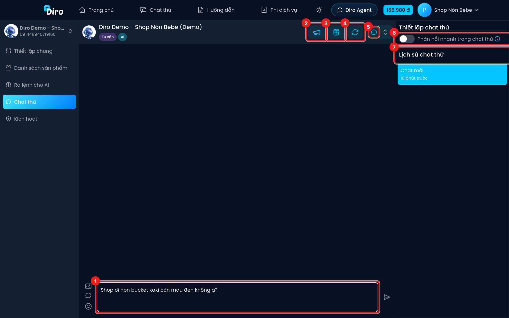

# Chat thử

**Chat thử** cho bạn đóng vai khách hàng để trò chuyện với AI, trước khi bật AI cho khách thật. Tin nhắn ở đây **không gửi tới Facebook**, chỉ dùng để kiểm tra mệnh lệnh, sản phẩm, tin nhắn tự động có hoạt động đúng không.

Mở Chat Agent → **Chat thử**.

1. **Ô soạn tin** — gõ như một khách hàng thật rồi nhấn Enter hoặc nút gửi. Bạn cũng gửi được ảnh (biểu tượng ảnh bên trái) để thử AI đọc ảnh.
2. **Kéo tương tác** — gửi ngay tin kéo tương tác của bạn vào hội thoại thử, không phải chờ khách im lặng.
3. **Gửi tin Upsell** — gửi ngay tin upsell.
4. **Thử lại** — làm lại hội thoại hiện tại từ đầu với cấu hình mới nhất (sau khi bạn vừa sửa mệnh lệnh).
5. **Chat mới** — mở một hội thoại thử mới. Mũi tên bên cạnh cho bạn chọn sản phẩm, giả lập khách nhắn tin từ bài viết của sản phẩm đó.
6. **Phản hồi nhanh trong chat thử** — bật thì AI trả lời ngay, bỏ qua thời gian "đang gõ". Chỉ áp dụng trong Chat thử.
7. **Lịch sử chat thử** — các hội thoại thử trước đó; bấm để mở lại.

Trên màn hình nhỏ, các nút 2–5 chỉ hiện biểu tượng; rê chuột vào để xem tên.

:::tip Kịch bản nên thử
- Hỏi giá, hỏi size, hỏi màu một sản phẩm.
- Đưa số điện thoại và địa chỉ để xem AI có tự lên đơn không.
- Phàn nàn hoặc hỏi điều shop chưa dạy để xem AI có chuyển nhân viên đúng lúc không.
- Mặc cả giá để xem AI có giữ giá theo mệnh lệnh không.
:::

:::note
Chat thử **không tính phí** — bạn thử bao nhiêu tin cũng được.
:::
