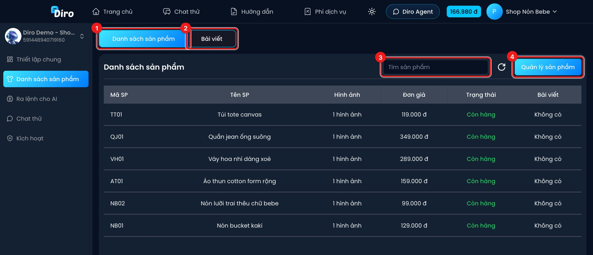
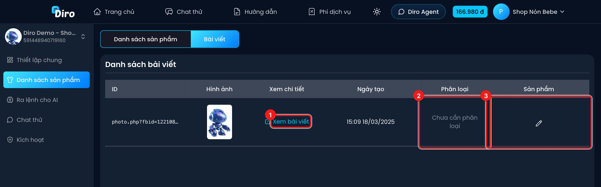

# Danh sách sản phẩm và bài viết

Mục **Danh sách sản phẩm** cho bạn xem nhanh AI đang biết những sản phẩm nào của trang, và các bài viết của Fanpage đã được gắn với sản phẩm nào. AI chỉ tư vấn và lên đơn được các sản phẩm có trong danh sách này.

## Tab Danh sách sản phẩm

1. **Danh sách sản phẩm** — bảng sản phẩm của trang: mã, tên, số hình ảnh, đơn giá, trạng thái (**Còn hàng**/hết hàng) và số bài viết đã gắn.
2. **Bài viết** — chuyển sang danh sách bài viết (xem bên dưới).
3. **Tìm sản phẩm** — gõ tên để lọc.
4. **Quản lý sản phẩm** — mở trang quản lý sản phẩm để thêm, sửa giá, phân loại, ảnh, phí ship… Cách làm ở mục **Sản phẩm & kho**.

Bảng này chỉ để xem. Muốn AI biết thêm sản phẩm, bạn thêm ở trang quản lý sản phẩm rồi quay lại bấm nút làm mới (mũi tên tròn).

## Tab Bài viết

Khi khách nhắn tin từ một bài viết (bấm "Gửi tin nhắn" trên bài, hoặc bình luận), AI cần biết bài đó nói về sản phẩm nào để tư vấn đúng. Diro tự đọc bài viết và **phân loại** sản phẩm cho từng bài.

1. **Xem bài viết** — mở bài trên Facebook.
2. **Phân loại** — kết quả Diro tự nhận diện sản phẩm cho bài: **Thành công**, **Thất bại**, **Đã bỏ qua** hoặc **Chưa cần phân loại**.
3. **Sản phẩm** — sản phẩm đang gắn với bài. Bấm biểu tượng bút chì để tự chọn/sửa sản phẩm cho bài khi Diro nhận diện sai hoặc chưa nhận diện. Bài dạng album còn có nút **Tạo sản phẩm từ album** để tạo nhanh sản phẩm từ ảnh của bài.
