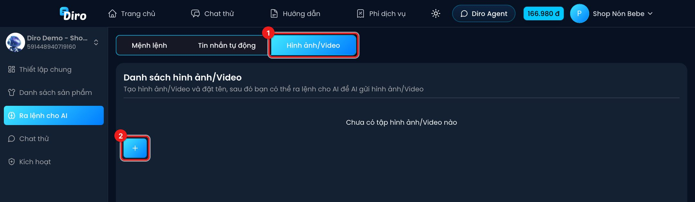
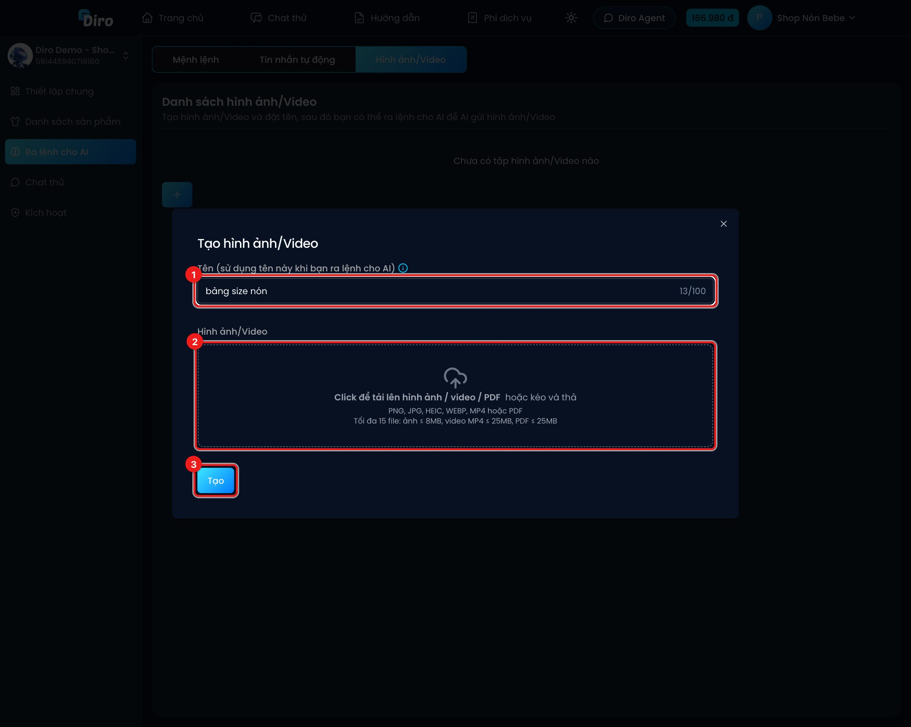

# Hình ảnh/Video cho AI gửi

Bạn tải lên các **tập hình ảnh/video** (bảng size, mã QR chuyển khoản, ảnh feedback khách, video sản phẩm…) và đặt tên. Sau đó chỉ cần ra lệnh cho AI gửi tập đó khi cần.

Mở Chat Agent → **Ra lệnh cho AI** → tab **Hình ảnh/Video**.

1. Tab **Hình ảnh/Video**.
2. Nút **+** — tạo tập mới.

## Tạo tập hình ảnh/video

1. **Tên** — tên ngắn, dễ nhớ, tối đa 100 ký tự. Đây là tên bạn sẽ dùng khi ra lệnh cho AI, ví dụ `bảng size nón`.
2. **Hình ảnh/Video** — bấm hoặc kéo thả để tải lên. Nhận PNG, JPG, HEIC, WEBP, MP4 hoặc PDF; tối đa 15 file (ảnh ≤ 8MB, video và PDF ≤ 25MB).
3. Bấm **Tạo**.

## Ra lệnh cho AI gửi tập ảnh

Vào tab **Mệnh lệnh**, thêm mệnh lệnh nhắc đúng tên tập, hoặc gõ `@` để chọn tập từ danh sách. Ví dụ:

> Khi khách hỏi size hoặc vòng đầu, hãy gửi @bảng size nón cho khách và hỏi khách vòng đầu bao nhiêu để tư vấn.

> Khi khách muốn chuyển khoản đặt cọc, hãy gửi mã QR cho khách.

Mỗi tập hiện thành một thẻ với số tệp bên trong; bạn sửa hoặc xoá được bất cứ lúc nào. Số tập có giới hạn — khi đầy, nút **+** bị khoá và báo *"Số tập hình ảnh bạn đã thêm đã đạt giới hạn cho phép"*.
