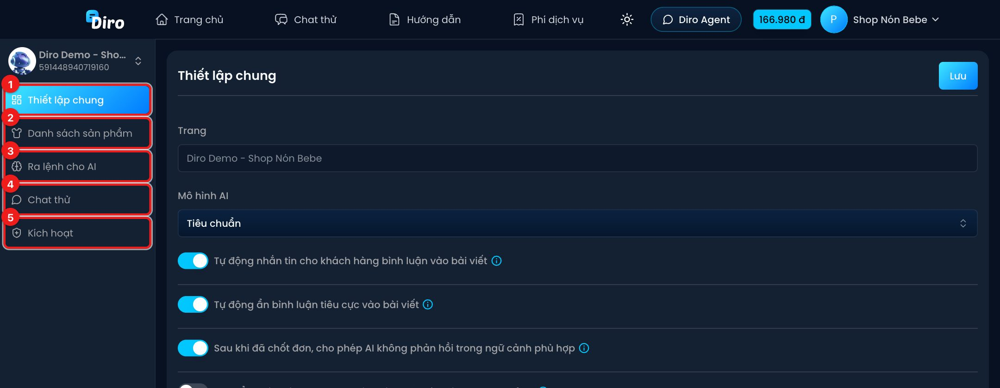

# Chat Agent (AI trả lời tin nhắn)

**Chat Agent** là "nhân viên AI" của một trang. Nó trả lời tin nhắn khách 24/7, tư vấn sản phẩm, nhắn tin cho khách bình luận, tự lên đơn khi đủ thông tin và chuyển cho nhân viên những việc nó không nên tự xử lý.

Bạn mở Chat Agent của một trang bằng nút **Chat Agent** trên thẻ trang ở **Bảng điều khiển**. Chưa có Chat Agent thì xem trang **Tạo Chat Agent và bật AI** trong mục **Bắt đầu**.

Thanh bên trái có 5 mục:

1. **Thiết lập chung** — mô hình AI, các công tắc hành vi (trả lời bình luận, ẩn bình luận tiêu cực, chuyển nhân viên…), cài đặt nâng cao và các nút **Tạo bản sao / Đồng bộ / Xem lịch sử / Xoá**. Xem [Thiết lập chung](./thiet-lap-chung.md).
2. **Danh sách sản phẩm** — sản phẩm và bài viết AI đang dùng để tư vấn. Xem [Danh sách sản phẩm và bài viết](./danh-sach-san-pham.md).
3. **Ra lệnh cho AI** — mệnh lệnh, tin nhắn tự động và hình ảnh/video cho AI gửi. Xem [Mệnh lệnh](./menh-lenh.md), [Tin nhắn tự động](./tin-nhan-tu-dong.md), [Hình ảnh/Video](./hinh-anh-video.md).
4. **Chat thử** — đóng vai khách để thử AI trước khi bật thật. Xem [Chat thử](./chat-thu.md).
5. **Kích hoạt** — bật/tắt **Auto reply** cho trang. Cách làm có ở trang **Tạo Chat Agent và bật AI** (mục **Bắt đầu**).

Ô trên cùng của thanh bên hiện tên trang đang mở. Bấm vào đó để chuyển sang Chat Agent của trang khác.

Đọc thêm:

- [Các việc hay giao cho AI](./cac-lenh-thuong-dung.md) — trả lời bình luận, ẩn bình luận, chuyển nhân viên, kéo tương tác, giá và phí ship…
- [Cách viết lệnh cho AI](./cach-viet-lenh.md) — mẹo viết mệnh lệnh để AI làm đúng ý.
- [Lịch sử thay đổi và khôi phục](./lich-su-thay-doi.md).

:::note
Chat Agent có hai kiểu thanh bên. Nếu mục tiêu của Chat Agent là **Số điện thoại** hoặc **Không lên đơn**, thanh bên không có mục **Danh sách sản phẩm**.
:::
