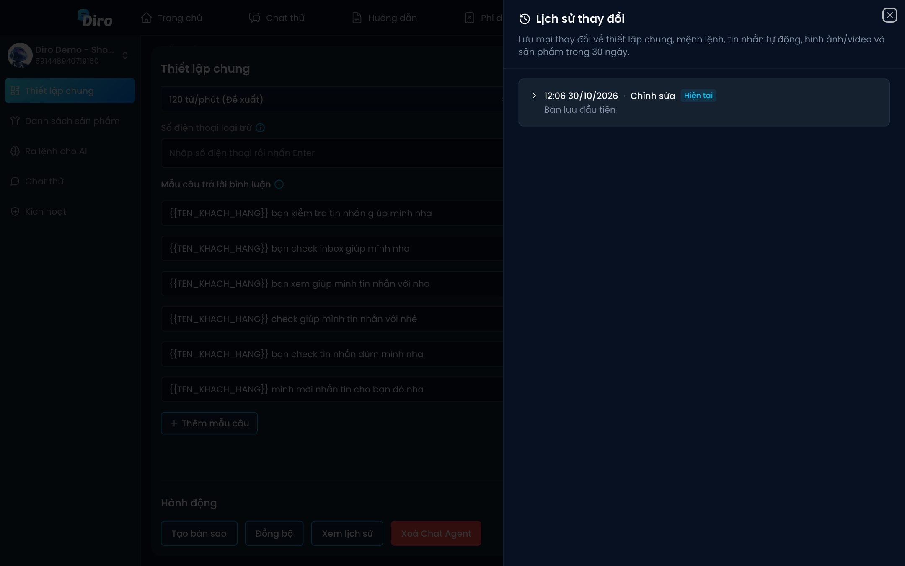

# Lịch sử thay đổi và khôi phục

Diro lưu lại **mọi thay đổi** của Chat Agent trong **30 ngày**: thiết lập chung, mệnh lệnh, tin nhắn tự động, hình ảnh/video và sản phẩm. Lỡ sửa sai, lỡ đồng bộ đè, bạn quay về phiên bản cũ được.

## Xem lịch sử

Mở Chat Agent → **Thiết lập chung** → kéo xuống mục **Hành động** → bấm **Xem lịch sử**.

Mỗi dòng là một lần thay đổi, ghi thời gian và nguồn thay đổi:

- **Chỉnh sửa** — bạn hoặc nhân viên sửa.
- **Đồng bộ từ trang …** — bị ghi đè khi một trang khác bấm **Đồng bộ**.
- **AI hỗ trợ áp dụng đề xuất** — Diro Agent thay đổi sau khi bạn bấm **Áp dụng**.
- **Khôi phục về phiên bản …** — một lần khôi phục trước đó.
- **Hệ thống cập nhật** — Diro tự cập nhật.

Phiên bản đang dùng có nhãn **Hiện tại**. Bấm vào một dòng để xem chi tiết: phần **Thêm** (xanh), **Sửa** (vàng, hiện nội dung **Cũ** và **Mới**), **Xoá** (đỏ). Bấm **Xem thêm** ở cuối để tải các thay đổi cũ hơn.

## Khôi phục một phiên bản

1. Bấm **Khôi phục** ở dòng phiên bản muốn quay về.
2. Diro hỏi **"Khôi phục phiên bản này?"** — toàn bộ cấu hình Chat Agent sẽ quay về như thời điểm đó.
3. Bấm **Khôi phục**. Diro báo **"Đã khôi phục Chat Agent"** và tải lại trang.

:::note
- Trạng thái ngay trước khi khôi phục vẫn được lưu trong lịch sử, nên bạn **hoàn tác được**.
- Sản phẩm **đã có đơn hàng** sẽ không bị xoá khi khôi phục; Diro ghi rõ những sản phẩm được giữ lại.
:::
