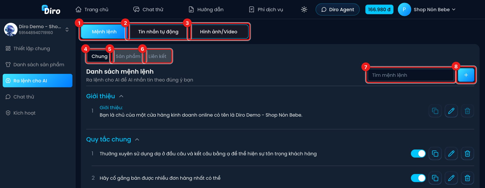
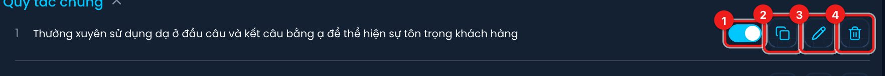
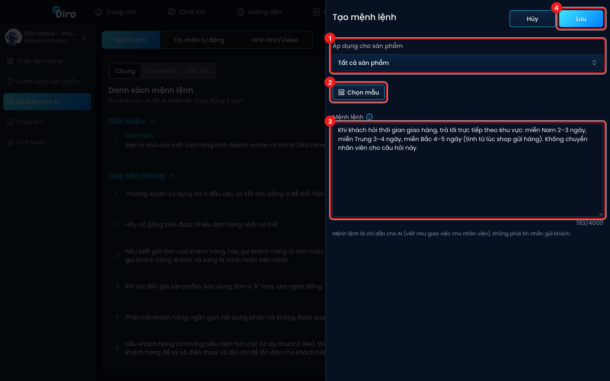
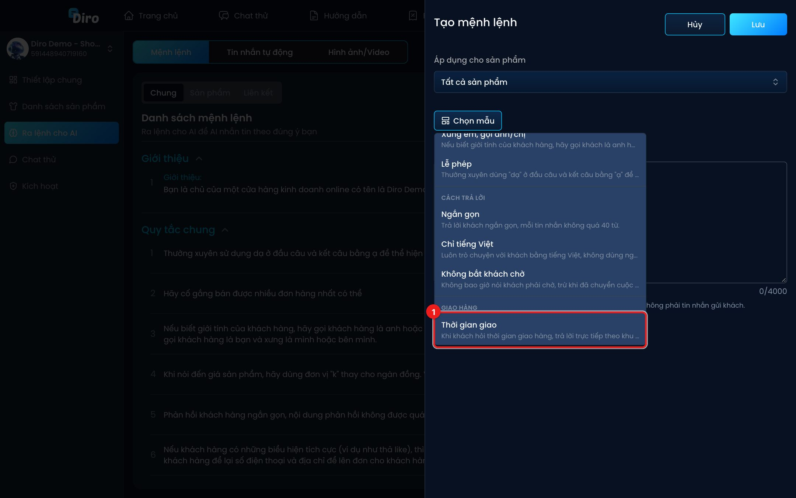
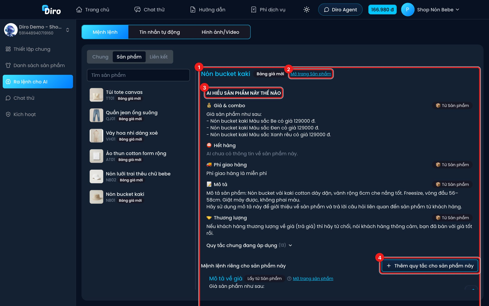

# Mệnh lệnh cho AI

**Mệnh lệnh** là các chỉ dẫn bạn giao cho AI, giống như dặn dò một nhân viên mới: xưng hô thế nào, trả lời ngắn hay dài, khi nào chuyển cho nhân viên, giao hàng mất mấy ngày…

Mở Chat Agent → **Ra lệnh cho AI** → tab **Mệnh lệnh**.

1. **Mệnh lệnh** — danh sách mệnh lệnh (trang này).
2. **Tin nhắn tự động** — câu chào, kéo tương tác, upsell. Xem [Tin nhắn tự động](./tin-nhan-tu-dong.md).
3. **Hình ảnh/Video** — các tập ảnh/video để AI gửi cho khách. Xem [Hình ảnh/Video](./hinh-anh-video.md).
4. **Chung** — mệnh lệnh áp dụng cho cả trang.
5. **Sản phẩm** — AI hiểu từng sản phẩm thế nào, cùng mệnh lệnh riêng của sản phẩm đó.
6. **Liên kết** — sản phẩm ở các trang khác cùng shop mà AI có thể bán chéo.
7. **Tìm mệnh lệnh** — lọc theo chữ.
8. **Nút +** — thêm mệnh lệnh mới.

## Tab Chung

Mệnh lệnh chung được chia thành các nhóm:

- **Giới thiệu** — AI là ai, bán gì (ví dụ "Bạn là chủ của một cửa hàng kinh doanh online có tên là…"). Diro tự tạo khi tạo Chat Agent, bạn sửa được nhưng không xoá được.
- **Quy tắc chung** — các mệnh lệnh bạn tự thêm.
- **Sau khi lên đơn** — AI nói gì ngay sau khi tạo đơn cho khách.
- **🔒 Hệ thống** — mệnh lệnh do Diro quản lý, đã khoá, mặc định thu gọn.

Mỗi mệnh lệnh có các nút:

1. **Công tắc bật/tắt** — tắt thì AI tạm bỏ qua mệnh lệnh này (hiện chữ **Đang tắt**), không cần xoá.
2. **Sao chép mệnh lệnh** — chép mệnh lệnh sang Chat Agent của các trang khác (tick trang rồi bấm **Xác nhận**).
3. **Sửa**.
4. **Xoá** — Diro hỏi lại trước khi xoá.

## Thêm mệnh lệnh

Bấm nút **+**. Bảng **Tạo mệnh lệnh** mở ra:

1. **Áp dụng cho sản phẩm** — **Tất cả sản phẩm**, hoặc chọn một sản phẩm để mệnh lệnh chỉ có hiệu lực khi khách hỏi sản phẩm đó.
2. **Chọn mẫu** — chèn sẵn một mệnh lệnh mẫu (xem bên dưới).
3. **Mệnh lệnh** — nội dung, tối đa 4000 ký tự. Viết như **giao việc cho nhân viên**, không phải tin nhắn gửi khách. Gõ `@` để chèn một tập hình ảnh/video, AI sẽ gửi tập đó khi phù hợp.
4. Bấm **Lưu**.

Sau khi bấm **Lưu**, AI đọc lại mệnh lệnh (**"AI đang tiếp nhận mệnh lệnh..."**). Nếu có vấn đề, Diro báo một trong ba trường hợp, kèm **Lý do** và thường có **Mệnh lệnh gợi ý** để bạn bấm **Áp dụng**:

- **Mệnh lệnh bị từ chối** — AI không thực hiện được (ví dụ yêu cầu ngoài khả năng).
- **Mệnh lệnh bị xung đột** — mâu thuẫn với một mệnh lệnh khác.
- **Mệnh lệnh không rõ** — câu chữ dễ hiểu nhầm.

Khi sửa một mệnh lệnh mà các trang khác cũng có mệnh lệnh y hệt, Diro hỏi bạn có muốn áp dụng nội dung mới cho các trang đó không — tick trang nào thì trang đó được sửa theo.

### Mệnh lệnh mẫu

Nút **Chọn mẫu** có sẵn các mẫu theo nhóm: **Xưng hô** (xưng em gọi anh/chị, lễ phép), **Cách trả lời** (ngắn gọn, chỉ tiếng Việt, không bắt khách chờ), **Giao hàng** (thời gian giao, đơn vị vận chuyển), **Thanh toán** (thanh toán khi nhận hàng), **Chốt đơn** (xin thông tin lên đơn, gọi hàm lên đơn ngay), **Chuyển nhân viên** (khiếu nại, hỏi ngoài phạm vi). Chọn một mẫu, nội dung được chèn vào ô **Mệnh lệnh** để bạn sửa lại cho đúng shop mình.

:::warning Đừng ghi giá và phí ship trong mệnh lệnh
Nếu mệnh lệnh có ghi giá hoặc phí ship, Diro sẽ cảnh báo: *"Mệnh lệnh này có ghi giá hoặc phí ship. Nên cấu hình ở Sản phẩm để AI không nhận hai thông tin khác nhau."* Giá, combo và phí giao hàng nên nhập ở trang sản phẩm — xem phần tab **Sản phẩm** dưới đây.
:::

## Tab Sản phẩm

Tab này cho bạn thấy **AI hiểu từng sản phẩm thế nào**. Chọn một sản phẩm ở danh sách bên trái:

1. Tên sản phẩm cùng nhãn chế độ cấu hình: **Bảng giá mới** (giá, combo và phí ship nhập dạng bảng/khối trên trang sản phẩm) hoặc **Mô tả chữ** (giá viết thành đoạn văn — cách cũ).
2. **Mở trang Sản phẩm** — sửa giá, combo, phí giao hàng, mô tả của sản phẩm.
3. **AI hiểu sản phẩm này thế nào** — các khối AI đang đọc: **💰 Giá & combo**, **⛔ Hết hàng**, **🚚 Phí giao hàng**, **📝 Mô tả**, **🤝 Thương lượng**. Nhãn **📦 Từ Sản phẩm** nghĩa là nội dung lấy từ trang sản phẩm; **⏱ Ưu đãi tạm thời** là ưu đãi từ tin nhắn tự động đang ghi đè. Bên dưới là **Quy tắc chung đang áp dụng** cho sản phẩm.
4. **Thêm quy tắc cho sản phẩm này** — thêm mệnh lệnh riêng chỉ áp dụng cho sản phẩm này.

Các mệnh lệnh **Mô tả về giá**, **Mô tả về phí giao hàng**, **Mô tả sản phẩm** được Diro trích tự động từ sản phẩm (nhãn **Lấy từ Sản phẩm**). Muốn sửa, bấm **Mở trang sản phẩm**.

## Tab Liên kết

Nếu trang thuộc một shop có nhiều trang, tab **Liên kết** liệt kê sản phẩm của các trang khác cùng shop để AI **bán chéo**. AI chỉ biết **tên và giá** của các sản phẩm này, không biết combo hay phí giao hàng của chúng. Muốn AI tư vấn đầy đủ, hãy thêm sản phẩm vào chính trang này.

Trang chưa thuộc shop nào sẽ hiện *"Chưa có sản phẩm liên kết nào ở các trang khác cùng shop."*

:::tip
Muốn viết mệnh lệnh hiệu quả, đọc [Cách viết lệnh cho AI](./cach-viet-lenh.md) và [Các việc hay giao cho AI](./cac-lenh-thuong-dung.md).
:::
