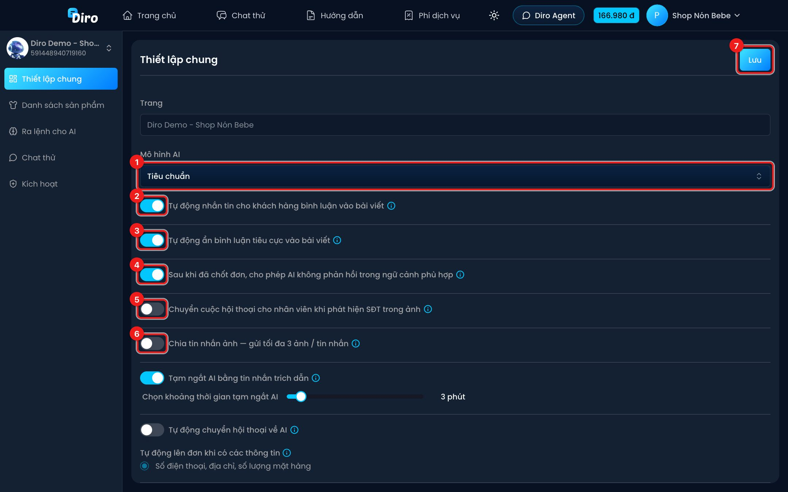
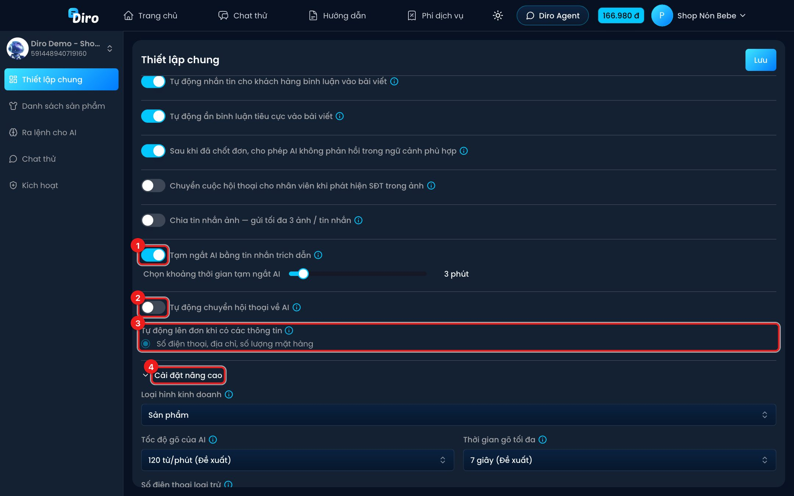
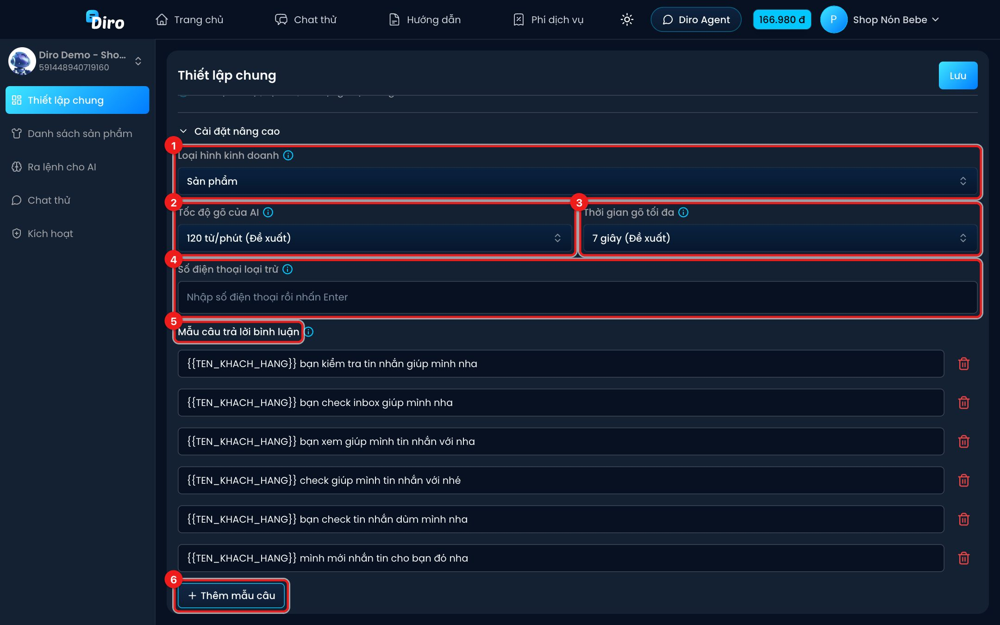
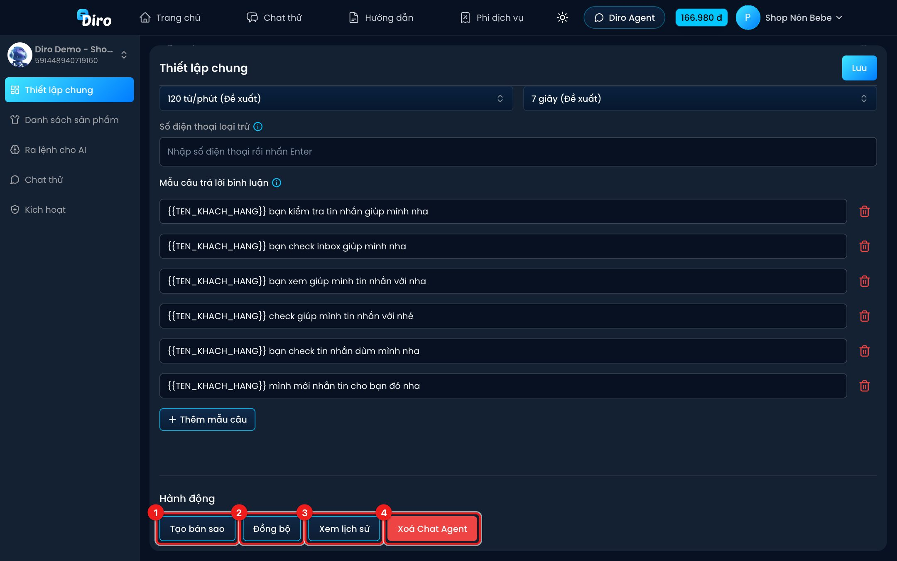
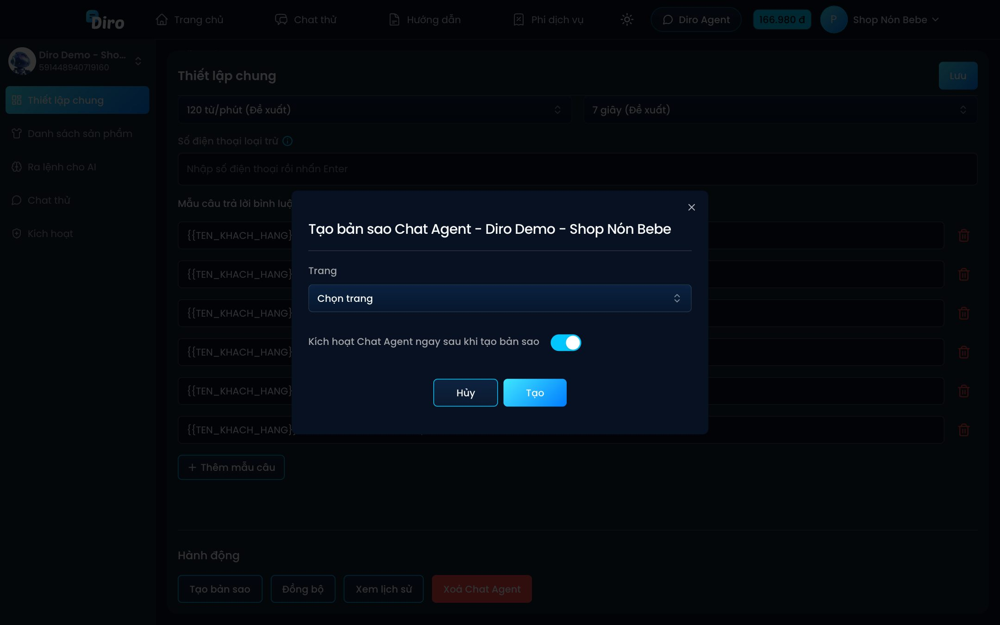
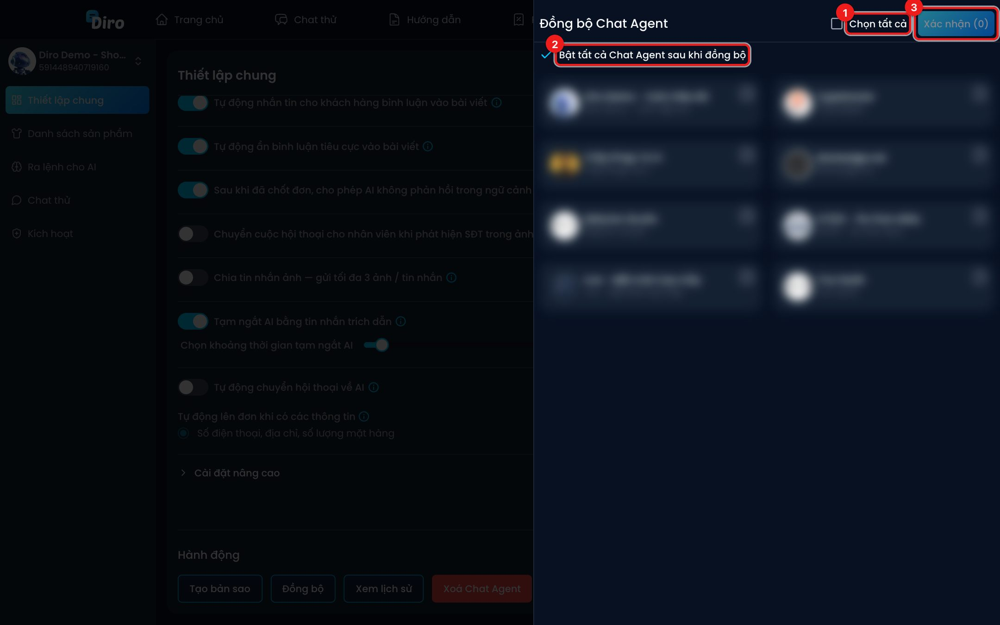

# Thiết lập chung

Trang **Thiết lập chung** quyết định AI dùng mô hình nào và cư xử ra sao: có trả lời bình luận không, có tự ẩn bình luận xấu không, khi nào nhường cho nhân viên…

:::warning Nhớ bấm Lưu
Mọi thay đổi trên trang này chỉ có hiệu lực sau khi bạn bấm nút **Lưu** ở góc trên bên phải. Diro báo **"Cập nhật thành công"** là xong.
:::

## Phần trên

Ô **Trang** cho biết Chat Agent này thuộc trang nào (không đổi được).

1. **Mô hình AI**:
   - **Tiêu chuẩn** — tư duy, suy luận ở mức khá. Giá **80 đ / 1 tin nhắn từ khách**. Khuyến khích dùng.
   - **Tư duy sâu** — tư duy, suy luận ở mức cao, ít "bịa" hơn. Giá **120 đ / 1 tin nhắn từ khách**.
2. **Tự động nhắn tin cho khách hàng bình luận vào bài viết** — khi khách bình luận vào bài của Fanpage, AI nhắn tin riêng cho khách và trả lời bình luận để báo khách kiểm tra tin nhắn.
3. **Tự động ẩn bình luận tiêu cực vào bài viết** — AI tự ẩn bình luận chê sản phẩm, phàn nàn về giá, dùng từ thô tục, quảng cáo sản phẩm khác hoặc **có số điện thoại** (tránh lộ thông tin khách).
4. **Sau khi đã chốt đơn, cho phép AI không phản hồi trong ngữ cảnh phù hợp** — sau khi đã chốt đơn, AI tự xem xét ngữ cảnh để thôi trả lời khi không cần thiết (ví dụ khách chỉ nhắn cảm ơn). Tắt thì AI luôn trả lời.
5. **Chuyển cuộc hội thoại cho nhân viên khi phát hiện SĐT trong ảnh** — khách gửi ảnh có số điện thoại (ví dụ chụp màn hình đơn cũ) thì hội thoại chuyển cho nhân viên.
6. **Chia tin nhắn ảnh — gửi tối đa 3 ảnh / tin nhắn** — thay vì gửi một album nhiều ảnh, AI tách thành nhiều tin (4 ảnh tách 2–2; từ 5 ảnh tách theo nhóm 3) để khách dễ xem.
7. **Lưu**.

## Phần giữa

1. **Tạm ngắt AI bằng tin nhắn trích dẫn** — khi nhân viên trả lời khách bằng cách bấm **Trả lời** (trích dẫn) một tin nhắn, AI tạm dừng ở hội thoại đó trong khoảng thời gian bạn chọn (kéo thanh trượt, **1–30 phút**). Hết thời gian, AI tự trả lời lại.
2. **Tự động chuyển hội thoại về AI** — hội thoại đang do nhân viên phụ trách sẽ về lại AI nếu khách nhắn tin mới sau một khoảng im lặng (nhập số giờ, **1–168 giờ**). Không áp dụng cho hội thoại có đơn đang hoàn/trả hoặc đang gắn thẻ **Chờ xử lý / Hết hàng / Trả hàng**.
3. **Tự động lên đơn khi có các thông tin** — mục tiêu bạn đã chọn lúc tạo Chat Agent. Chỉ để xem, muốn đổi phải xoá và tạo lại Chat Agent.
4. **Cài đặt nâng cao** — bấm để mở thêm các tuỳ chọn bên dưới.

## Cài đặt nâng cao

1. **Loại hình kinh doanh** — **Sản phẩm** hoặc **Dịch vụ**. Chọn **Dịch vụ** thì mọi chữ "Sản phẩm" trên Diro (thiết lập, hội thoại, đơn hàng) và trong câu trả lời của AI đổi thành "Dịch vụ". Trang thuộc một shop thì theo loại hình của shop.
2. **Tốc độ gõ của AI** — từ 60 tới 180 từ/phút (đề xuất 120). AI giả lập thời gian "đang gõ" như người thật; số càng cao AI gửi càng nhanh.
3. **Thời gian gõ tối đa** — 3 tới 10 giây (đề xuất 7). Giới hạn thời gian chờ trước khi gửi, kể cả với tin dài.
4. **Số điện thoại loại trừ** — gõ số rồi nhấn Enter (hoặc dấu `;`) để thêm. Ví dụ số hotline của shop: AI sẽ không gán số này cho khách, và đơn có số này luôn bị báo lỗi khi duyệt.
5. **Mẫu câu trả lời bình luận** — các câu AI dùng để trả lời bình luận (báo khách xem tin nhắn). Dùng `{{TEN_KHACH_HANG}}` để chèn tên khách. Chat Agent mới có sẵn 6 câu, bạn sửa trực tiếp trong ô hoặc bấm biểu tượng thùng rác để xoá.
6. **Thêm mẫu câu** — thêm một câu mới.

## Hành động

Cuối trang có mục **Hành động**:

1. **Tạo bản sao** — chép toàn bộ Chat Agent này sang một trang **chưa có** Chat Agent.
2. **Đồng bộ** — chép Chat Agent này (thiết lập chung, mệnh lệnh, tin nhắn tự động, hình ảnh/video và **sản phẩm**) **đè lên** Chat Agent của các trang khác.
3. **Xem lịch sử** — xem và khôi phục các phiên bản cũ. Xem [Lịch sử thay đổi và khôi phục](./lich-su-thay-doi.md).
4. **Xoá Chat Agent** — Diro hỏi lại trước khi xoá. Xoá rồi không lấy lại được.

### Tạo bản sao

Chọn **Trang** sẽ nhận bản sao, bật/tắt **Kích hoạt Chat Agent ngay sau khi tạo bản sao** (bật thì AI ở trang mới trả lời khách ngay), rồi bấm **Tạo**. Diro mở luôn Chat Agent mới.

### Đồng bộ

Bảng **Đồng bộ Chat Agent** liệt kê các Chat Agent khác của bạn.

1. Tick từng trang cần nhận thiết lập, hoặc **Chọn tất cả**.
2. **Bật tất cả Chat Agent sau khi đồng bộ** — giữ tick nếu muốn AI ở các trang đó bật luôn sau khi đồng bộ.
3. Bấm **Xác nhận**. Diro báo **"Đang đồng bộ..."** và sẽ thông báo khi xong.

:::warning
Đồng bộ **ghi đè** cấu hình và danh sách sản phẩm của các trang được chọn. Nếu lỡ tay, mở **Xem lịch sử** ở trang bị ghi đè để khôi phục.
:::
