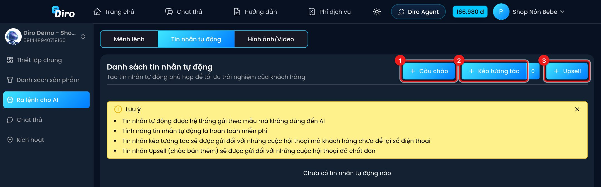
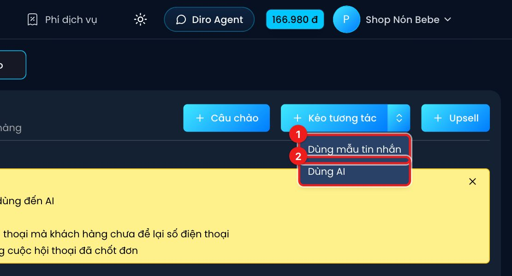
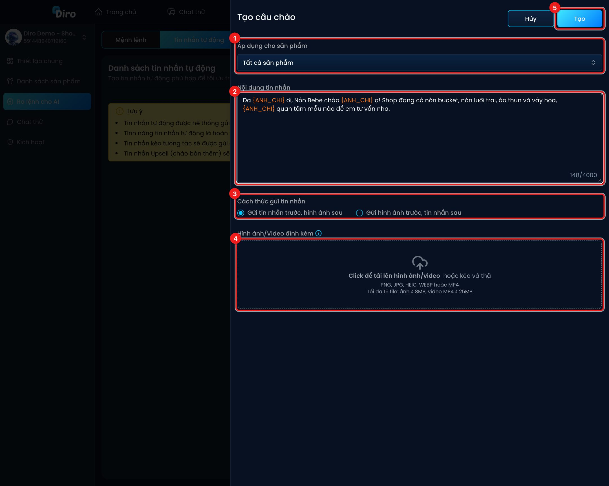
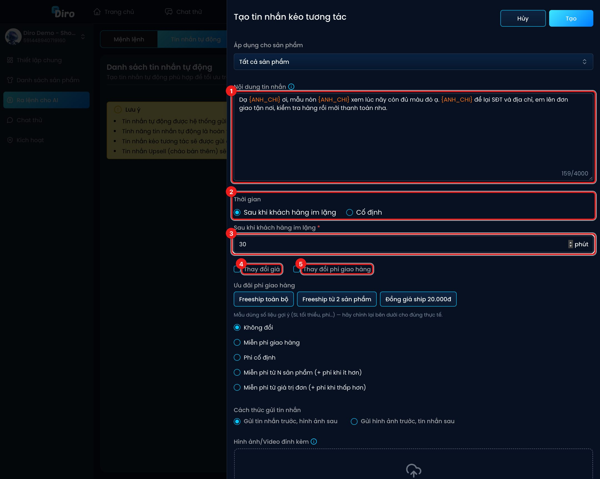
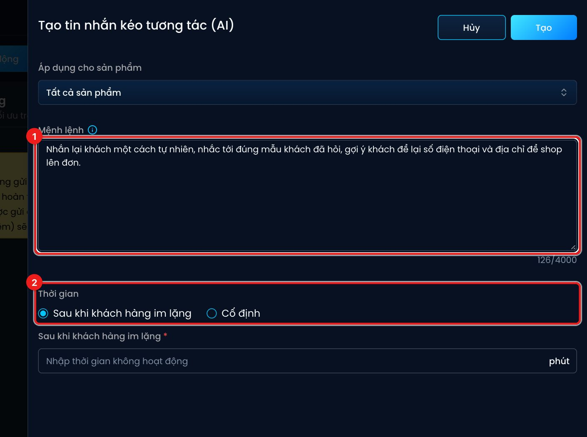
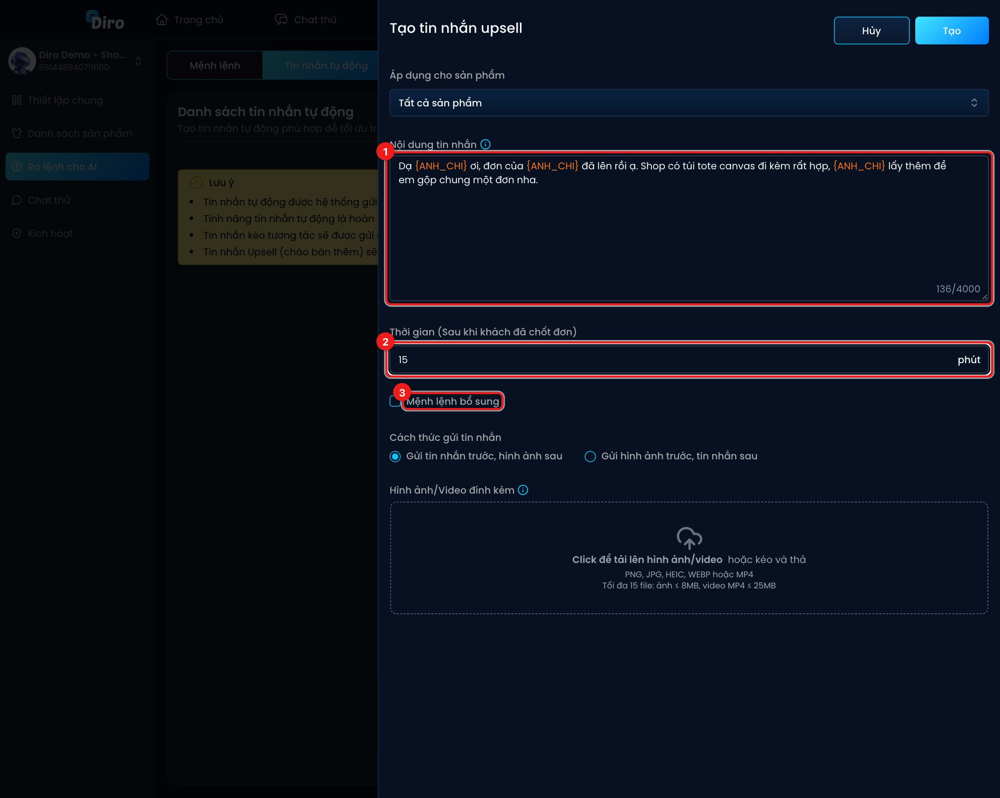

# Tin nhắn tự động

**Tin nhắn tự động** là các tin Diro tự gửi cho khách theo mẫu bạn soạn sẵn, không cần AI. Tin gửi theo mẫu **hoàn toàn miễn phí**. Có ba loại:

| Loại | Gửi khi nào |
|---|---|
| **Câu chào** | Khách vừa nhắn tin lần đầu. |
| **Kéo tương tác** | Khách **chưa để lại số điện thoại** và im lặng một thời gian (hoặc tới giờ cố định bạn chọn). Dùng để níu khách quay lại. |
| **Upsell** (chào bán thêm) | Một thời gian sau khi khách **đã chốt đơn**. Dùng để mời khách mua thêm. |

Mở Chat Agent → **Ra lệnh cho AI** → tab **Tin nhắn tự động**.

1. **Câu chào** — tạo câu chào.
2. **Kéo tương tác** — tạo tin kéo tương tác theo mẫu. Mũi tên bên cạnh cho bạn chọn kiểu:

   

   1. **Dùng mẫu tin nhắn** — gửi đúng câu bạn soạn.
   2. **Dùng AI** — bạn ra lệnh, AI tự viết tin phù hợp với từng hội thoại.
3. **Upsell** — tạo tin upsell (chỉ bấm được khi trang đã có sản phẩm).

Các tin đã tạo hiện thành danh sách, nhóm theo sản phẩm. Mỗi tin có nút sửa, xoá và sao chép sang trang khác.

## Tạo câu chào

1. **Áp dụng cho sản phẩm** — **Tất cả sản phẩm** hoặc một sản phẩm cụ thể (ví dụ câu chào riêng cho khách nhắn từ bài quảng cáo nón bucket).
2. **Nội dung tin nhắn** — tối đa 4000 ký tự. Gõ `{ANH_CHI}` để Diro tự thay bằng "anh" hoặc "chị" theo giới tính khách, không rõ giới tính thì thay bằng "bạn".
3. **Cách thức gửi tin nhắn** — **Gửi tin nhắn trước, hình ảnh sau** hoặc ngược lại.
4. **Hình ảnh/Video đính kèm** — bấm hoặc kéo thả để tải lên (PNG, JPG, HEIC, WEBP, MP4; tối đa 15 file, ảnh ≤ 8MB, video ≤ 25MB). Kéo thả để đổi thứ tự gửi.
5. Bấm **Tạo**.

Mỗi sản phẩm chỉ có một câu chào. Tạo trùng, Diro sẽ báo lỗi.

## Tạo tin kéo tương tác (dùng mẫu)

1. **Nội dung tin nhắn** — câu nhắn lại khách, có thể dùng `{ANH_CHI}`.
2. **Thời gian** — chọn **Sau khi khách hàng im lặng** hoặc **Cố định**.
3. Với **Sau khi khách hàng im lặng**: nhập số **phút** kể từ tin cuối của khách. Với **Cố định**: chọn các giờ gửi trong ngày (0h–23h, chọn ít nhất 2 giờ).
4. **Thay đổi giá** — tick để kèm ưu đãi giá trong tin này (ví dụ giảm giá để níu khách). Sản phẩm dùng **Bảng giá mới** thì nhập **Ưu đãi bảng giá** dạng bảng: dòng cùng số lượng với **Bảng giá & combo** sẽ thay giá gốc, dòng mới được thêm vào. Có thêm ô **Ghi chú ưu đãi về giá cho AI**.
5. **Thay đổi phí giao hàng** — tick để kèm ưu đãi ship. Mục **Ưu đãi phí giao hàng** có mẫu nhanh (**Freeship toàn bộ**, **Freeship từ 2 sản phẩm**, **Đồng giá ship 20.000đ**) và các lựa chọn: **Không đổi**, **Miễn phí giao hàng**, **Phí cố định**, **Miễn phí từ N sản phẩm**, **Miễn phí từ giá trị đơn**.

Bên dưới còn **Cách thức gửi tin nhắn** và **Hình ảnh/Video đính kèm** như câu chào. Bấm **Tạo** để lưu.

:::tip Ưu đãi tạm thời
Khi khách đã nhận tin kéo tương tác có ưu đãi, AI sẽ dùng giá/phí ship ưu đãi đó khi tư vấn tiếp cho khách. Bạn xem được ưu đãi nào đang áp dụng ở tab **Sản phẩm** trong **Mệnh lệnh** (nhãn **⏱ Ưu đãi tạm thời**).
:::

Bạn có thể tạo nhiều tin kéo tương tác ở các mốc thời gian khác nhau (ví dụ sau 30 phút và sau 6 giờ), nhưng không trùng mốc.

## Tạo tin kéo tương tác bằng AI

1. **Mệnh lệnh** — dặn AI cách nhắn lại khách. Gõ `@` để chọn hình ảnh/video, AI sẽ tự gửi kèm nếu hợp ngữ cảnh.
2. **Thời gian** — như kiểu dùng mẫu.

## Tạo tin upsell

1. **Nội dung tin nhắn** — lời mời mua thêm.
2. **Thời gian (Sau khi khách đã chốt đơn)** — số phút sau khi chốt đơn thì gửi.
3. **Mệnh lệnh bổ sung** — tick để thêm chỉ dẫn giúp AI hiểu nội dung upsell (khi khách trả lời tin upsell, AI biết cách tư vấn tiếp).

Rồi chọn cách gửi, đính kèm ảnh/video và bấm **Tạo**.

:::note
Muốn thử tin kéo tương tác và upsell trước khi dùng thật, vào **Chat thử** và bấm nút **Kéo tương tác** hoặc **Gửi tin Upsell**. Xem [Chat thử](./chat-thu.md).
:::
