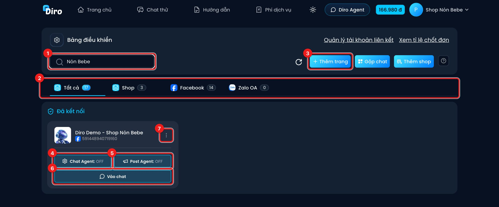
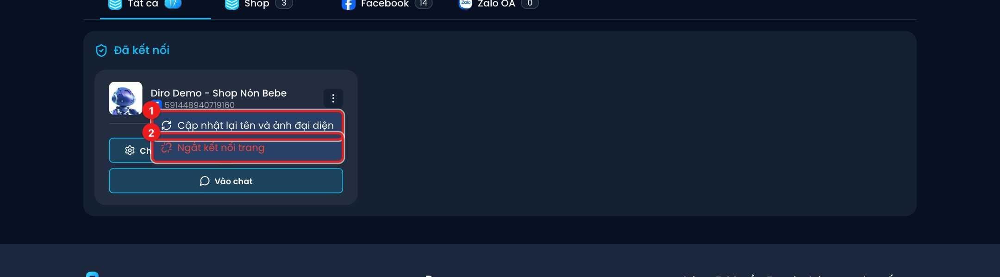

# Bảng điều khiển

**Bảng điều khiển** là màn hình đầu tiên sau khi đăng nhập. Ở đây hiện mọi trang (Fanpage Facebook, Zalo OA) và shop bạn đang quản lý, kèm lối vào Chat Agent, Post Agent và khung chat của từng trang.

Bạn mở lại màn hình này bất cứ lúc nào bằng nút **Trang chủ** trên thanh menu.

1. **Ô tìm kiếm** — gõ tên trang để lọc nhanh khi bạn quản lý nhiều trang.
2. **Các tab nền tảng** — **Tất cả**, **Shop**, **Facebook**, **Zalo OA**. Con số bên cạnh là số trang/shop trong từng tab.
3. **Thêm trang** — kết nối thêm Fanpage hoặc Zalo OA. Xem [Kết nối thêm trang](./them-trang.md).
4. **Chat Agent** — mở phần thiết lập AI trả lời tin nhắn của trang. Chữ **ON**/**OFF** cho biết AI đang bật hay tắt. Trang chưa có Chat Agent thì nút ghi **Tạo Chat Agent** — xem [Tạo Chat Agent và bật AI](./kich-hoat-ai.md).
5. **Post Agent** — mở phần AI tự đăng bài lên Fanpage. **ON**/**OFF** cho biết đang bật hay tắt. Chi tiết ở mục **Post Agent**.
6. **Vào chat** — mở khung chat để xem và trả lời tin nhắn, bình luận của trang.
7. **Nút ⋮** — các tuỳ chọn thêm cho trang (xem bên dưới).

Các nút khác trên thanh trên cùng:

- **Làm mới** (biểu tượng mũi tên tròn) — tải lại danh sách trang.
- **Gộp chat** — xem tin nhắn của nhiều trang trong một khung chat.
- **Thêm shop** — gom nhiều trang vào một shop để dùng chung sản phẩm, đơn hàng.
- **Quản lý tài khoản liên kết** (chỉ tài khoản Master) — các tài khoản Facebook đã liên kết vào Master.
- **Xem tỉ lệ chốt đơn** — thống kê tỉ lệ hội thoại thành đơn.

Gộp chat, shop và tài khoản liên kết được hướng dẫn ở các mục **Tin nhắn** và **Shop, nhân viên & tài khoản liên kết**.

## Menu ⋮ của thẻ trang

Bấm nút **⋮** ở góc phải thẻ trang:

1. **Cập nhật lại tên và ảnh đại diện** — khi bạn vừa đổi tên hoặc ảnh Fanpage trên Facebook mà Diro vẫn hiện tên/ảnh cũ.
2. **Ngắt kết nối trang** — trang ngừng nhận tin trên Diro và chuyển xuống mục **Đã huỷ kết nối**. Diro hỏi lại trước khi ngắt. Bạn kết nối lại được bất cứ lúc nào, dữ liệu cũ vẫn còn.

## Đã kết nối và Đã huỷ kết nối

- **Đã kết nối**: các trang đang hoạt động. Shop xếp đầu, rồi tới trang đang bật AI, trang đã có Chat Agent, cuối cùng là trang chưa có Chat Agent.
- **Đã huỷ kết nối**: các trang đã ngắt. Bấm vào thẻ trang để mở hộp **Thêm kết nối** và kết nối lại.

:::warning Khung đỏ "Có lỗi xảy ra !!!"
Nếu Bảng điều khiển hiện khung đỏ **"Vui lòng kiểm tra lại kết nối đối với trang: …"**, quyền của Diro với những trang đó đã hỏng (thường do đổi mật khẩu Facebook hoặc bị gỡ quyền quản trị trang). Chat Agent sẽ **không hoạt động** ở các trang này cho tới khi bạn kết nối lại — xem [Kết nối thêm trang](./them-trang.md).
:::
