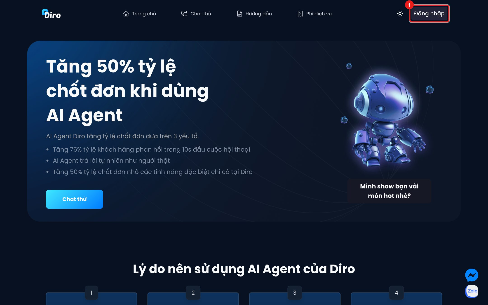
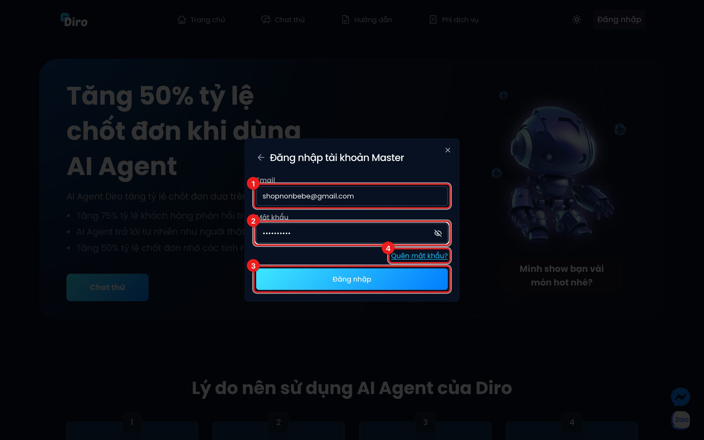
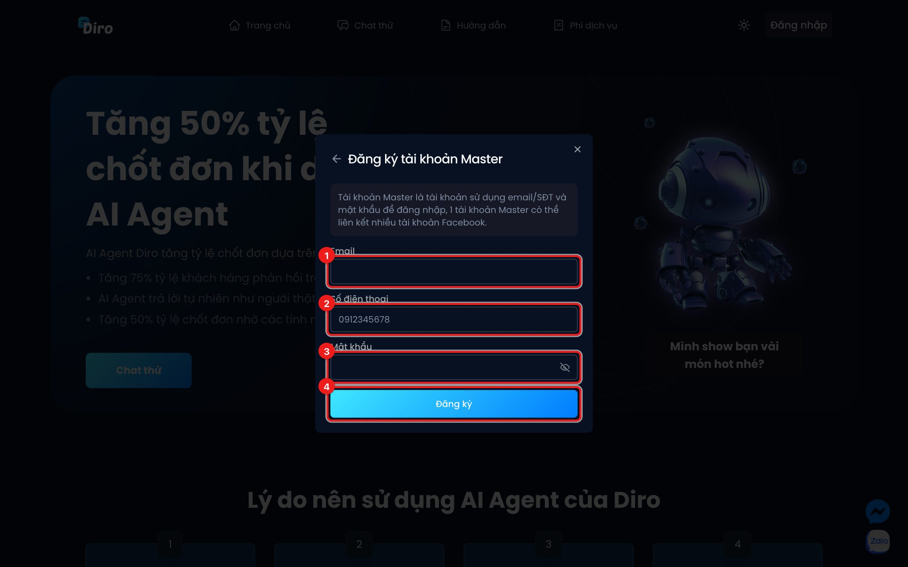

# Đăng nhập Diro

Diro có ba cách đăng nhập. Bạn chọn cách phù hợp với mình:

| Cách đăng nhập | Dành cho ai |
|---|---|
| **Tài khoản Facebook** | Chủ shop quản lý Fanpage bằng một tài khoản Facebook. |
| **Tài khoản Master** | Chủ shop có nhiều tài khoản Facebook. Master đăng nhập bằng email và mật khẩu, và **một tài khoản Master liên kết được nhiều tài khoản Facebook**. |
| **Tài khoản nhân viên** | Nhân viên được chủ tài khoản Master tạo và cấp quyền. |

## Mở hộp đăng nhập

Vào trang [diro.ai](https://diro.ai), bấm nút **Đăng nhập** ở góc trên bên phải **(1)**.

Hộp **Đăng nhập vào Diro** hiện ra với các lựa chọn:

1. **Đăng nhập bằng tài khoản Facebook**
2. **Đăng nhập bằng tài khoản Master**
3. **Đăng nhập tài khoản nhân viên**
4. **Đăng ký tài khoản Master** — nếu bạn chưa có tài khoản Master.

## Cách 1: Đăng nhập bằng Facebook

1. Bấm **Đăng nhập bằng tài khoản Facebook (1)**.
2. Facebook mở ra, bạn đăng nhập (nếu chưa) và **cho phép Diro truy cập các trang** bạn muốn dùng.
3. Xong, Diro đưa bạn vào **Bảng điều khiển**.

:::warning Tài khoản Facebook đã liên kết vào Master
Nếu tài khoản Facebook của bạn đã được liên kết vào một tài khoản Master, Diro sẽ báo **"Đăng nhập không thành công"** và tự mở ô đăng nhập Master. Lúc này bạn phải đăng nhập bằng email và mật khẩu của tài khoản Master đó.
:::

## Cách 2: Đăng nhập bằng tài khoản Master

1. Nhập **Email** của tài khoản Master.
2. Nhập **Mật khẩu**.
3. Bấm **Đăng nhập**.
4. Quên mật khẩu thì bấm **Quên mật khẩu?**, nhập email, Diro gửi mã 6 số để bạn đặt mật khẩu mới.

Nếu tài khoản chưa xác nhận email, Diro tự gửi lại mã xác nhận và chuyển bạn sang màn hình nhập mã.

## Đăng ký tài khoản Master

1. Nhập **Email**.
2. Nhập **Số điện thoại**.
3. Đặt **Mật khẩu**.
4. Bấm **Đăng ký**.

Diro gửi **mã xác nhận 6 số** tới email. Nhập mã rồi bấm **Xác nhận** là tài khoản được tạo và bạn vào thẳng Bảng điều khiển. Không thấy mã thì bấm **Gửi lại mã**.

Sau khi có tài khoản Master, bạn thêm các tài khoản Facebook vào bằng nút **Thêm trang** — xem [Kết nối thêm trang](./them-trang.md).

## Cách 3: Đăng nhập tài khoản nhân viên

Bấm **Đăng nhập tài khoản nhân viên**, nhập email và mật khẩu chủ shop đã cấp cho bạn, rồi bấm **Đăng nhập**.

Tài khoản nhân viên không có nút quên mật khẩu. Quên mật khẩu thì nhờ chủ tài khoản Master đặt lại giúp.
