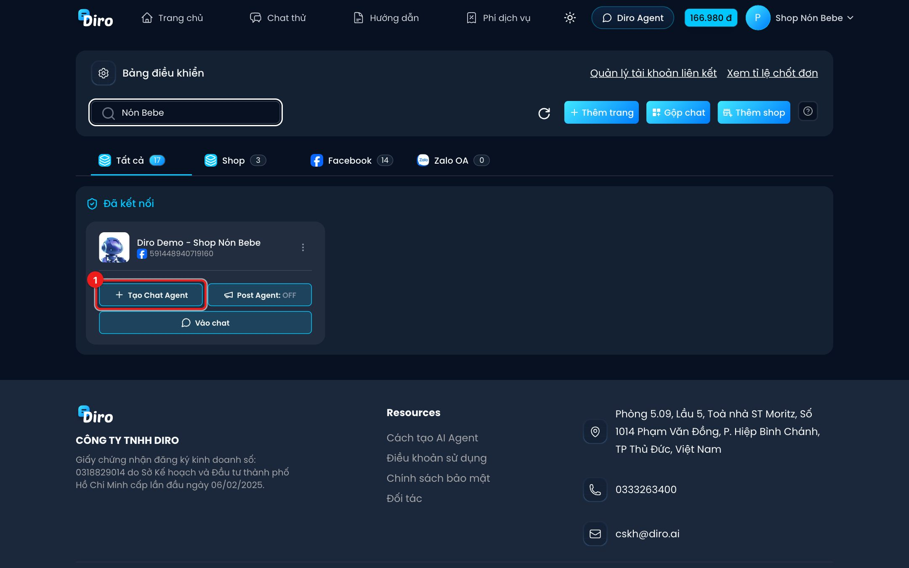
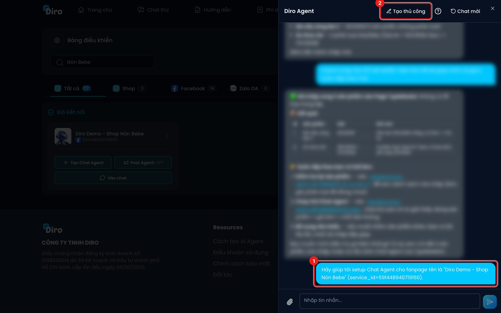
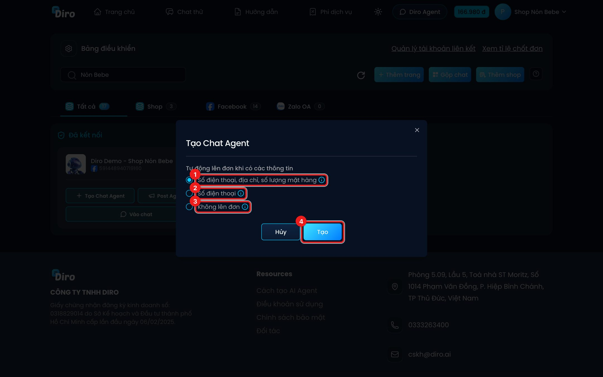
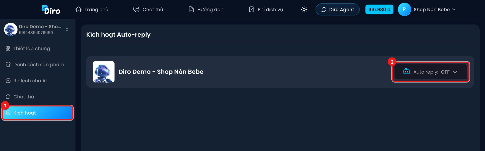
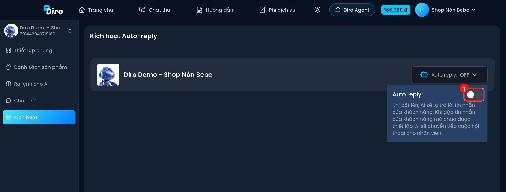

# Tạo Chat Agent và bật AI

**Chat Agent** là "nhân viên AI" của một trang: nó đọc sản phẩm và mệnh lệnh của bạn để trả lời khách, tư vấn và tự lên đơn. Mỗi trang có một Chat Agent riêng.

## Bước 1: Tạo Chat Agent

Trên **Bảng điều khiển**, trang chưa có Chat Agent sẽ có nút **Tạo Chat Agent (1)**.

Bấm vào, khung **Diro Agent** (trợ lý AI của Diro) mở ra ở bên phải và tự gửi yêu cầu **"Hãy giúp tôi setup Chat Agent cho fanpage…" (1)**. Bạn có hai cách:

- **Để Diro Agent làm giúp**: trò chuyện với Diro Agent, trả lời các câu nó hỏi (bán gì, giá, phí ship…). Khi Diro Agent muốn thay đổi gì, nó hiện thẻ đề xuất — bạn bấm **Áp dụng** để đồng ý hoặc **Bỏ qua**.
- **Tự tạo**: bấm **Tạo thủ công (2)**.

Khi tạo thủ công, hộp **Tạo Chat Agent** hỏi mục tiêu **"Tự động lên đơn khi có các thông tin"**:

1. **Số điện thoại, địa chỉ, số lượng mặt hàng** — phù hợp bán hàng online. AI tự lên đơn khi đủ thông tin.
2. **Số điện thoại** — phù hợp khoá học, bất động sản, du lịch…: chỉ cần xin số điện thoại để gọi lại tư vấn.
3. **Không lên đơn** — chỉ dùng AI để chăm sóc, hỗ trợ khách.
4. Bấm **Tạo**.

:::warning Chọn kỹ mục tiêu
Mục tiêu **không đổi được** sau khi tạo. Muốn đổi, bạn phải xoá Chat Agent rồi tạo lại.
:::

Diro báo **"Chat Agent đã được tạo thành công"** và mở trang **Thiết lập chung** của Chat Agent. Chat Agent mới có sẵn vài mệnh lệnh cơ bản (xưng hô lễ phép, chuyển nhân viên khi khách muốn đổi/huỷ đơn hoặc hỏi tình trạng giao hàng…) và 6 mẫu câu trả lời bình luận. AI **chưa bật** — bạn cần làm bước 3.

## Bước 2: Chuẩn bị cho AI

Trước khi bật, hãy:

- Thêm sản phẩm (mục tiêu lên đơn theo số lượng mặt hàng bắt buộc có **ít nhất 1 sản phẩm**).
- Viết mệnh lệnh cho AI và thử trò chuyện ở **Chat thử**.

Các bước này nằm trong mục **Chat Agent (AI trả lời tin nhắn)**.

## Bước 3: Bật AI tự động trả lời

1. Trong Chat Agent, bấm **Kích hoạt (1)** ở thanh bên trái.
2. Bấm nút **Auto reply: OFF (2)**.

3. Bật công tắc **Auto reply (1)**. Diro báo **"Cập nhật thành công"**.

Từ lúc này AI tự trả lời tin nhắn của khách. Gặp câu hỏi chưa được thiết lập, AI chuyển hội thoại cho nhân viên. Muốn tắt AI, bạn làm lại các bước trên và tắt công tắc.

Trên Bảng điều khiển, nút của trang đổi thành **Chat Agent: ON**.

:::note Chưa bật được?
Nếu thấy dòng vàng **"Bạn cần phải có ít nhất 1 sản phẩm để có thể kích hoạt trang này"**, hãy thêm sản phẩm cho trang trước.
:::

:::note Ai được tạo/sửa Chat Agent?
- Tài khoản Facebook đã liên kết vào Master: tạo Chat Agent ở tài khoản Master.
- Nhân viên không tạo, không sửa được Chat Agent. Kỹ thuật viên sửa được nhưng không tạo được.
:::
