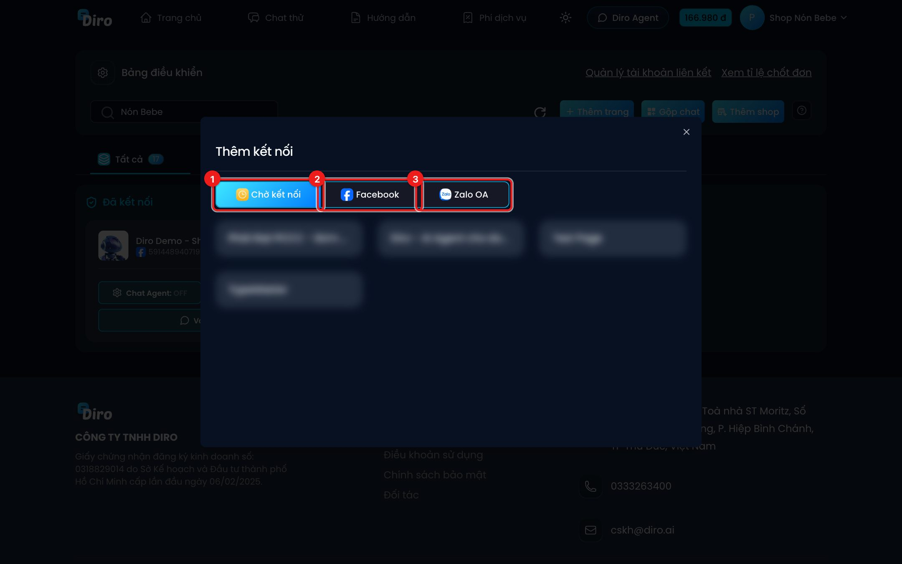
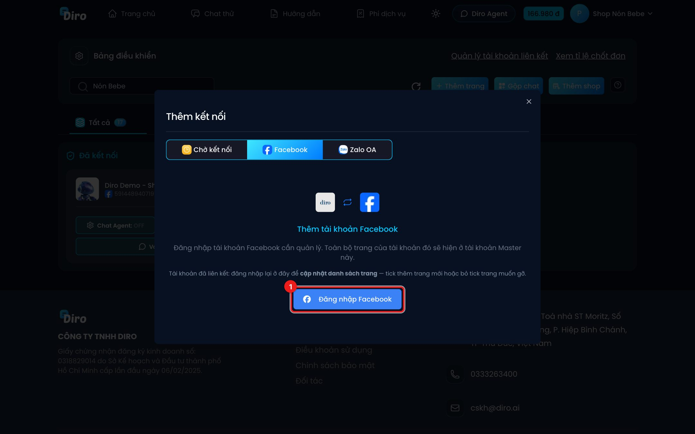
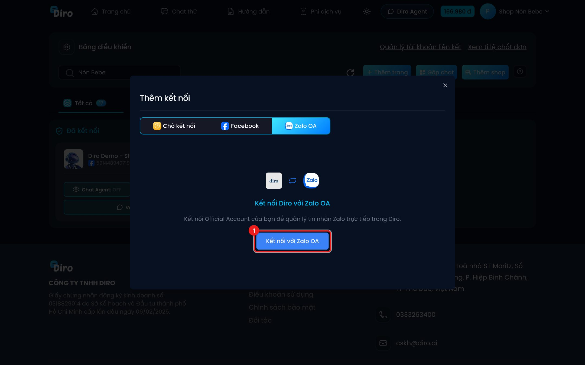

# Kết nối thêm trang

Bạn kết nối Fanpage Facebook hoặc Zalo Official Account (Zalo OA) vào Diro để quản lý tin nhắn và cho AI trả lời.

Trên **Bảng điều khiển**, bấm **Thêm trang**. Hộp **Thêm kết nối** có ba tab:

1. **Chờ kết nối** — các trang Diro đã biết nhưng đang tắt (đã ngắt hoặc chưa kích hoạt). **Bấm vào thẻ trang** để kết nối lại; Diro báo **"Trang đã được kích hoạt"**.
2. **Facebook** — thêm Fanpage từ tài khoản Facebook.
3. **Zalo OA** — kết nối Zalo Official Account.

## Thêm Fanpage Facebook

**Nếu bạn đăng nhập bằng tài khoản Master**, tab này ghi **Thêm tài khoản Facebook**:

1. Bấm **Đăng nhập Facebook (1)**. Một cửa sổ nhỏ mở ra (nếu trình duyệt chặn cửa sổ bật lên, hãy cho phép).
2. Đăng nhập tài khoản Facebook cần quản lý và tick chọn các trang muốn đưa vào Diro.
3. Lần đầu liên kết, Diro hiện bảng tóm tắt những gì sẽ chuyển sang tài khoản Master (số dư, Chat Agent, số trang…). Đọc kỹ rồi bấm **Liên kết**.

:::danger Liên kết là vĩnh viễn
Sau khi liên kết, tài khoản Facebook đó **không đăng nhập Diro riêng được nữa** và **không thể gỡ liên kết**. Mọi thứ sẽ quản lý qua tài khoản Master.
:::

Tài khoản Facebook **đã liên kết từ trước** cũng đăng nhập lại ở đây để **cập nhật danh sách trang** — tick thêm trang mới hoặc bỏ tick trang muốn gỡ. Diro báo số trang đã thêm/gỡ.

**Nếu bạn đăng nhập bằng tài khoản Facebook**, tab này có nút **Kết nối lại với Facebook**. Bấm vào, Facebook hỏi lại quyền, bạn tick thêm các trang muốn dùng rồi xác nhận.

## Kết nối Zalo OA

1. Bấm **Kết nối với Zalo OA**.
2. Zalo mở trang xác nhận, bạn đăng nhập tài khoản quản trị OA và đồng ý cấp quyền.
3. Quay về Diro, bạn thấy thông báo **"Đã kết nối Zalo OA thành công"** và OA hiện trong tab **Zalo OA**.

Nếu Zalo OA bị mất kết nối, thẻ của OA trên Bảng điều khiển chuyển sang nút vàng **Kết nối lại** — bấm vào để làm lại các bước trên.

:::note
Nhân viên không có nút **Thêm trang**. Chỉ chủ tài khoản mới kết nối được trang.
:::
