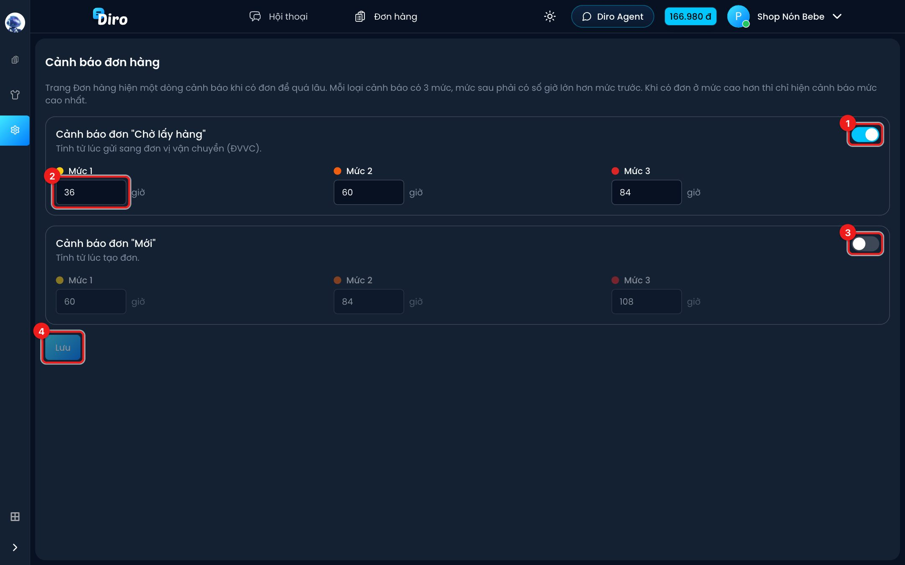

# Cảnh báo đơn hàng

Đơn để lâu không gửi, hoặc gửi rồi mà hãng chậm lấy, thì khách dễ đổi ý. Theo thống kê của Diro, tỉ lệ giao thành công giảm khoảng 3% cho mỗi 24 giờ chậm giao. **Cảnh báo đơn hàng** hiện một dòng nhắc ngay trên danh sách đơn khi có đơn để quá lâu.

Mở bằng: **Thiết lập → Cửa hàng → Cảnh báo đơn hàng**.

Có hai loại cảnh báo, mỗi loại có công tắc bật/tắt riêng và 3 mức:

1. **Cảnh báo đơn "Chờ lấy hàng"** — tính từ lúc gửi sang đơn vị vận chuyển. Dùng để phát hiện đơn mà bưu tá chưa tới lấy.
2. **Mức 1, Mức 2, Mức 3** — số giờ để bật cảnh báo ở từng mức (vàng, cam, đỏ). Mức sau phải lớn hơn mức trước.
3. **Cảnh báo đơn "Mới"** — tính từ lúc tạo đơn. Dùng để phát hiện đơn tạo rồi mà chưa ai xử lý.
4. Bấm **Lưu** để áp dụng. Đổi công tắc hay số giờ mà chưa bấm Lưu thì chưa có hiệu lực.

Khi có đơn quá hạn, đầu danh sách đơn hiện dòng như: "**Cảnh báo:** Bạn có **3** đơn hàng **Chờ lấy hàng** đã quá 60 giờ (tính từ lúc gửi sang ĐVVC)". Rê chuột vào để xem mã các đơn. Nếu có đơn ở nhiều mức thì chỉ hiện mức cao nhất. Dòng cảnh báo không tắt được trên danh sách đơn — muốn tắt, tắt công tắc ở trang thiết lập này.

:::note
Trang thuộc một shop dùng chung thiết lập cảnh báo của shop. Khi đó trang này chỉ hiển thị, kèm link **Mở thiết lập của cửa hàng** để bạn sửa ở cấp shop.
:::
