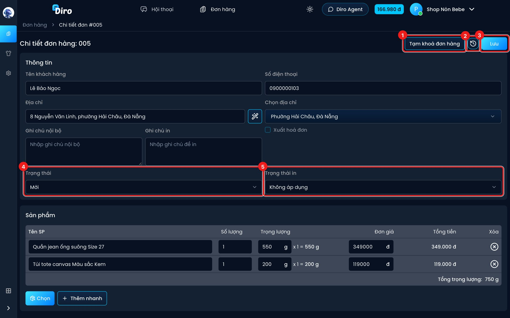
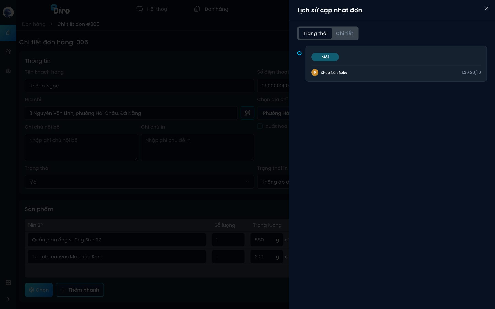

# Xem và sửa đơn

Bấm vào một dòng bất kỳ trong danh sách đơn để mở trang **Chi tiết đơn hàng**. Ở đây bạn sửa mọi thông tin của đơn, đổi trạng thái, tạm khoá đơn và xem lịch sử thay đổi.

Các ô **Thông tin**, **Sản phẩm**, **Thanh toán** giống hệt form [tạo đơn](./tao-don.md): tên, số điện thoại, địa chỉ (có nút đũa phép tự tách địa chỉ), ghi chú nội bộ, ghi chú in, **Xuất hoá đơn**, danh sách sản phẩm, phí vận chuyển, giảm giá.

Các nút và ô riêng của trang chi tiết:

1. **Tạm khoá đơn hàng** — hẹn ngày mới được gửi hàng (xem [bên dưới](#tam-khoa-don)).
2. **Lịch sử cập nhật** (biểu tượng đồng hồ) — xem ai đã đổi gì trên đơn.
3. **Lưu** — lưu mọi thay đổi. Chưa bấm **Lưu** thì chưa có gì thay đổi. Đơn do Chat Agent tạo sẽ thành **Đã duyệt** sau khi bạn sửa và lưu.
4. **Trạng thái** — đổi trạng thái đơn bằng tay (trừ **Chờ xử lý đơn**, trạng thái này chỉ hãng vận chuyển đặt).
5. **Trạng thái in** — **Chưa in** / **Đã in**. Đơn chưa có vận đơn để **Không áp dụng**.

Một số phần chỉ hiện khi có:

- **Vì sao AI lên đơn?** — với đơn Chat Agent tạo: mở giải thích AI đã dựa vào tin nhắn nào để chọn sản phẩm, giá, địa chỉ.
- Tên trang và đường mở nhanh hội thoại — với đơn gắn với một hội thoại.
- Thông tin vận đơn — với đơn đã gửi sang ĐVVC.

:::caution
Đổi trạng thái đơn sang **Đã xác nhận**, **Đã giao hàng**… có thể khiến Diro báo sự kiện mua hàng cho Facebook (nếu bạn đã bật Sự kiện chuyển đổi). Chỉ đổi khi đúng là đơn đã tới bước đó.
:::

## Lịch sử cập nhật

Tab **Trạng thái** liệt kê các lần đơn đổi trạng thái, ai đổi và lúc nào. Tab **Chi tiết** liệt kê các lần sửa thông tin đơn (địa chỉ, sản phẩm, tiền…). Bạn cũng mở được bảng này từ biểu tượng đồng hồ ở cột **Hành động** của danh sách đơn.

## Tạm khoá đơn {#tam-khoa-don}

Dùng khi khách hẹn "tuần sau mới gửi" hoặc bạn đang chờ hàng về. Đơn bị khoá **không gửi sang ĐVVC được** cho tới ngày mở khoá.

1. Bấm **Tạm khoá đơn hàng** (ở trang chi tiết, hoặc rê chuột vào cột **Trạng thái** ở danh sách đơn).
2. Chọn **ngày mở khoá** trên lịch.
3. Bấm **Khoá đến …**.

Trong danh sách, đơn bị khoá hiện mờ đi; rê chuột vào dòng để thấy "Đơn hàng đang bị tạm khoá đến ngày …". Tới ngày mở khoá, dòng chuyển nền **xanh lá nhạt** để bạn biết đơn vừa được mở. Muốn đổi ngày hoặc mở sớm, bấm **Đổi ngày khoá** hoặc **Mở khoá**.

Chỉ tạm khoá được đơn **chưa có vận đơn** và đang ở trạng thái **Mới**, **Chờ hàng**, **Đã xác nhận** hoặc **Đang đóng hàng**.

:::tip
Muốn chặn mọi đơn có một sản phẩm (ví dụ hết hàng tạm thời), dùng **Khoá SP** thay vì khoá từng đơn — xem [Thao tác với nhiều đơn](./thao-tac-hang-loat.md#khoa-sp).
:::
