# Danh sách đơn hàng

Trang **Đơn hàng** liệt kê toàn bộ đơn của trang: đơn Chat Agent tự lên trong lúc chat và đơn bạn tạo tay. Bấm vào một dòng bất kỳ để mở [chi tiết đơn](./chi-tiet-sua-don.md).

## Thanh công cụ

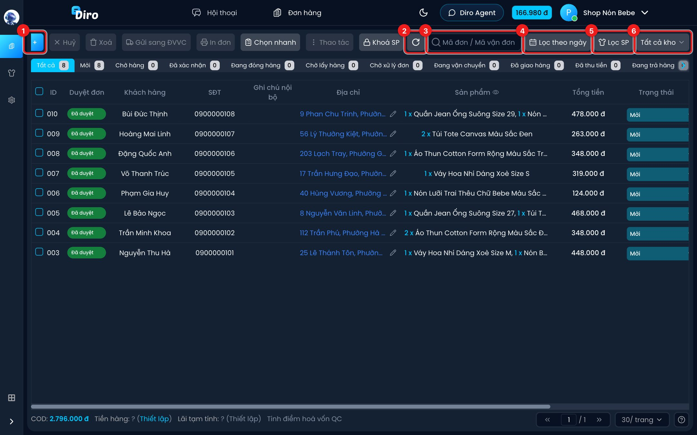

1. **+** — tạo đơn mới bằng tay (xem [Tạo đơn thủ công](./tao-don.md)).
2. **Tải lại** — tải lại danh sách và số đếm ở các tab. Biểu tượng xoay tròn khi đang tải.
3. **Ô tìm kiếm** — gõ **mã đơn, mã vận đơn, số điện thoại hoặc tên khách** rồi nhấn **Enter**. Xoá trắng ô để hiện lại tất cả.
4. **Lọc theo ngày** — chỉ hiện đơn tạo trong khoảng ngày bạn chọn.
5. **Lọc SP** — chỉ hiện đơn có (hoặc không có) sản phẩm bạn chọn.
6. **Tất cả kho** — lọc theo kho xử lý. Nút này chỉ hiện khi bạn đã tạo ít nhất một kho hàng.

Các nút **Huỷ, Xoá, Gửi sang ĐVVC, In đơn, Chọn nhanh, Thao tác, Khoá SP** ở bên trái dùng cho nhiều đơn cùng lúc — xem [Thao tác với nhiều đơn](./thao-tac-hang-loat.md).

Ở cuối thanh còn nút **Xem** (con mắt) để ẩn/hiện cột — xem [Ẩn, hiện cột](#an-hien-cot) bên dưới.

### Lọc theo ngày

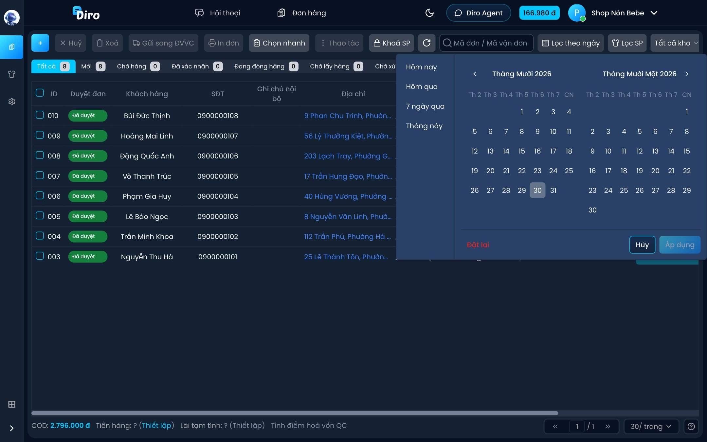

Bấm một mốc nhanh ở cột trái (**Hôm nay**, **Hôm qua**, **7 ngày qua**, **Tháng này**) hoặc chọn ngày bắt đầu và ngày kết thúc trên lịch rồi bấm **Áp dụng**. **Đặt lại** để bỏ lọc.

:::tip
Mốc nhanh luôn tính theo ngày hiện tại. Lưu link trang khi đang chọn **Hôm nay**, mai mở lại sẽ ra đơn của ngày mai chứ không phải ngày đã lưu.
:::

### Lọc SP

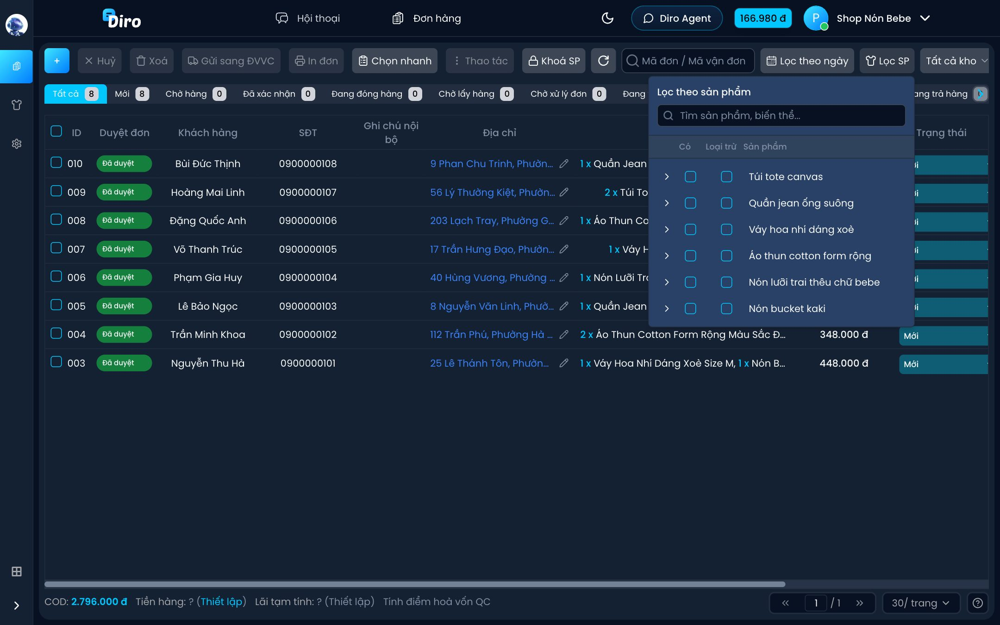

Mỗi sản phẩm có hai ô tick:

- **Có** — chỉ hiện đơn có chứa sản phẩm này.
- **Loại trừ** — ẩn mọi đơn có chứa sản phẩm này.

Bấm mũi tên **>** bên trái tên sản phẩm để lọc tới từng biến thể (size, màu…). Gõ vào ô **Tìm sản phẩm, biến thể...** để tìm nhanh. **Đặt lại** để bỏ hết lựa chọn.

## Các tab trạng thái

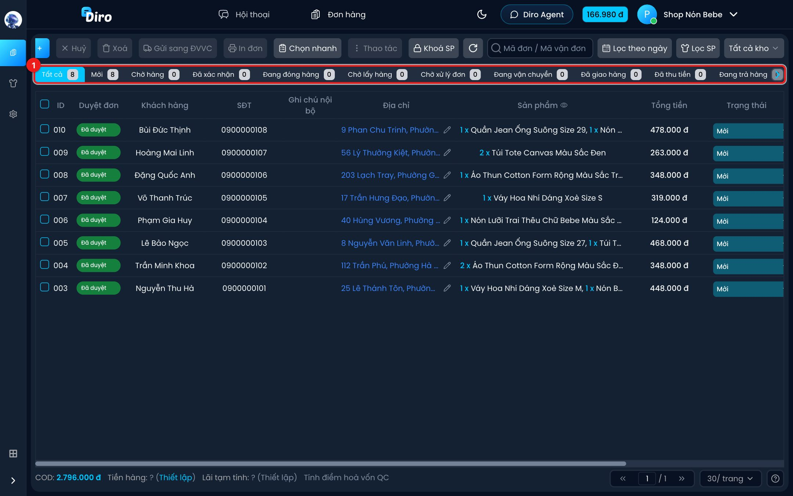

Mỗi tab là một trạng thái đơn, con số bên cạnh là số đơn đang ở trạng thái đó (đã tính theo bộ lọc ngày, sản phẩm, kho đang chọn). Tab nào không vừa màn hình thì bấm mũi tên ở hai đầu để cuộn.

| Tab | Ý nghĩa |
| --- | --- |
| **Tất cả** | Mọi đơn. |
| **Mới** | Đơn vừa tạo, chưa xử lý. Đơn Chat Agent tạo nằm ở đây. |
| **Chờ hàng** | Đơn đang chờ nhập hàng về. |
| **Đã xác nhận** | Đơn đã gọi xác nhận với khách. |
| **Đang đóng hàng** | Đơn đang được đóng gói. |
| **Chờ lấy hàng** | Đã gửi sang đơn vị vận chuyển (ĐVVC), chờ bưu tá tới lấy. |
| **Chờ xử lý đơn** | ĐVVC đang tạm giữ đơn và cần shop xử lý. Trạng thái này do hãng vận chuyển cập nhật, bạn không tự chọn được. |
| **Đang vận chuyển** | Hãng đã lấy hàng, đang giao. |
| **Đã giao hàng** | Khách đã nhận hàng. |
| **Đã thu tiền** | Đã nhận tiền COD từ hãng. |
| **Đang trả hàng** | Giao không thành công, hàng đang trả về shop. |
| **Đã trả hàng một phần** | Khách nhận một phần, phần còn lại trả về. |
| **Đã trả hàng** | Hàng đã về lại shop. |
| **Đã hủy** | Đơn đã huỷ. |
| **Đã xóa** | Đơn đã xoá. |

Các trạng thái sau khi gửi hàng (Chờ lấy hàng trở đi) thường được hãng vận chuyển tự cập nhật, bạn không cần chuyển tay.

## Các cột trong bảng

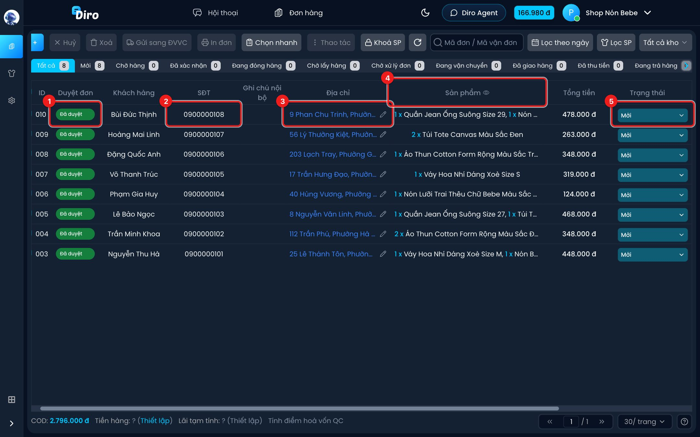

1. **Duyệt đơn** — nhãn cho biết đơn đã được kiểm tra chưa:
   - **Chưa duyệt** (vàng): đơn do Chat Agent tạo, chưa ai kiểm tra. Bạn nên duyệt trước khi gửi sang ĐVVC (xem [AI duyệt đơn](./duyet-don-ai.md)). Đơn bạn tạo tay hoặc đã sửa và lưu sẽ thành **Đã duyệt**.
   - **Đã duyệt** (xanh).
   - **Đòi huỷ** (đỏ): khách đã nhắn đòi huỷ đơn, hội thoại đã được chuyển cho nhân viên. Rê chuột vào nhãn để xem thời điểm khách đòi huỷ. Nếu đã xử lý xong với khách, bấm **OK** trong khung đó để gỡ nhãn.
   - Có thể có thêm nhãn cảnh báo khi AI thấy giá tiền trong đơn không khớp bảng giá.
2. **SĐT** — số điện thoại khách, tô màu theo tỉ lệ nhận hàng của số đó (xem [bảng màu](#mau-sac-tren-bang)). Rê chuột để xem tỉ lệ và số đơn.
3. **Địa chỉ** — tô màu theo kiểu địa chỉ. Bấm biểu tượng **bút chì** để sửa nhanh địa chỉ mà không phải mở đơn.
4. **Sản phẩm** — danh sách sản phẩm trong đơn (số lượng × tên). Rê chuột vào biểu tượng **con mắt** trên tiêu đề cột để xem bảng thống kê: mỗi sản phẩm đang có bao nhiêu cái trong các đơn đang lọc — tiện để biết cần chuẩn bị bao nhiêu hàng.
5. **Trạng thái** — rê chuột vào để mở menu đổi nhanh trạng thái (xem bên dưới).

Các cột còn lại: **ID** (mã đơn), **Khách hàng** (kèm nhãn **KC** nếu là khách cũ), **Ghi chú nội bộ**, **Tổng tiền** (số tiền thu hộ COD), **Tạo lúc**, **Tạo bởi** (tên người tạo, hoặc **AI** nếu Chat Agent tạo), **Hành động**.

Ở tab **Chờ xử lý đơn** có thêm cột **Lý do tạm giữ** (lý do hãng giữ đơn) và **TT xử lý** (**Đã xử lý** / **Chưa xử lý**).

### Menu đổi nhanh trạng thái

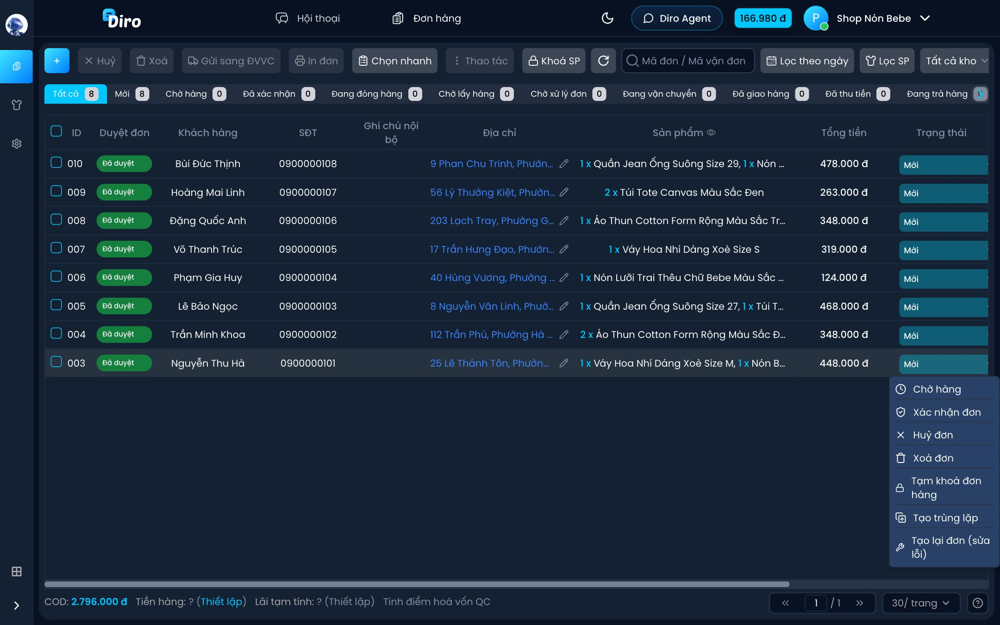

Rê chuột vào ô trạng thái của một đơn để thấy các lựa chọn. Lựa chọn hiện ra tuỳ theo trạng thái hiện tại:

- **Chờ hàng** — chỉ với đơn **Mới**.
- **Xác nhận đơn** — với đơn **Mới** hoặc **Chờ hàng**.
- **Huỷ đơn** — với đơn **Mới**, **Chờ hàng**, **Chờ lấy hàng**.
- **Xoá đơn** — với đơn **Mới** hoặc **Đã hủy**.
- **Tạm khoá đơn hàng** / **Đổi ngày khoá** / **Mở khoá** — xem [Tạm khoá đơn](./chi-tiet-sua-don.md#tam-khoa-don).
- **Tạo trùng lặp** và **Tạo lại đơn (sửa lỗi)** — xem [Thao tác với nhiều đơn](./thao-tac-hang-loat.md#tao-trung-lap-va-tao-lai-don).

Huỷ và xoá đều hỏi xác nhận trước khi làm.

### Cột Hành động

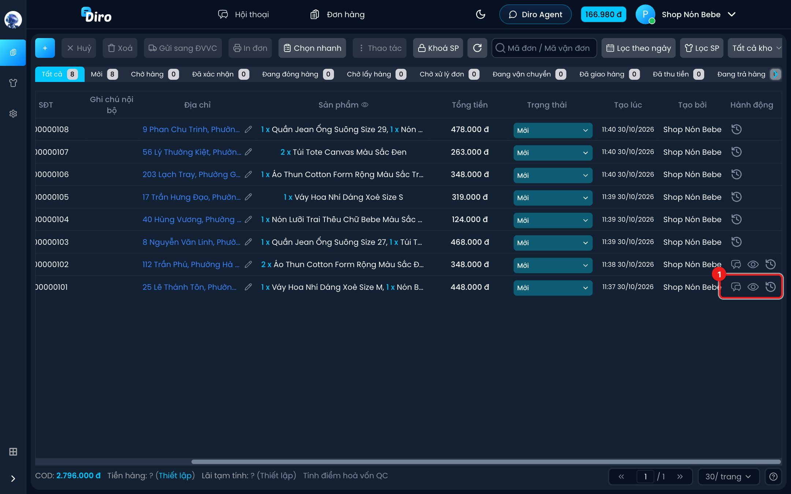

Kéo bảng sang phải để thấy cột cuối. Tuỳ đơn mà có các biểu tượng:

- **Bong bóng chat** — mở nhanh hội thoại với khách (chỉ có ở đơn gắn với một hội thoại).
- **Con mắt** — **Vì sao AI lên đơn như này?**: xem AI đã dựa vào tin nhắn nào để lên đơn (chỉ có ở đơn do Chat Agent tạo).
- **Đồng hồ** — **Lịch sử cập nhật**: ai đã đổi gì, lúc nào.

### Ẩn, hiện cột {#an-hien-cot}

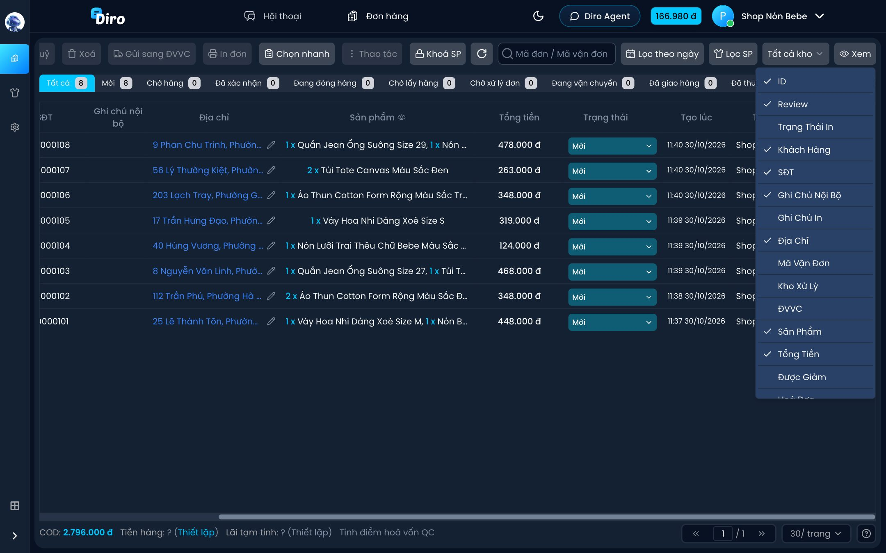

Bấm nút **Xem** (cuối thanh công cụ) rồi tick các cột muốn hiện. Một số cột mặc định ẩn:

- **Mã vận đơn** — với đơn SPX, bấm vào mã để xem hành trình đơn.
- **Ghi chú in** — nội dung sẽ gửi sang ĐVVC và in trên tem.
- **Trạng thái in** (tiêu đề cột là **TT in**) — **Chưa in** / **Đã in**; tự hiện khi bạn ở tab **Chờ lấy hàng**.
- **Được giảm**, **Cập nhật lúc**, **Kho xử lý**, **ĐVVC**.
- **Hoá đơn** — tự hiện khi bạn bật xuất hoá đơn điện tử.
- **Trang** — chỉ có khi bạn xem đơn của cả shop (gộp nhiều trang).

## Màu sắc trên bảng {#mau-sac-tren-bang}

Bấm nút **?** ở góc phải dưới cùng để mở bảng **Hướng dẫn sử dụng** ngay trên Diro.

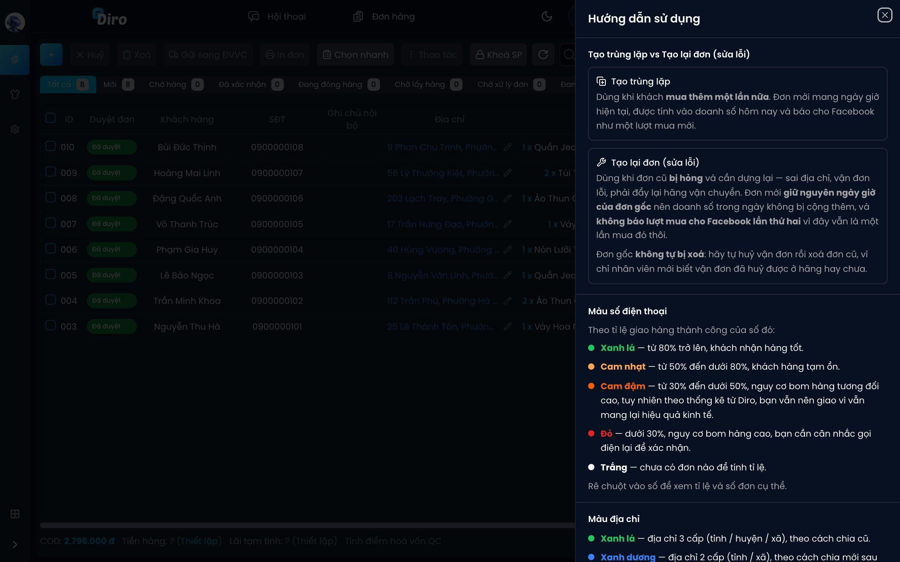

**Màu số điện thoại** (theo tỉ lệ giao thành công của số đó):

- **Xanh lá** — từ 80% trở lên, khách nhận hàng tốt.
- **Cam nhạt** — từ 50% đến dưới 80%.
- **Cam đậm** — từ 30% đến dưới 50%, nguy cơ bom hàng tương đối cao.
- **Đỏ** — dưới 30%, nên gọi xác nhận lại trước khi gửi.
- **Đen / trắng** — số này chưa có đơn nào để tính.

**Màu địa chỉ:**

- **Xanh lá** — địa chỉ 3 cấp (tỉnh / huyện / xã) theo cách chia cũ.
- **Xanh dương** — địa chỉ 2 cấp (tỉnh / xã) theo cách chia mới sau sáp nhập.
- **Không màu** — chưa xác định được, nên kiểm tra lại trước khi gửi.

**Nhãn KC (khách cũ)** cạnh tên khách: **xanh lá** = từng nhận hàng, **đỏ** = từng trả hàng (bom), **cam** = vừa từng nhận vừa từng trả. Không có nhãn là khách mua lần đầu.

**Màu nền của cả dòng:**

- **Cam nhạt** (chỉ ở tab **Mới**) — đơn trùng số điện thoại với một đơn mới khác, có thể khách đặt hai lần. Rà lại trước khi gửi hàng.
- **Mờ đi** — đơn đang bị tạm khoá, hoặc có sản phẩm đang bị khoá. Đơn mờ vẫn chọn, sửa, huỷ được bình thường nhưng **không gửi sang ĐVVC được**. Rê chuột vào dòng để xem lý do.
- **Xanh lá nhạt** — đơn vừa được mở khoá hôm nay.
- **Vàng nhạt** (khi đang lọc một kho) — đơn có sản phẩm thuộc kho khác; cạnh mã đơn có dấu cảnh báo.
- **Xanh ngọc nhạt** (khi shop có từ 2 kho) — mọi sản phẩm của đơn đều có ở tất cả các kho.

## Thanh tổng cuối bảng

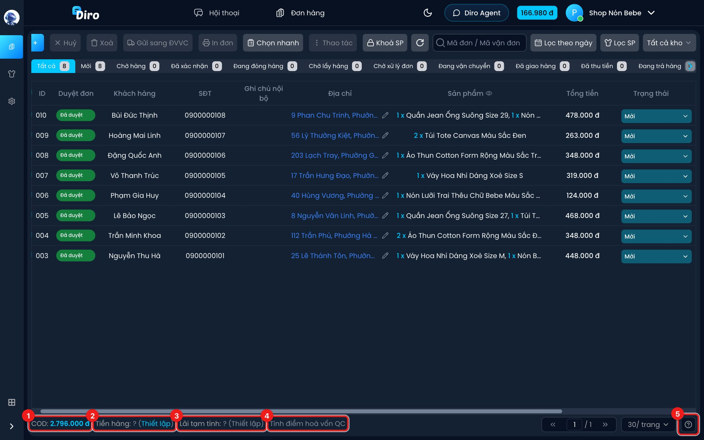

1. **COD** — tổng tiền thu hộ của các đơn **đang hiển thị trên trang này** (không tính đơn đã huỷ).
2. **Tiền hàng** — tổng giá vốn của các đơn đó. Lần đầu sẽ hiện **?**: bấm **Thiết lập** để nhập giá vốn (tiền hàng) cho từng sản phẩm, từng biến thể. Rê chuột vào con số để xem cách tính theo từng sản phẩm.

   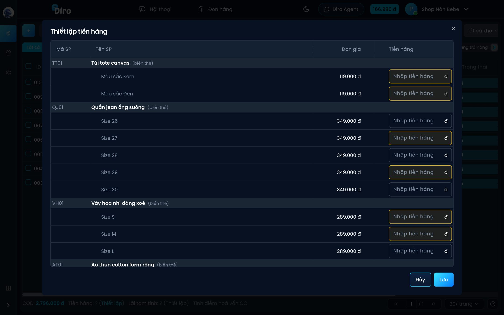

   Ô tô vàng là sản phẩm có trong các đơn đang hiển thị mà chưa có tiền hàng. Nhập xong bấm **Lưu**. Tiền hàng được lưu vào sản phẩm, lần sau không phải nhập lại.
3. **Lãi tạm tính** — bấm **Thiết lập** (chỉ bấm được sau khi đã có đủ tiền hàng) và nhập: **Tỉ lệ giao thành công** (%), **Phí vận chuyển trên mỗi đơn hàng**, **Chi phí phụ trên mỗi đơn hàng** (hộp, xốp, tem in…), và tick **Thuế … trên doanh thu** nếu muốn trừ thuế. Công thức:

   > Lãi tạm tính = COD × tỉ lệ giao − Tiền hàng × tỉ lệ giao − Phí ship × số đơn − Chi phí phụ × số đơn − Thuế (nếu bật)

   Rê chuột vào con số để xem từng khoản. Lãi tạm tính **chưa trừ** chi phí quảng cáo, mặt bằng, nhân sự. Thiết lập này được nhớ trên trình duyệt bạn đang dùng.
4. **Tính điểm hoà vốn QC** — mở bảng **Tính điểm hoà vốn của quảng cáo**: với từng sản phẩm, Diro tính số tiền quảng cáo tối đa bạn được chi cho mỗi đơn mà vẫn không lỗ (dùng các số đã nhập ở Lãi tạm tính). Rê chuột vào con số để xem cách tính. Bấm được sau khi đã thiết lập tiền hàng và lãi tạm tính.
5. **?** — mở bảng **Hướng dẫn sử dụng** (màu sắc, khác nhau giữa Tạo trùng lặp và Tạo lại đơn).

Nếu bạn đã bật hoá đơn điện tử, cạnh đó có thêm nút **Nhập tên SP trên HĐ** để đặt tên sản phẩm in trên hoá đơn.

Bên phải là phần chuyển trang và chọn số đơn mỗi trang (**30, 50, 100, 200, 500**).

:::note
Ba con số COD, Tiền hàng, Lãi tạm tính chỉ tính trên các đơn đang hiện ở trang hiện tại của bảng. Muốn tính cho cả ngày, hãy lọc theo ngày và chọn số đơn mỗi trang đủ lớn.
:::
