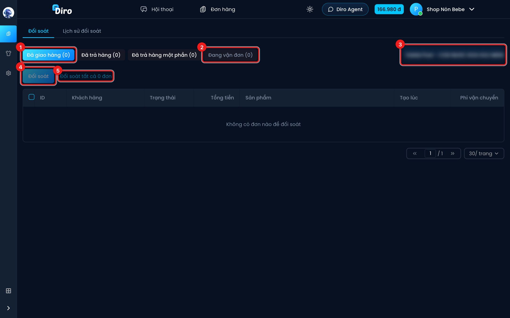
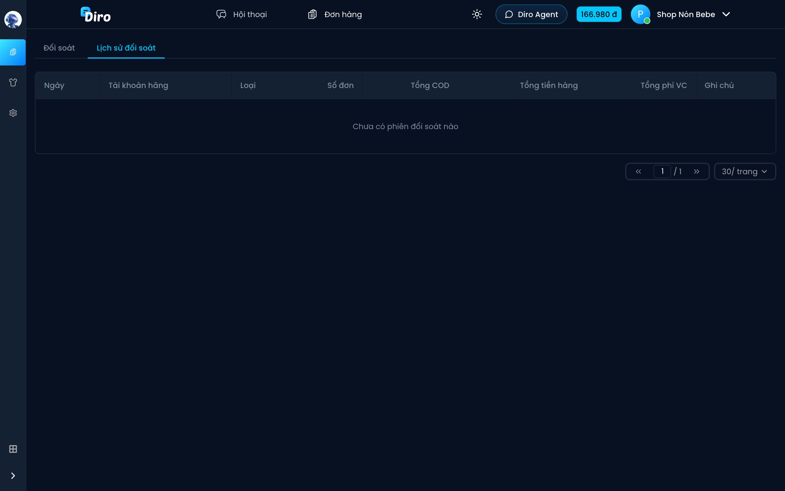

# Đối soát

**Đối soát** giúp bạn chốt sổ với đơn vị vận chuyển: với một lô đơn đã giao (hoặc đã hoàn), Diro cộng tổng COD, tổng tiền hàng, tổng phí ship, chi phí phụ và ra **lãi tạm tính** của lô đó, rồi lưu lại thành một phiên đối soát để xem về sau.

Mở bằng thanh bên trái: **Đơn hàng → Đối soát**. Trang này cần bạn đã kết nối ít nhất một tài khoản đơn vị vận chuyển; chưa kết nối thì Diro báo **Chưa có tài khoản đơn vị vận chuyển nào được kết nối.**

## Chọn đơn cần đối soát

1. Chọn nhóm đơn: **Đã giao hàng**, **Đã trả hàng** hoặc **Đã trả hàng một phần**. Số trong ngoặc là số đơn chưa đối soát.
2. **Đang vận đơn** chỉ để xem số lượng, không đối soát được: các đơn đang **Chờ lấy hàng**, **Chờ xử lý đơn**, **Đang vận chuyển**, **Đang trả hàng**… chưa có kết quả cuối.
3. Chọn **tài khoản vận chuyển** cần đối soát (nếu bạn có nhiều tài khoản/hãng).
4. Tick các đơn muốn đối soát rồi bấm **Đối soát (số đơn)**.
5. Hoặc bấm **Đối soát tất cả … đơn** để lấy hết đơn của nhóm đang chọn.

Bảng có các cột **ID, Khách hàng, Trạng thái, Tổng tiền, Sản phẩm, Tạo lúc, Phí vận chuyển**. Bấm biểu tượng bút cạnh phí vận chuyển để **Sửa phí vận chuyển** của một đơn. Phí tô màu cam là đơn chưa có phí vận chuyển.

## Nhập giá và hoàn thành

Sau khi bấm Đối soát, màn hình **Đối soát … đơn** hiện ra:

- **Giá từng loại mặt hàng** — mỗi sản phẩm/biến thể một dòng (**Mã SP, Mặt hàng, Số lượng, Đơn giá (tiền hàng)**). Giá mặc định lấy từ **Tiền hàng** bạn đã thiết lập; sửa lại nếu lô này nhập giá khác. Giá sửa ở đây chỉ lưu trong phiên đối soát, **không** đổi tiền hàng của sản phẩm.
- **Phí giao hàng mặc định** — chỉ bật khi có đơn chưa có phí vận chuyển; số bạn nhập sẽ áp cho các đơn đó.
- **Chi phí phụ trên mỗi đơn hàng** — hộp, băng keo, tem… nhân với số đơn.
- **Ghi chú đối soát**.
- Khung tổng: **Tổng COD**, trừ **Tổng tiền hàng**, **Tổng phí vận chuyển**, **Tổng chi phí phụ**, ra **Lãi tạm tính** (với nhóm đơn trả hàng chỉ có tiền hàng và phí ship).

Bấm **Hoàn Thành** để lưu phiên. Các đơn vừa đối soát rời khỏi danh sách chờ đối soát. Bấm **Quay lại** nếu muốn chọn lại đơn.

## Lịch sử đối soát

Tab **Lịch sử đối soát** liệt kê các phiên đã làm: **Ngày, Tài khoản hãng, Loại** (giao thành công màu xanh, trả hàng màu đỏ), **Số đơn, Tổng COD, Tổng tiền hàng, Tổng phí VC, Ghi chú**. Bấm vào một phiên để xem chi tiết giá từng mặt hàng và các khoản tổng.
