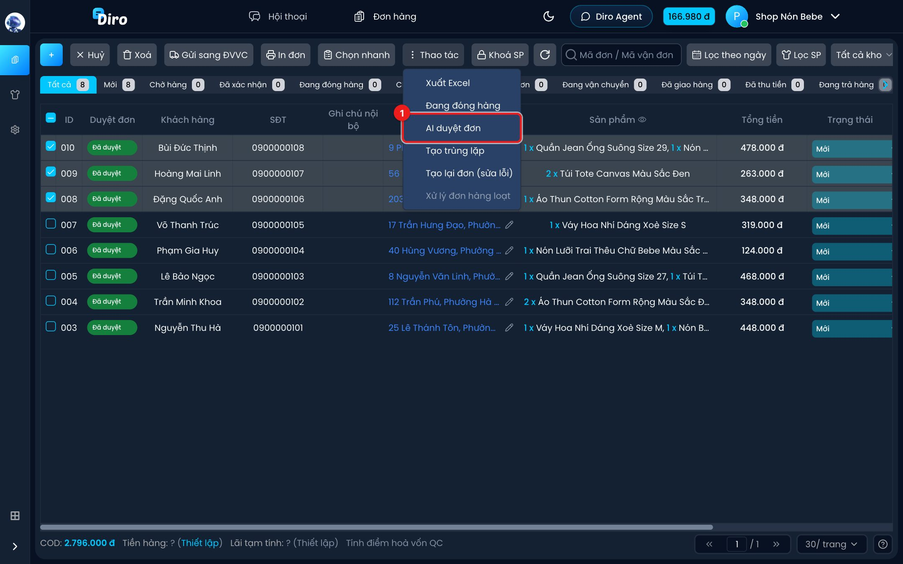
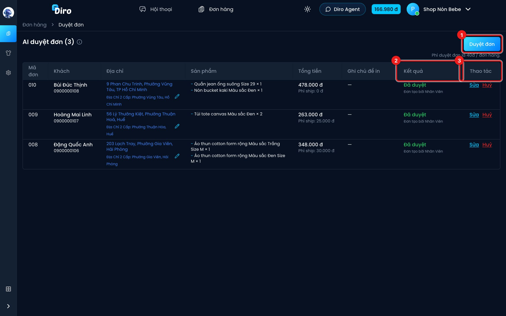

# AI duyệt đơn

Đơn do Chat Agent tạo trong lúc chat có thể sai sót (nhầm size, sai giá, thiếu địa chỉ…). Trước khi gửi hàng, bạn nên duyệt lại. **AI duyệt đơn** dùng một AI mạnh hơn đọc lại toàn bộ hội thoại, so với đơn và tự sửa chỗ sai, giúp bạn duyệt hàng trăm đơn trong vài phút.

## Bước 1: Chọn đơn cần duyệt

1. Ở danh sách đơn (thường là tab **Mới**), bấm **Chọn nhanh → Chưa duyệt** để tick các đơn chưa duyệt, hoặc tự tick.
2. Bấm **Thao tác → AI duyệt đơn** (1). Trang **AI duyệt đơn** mở ra ở tab mới.

## Bước 2: Chạy duyệt

1. Bấm **Duyệt đơn**. Phí là **40đ / đơn hàng**, trừ vào ví Diro. Góc phải dưới hiện tiến độ **Đã duyệt x/y đơn**.
2. Cột **Kết quả** cho biết từng đơn:
   - **Đã duyệt — Chat Agent đã tạo đơn đúng**: đơn không có gì sai.
   - **Đã duyệt — Chat Agent tạo đơn không đúng, đã sửa**: AI đã sửa đơn cho khớp hội thoại. Nên xem lại các cột sản phẩm, tiền, địa chỉ.
   - **Duyệt thất bại — Cần nhân viên duyệt đơn hàng này**: AI không chắc chắn, bạn cần tự kiểm tra (rê chuột để xem lý do).
   - **Đã duyệt — Đơn tạo bởi Nhân Viên**: đơn tạo tay, không cần AI duyệt.
   - **Đã duyệt — Nhân viên đã sửa đơn**: đơn từng duyệt thất bại nhưng bạn đã sửa và lưu.
   - **Đã huỷ**, hoặc **Chưa chạy** (chưa bấm duyệt).
3. Cột **Thao tác**: **Sửa** để mở nhanh form sửa đơn ngay trên trang này, **Huỷ** để huỷ đơn (có hỏi lại **Đồng ý huỷ đơn**).

Ở cột **Địa chỉ** có thêm dòng **Địa Chỉ 2 Cấp** (địa chỉ theo cách chia mới) và nút bút chì để sửa địa chỉ.

## Lưu ý

- Đơn đã ở trạng thái **Đã duyệt** sẽ không bị duyệt lại (trừ đơn thất bại do lỗi hệ thống), nên bạn không mất phí hai lần.
- Không đủ số dư ví thì Diro báo **Không thể duyệt đơn**. Nạp thêm tiền rồi bấm lại.
- Tải lại trang (F5) vẫn giữ nguyên danh sách đơn đang duyệt.
- Ở danh sách đơn, cột **Duyệt đơn** đổi sang **Đã duyệt** cho các đơn AI duyệt thành công.
