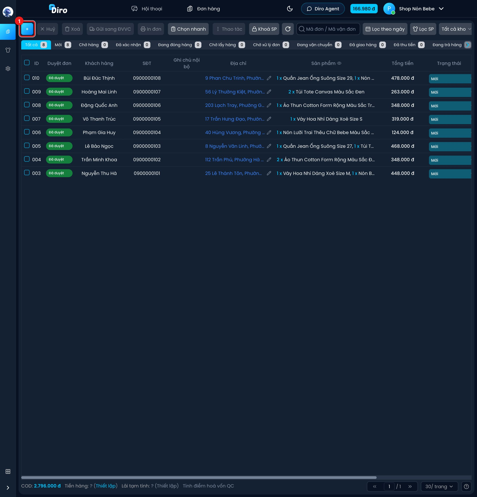
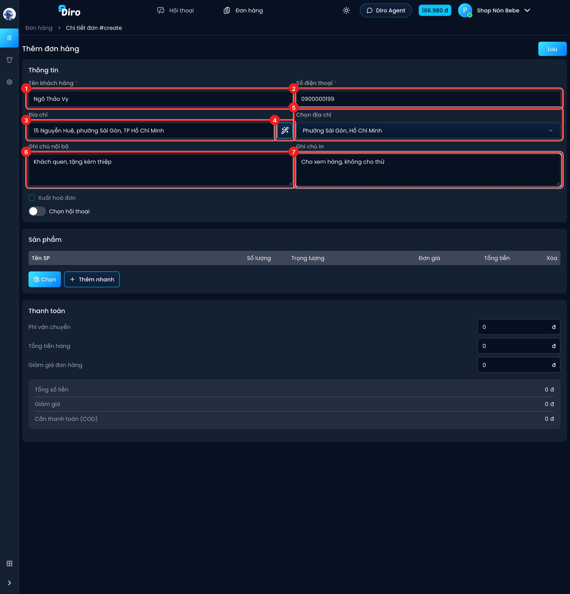
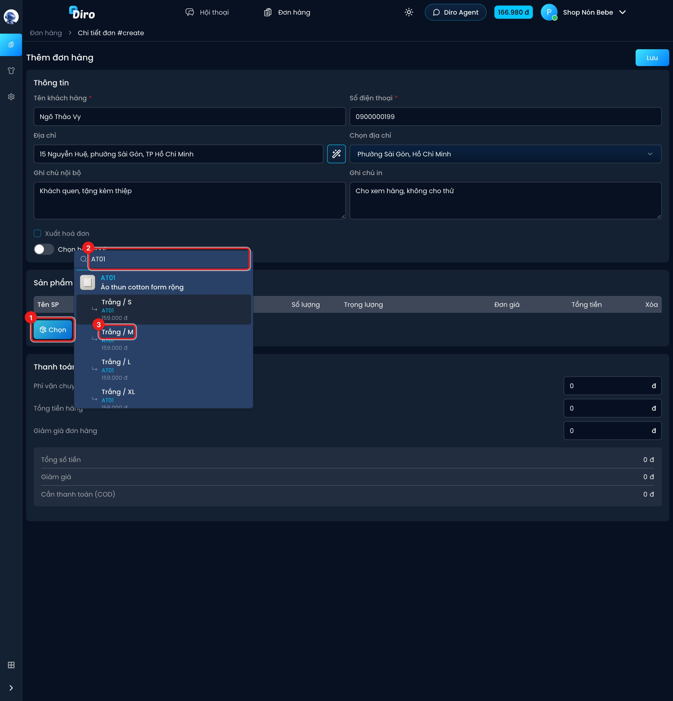
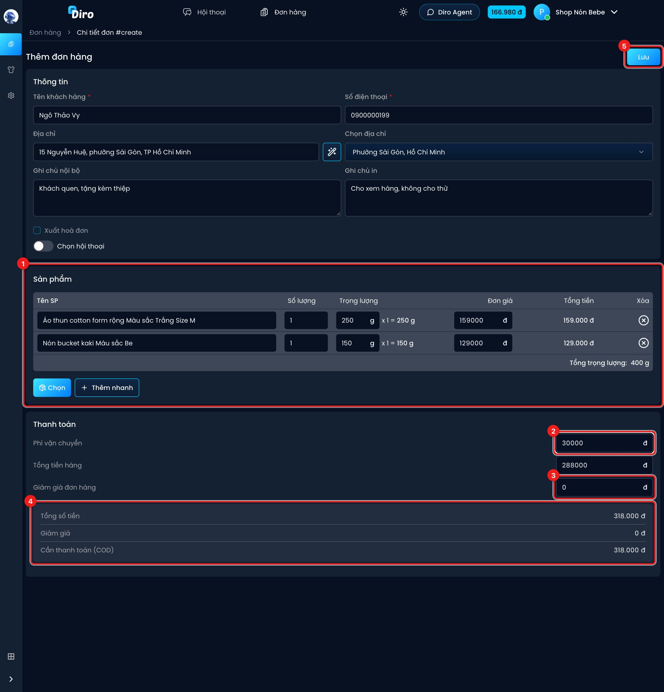

# Tạo đơn thủ công

Chat Agent tự lên đơn khi khách chốt trong Messenger. Với khách gọi điện, nhắn Zalo hoặc mua trực tiếp, bạn tự tạo đơn bằng tay theo các bước dưới đây. Đơn tạo tay được tính là **Đã duyệt** ngay.

## Bước 1: Mở form tạo đơn

Ở trang **Đơn hàng**, bấm nút **+** (1) ở góc trái thanh công cụ. Trang **Thêm đơn hàng** hiện ra.

## Bước 2: Nhập thông tin khách

1. **Tên khách hàng** (bắt buộc).
2. **Số điện thoại** (bắt buộc).
3. **Địa chỉ** — gõ cả địa chỉ trên một dòng, ví dụ `15 Nguyễn Huệ, phường Sài Gòn, TP Hồ Chí Minh`.
4. **Đũa phép** (**Tự động chọn địa chỉ**) — Diro tự tách địa chỉ ra tỉnh/thành và phường/xã. Diro cũng tự làm việc này khi bạn bấm ra khỏi ô địa chỉ.
5. **Chọn địa chỉ** — kiểm tra kết quả tách địa chỉ, chọn lại bằng tay nếu sai. Nếu Diro báo **Không tách được địa chỉ** hoặc **Địa chỉ có phường/xã trùng tên**, hãy chọn phường/xã ở ô này.
6. **Ghi chú nội bộ** — chỉ shop thấy, không gửi đi đâu.
7. **Ghi chú in** — gửi sang đơn vị vận chuyển và in trên tem (ví dụ "Cho xem hàng, không cho thử").

Bên dưới còn có:

- **Xuất hoá đơn** — tick để xuất hoá đơn điện tử cho đơn này (chỉ bấm được khi bạn đã thiết lập hoá đơn điện tử).
- **Chọn hội thoại** — bật lên để gắn đơn vào một hội thoại Messenger có cùng số điện thoại. Cần nhập số điện thoại trước. Đơn gắn hội thoại sẽ có nút mở nhanh hội thoại ở danh sách đơn.

## Bước 3: Chọn sản phẩm

1. Bấm **Chọn**.
2. Gõ mã hoặc tên sản phẩm vào ô tìm kiếm.
3. Bấm đúng biến thể (màu, size) khách đặt.

Lặp lại cho từng sản phẩm. Nếu khách mua món chưa có trong danh mục, bấm **Thêm nhanh** để thêm một dòng và tự gõ tên, giá.

## Bước 4: Kiểm tra số lượng, tiền và lưu

1. **Sản phẩm** — sửa **Số lượng**, **Trọng lượng** (gram, dùng khi gửi hãng vận chuyển), **Đơn giá** nếu cần. Bấm **⊗** ở cột **Xóa** để bỏ một dòng. Dòng **Tổng trọng lượng** cộng sẵn cho bạn.
2. **Phí vận chuyển** — phí ship thu của khách. **Tổng tiền hàng** tự cộng từ các dòng sản phẩm, bạn vẫn sửa được.
3. **Giảm giá đơn hàng** — số tiền giảm cho khách (nếu có).
4. Khung tổng: **Tổng số tiền** = tiền hàng + phí ship, trừ **Giảm giá**, ra **Cần thanh toán (COD)** — số tiền bưu tá sẽ thu của khách.
5. Bấm **Lưu**. Diro báo **Đã tạo đơn thành công** và đơn mới nằm ở tab **Mới**.

## Lưu ý

- Sửa tên một sản phẩm lấy từ danh mục thì dòng đó trở thành "sản phẩm tự do", không còn gắn với sản phẩm trong danh mục nữa.
- Đơn vừa tạo chưa được gửi đi đâu. Muốn gửi hàng, chọn đơn ở danh sách rồi bấm **Gửi sang ĐVVC** (xem mục Vận chuyển).
