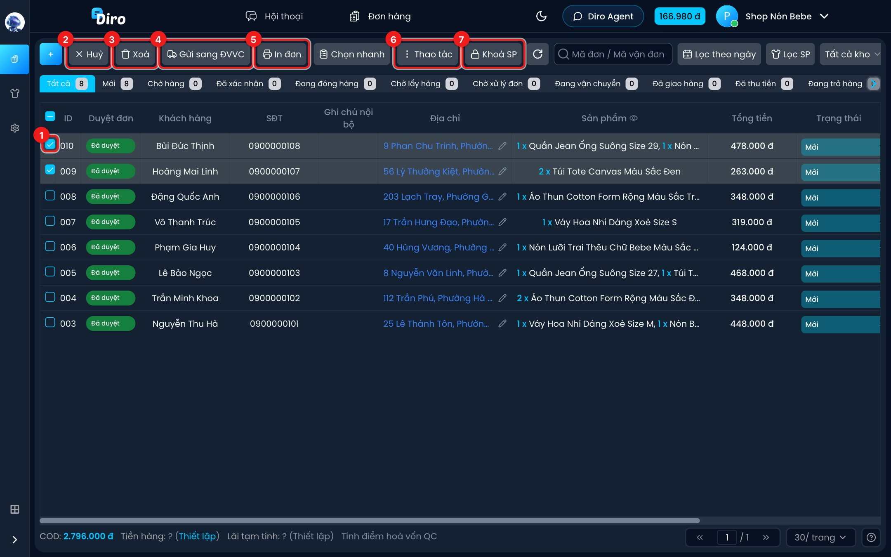
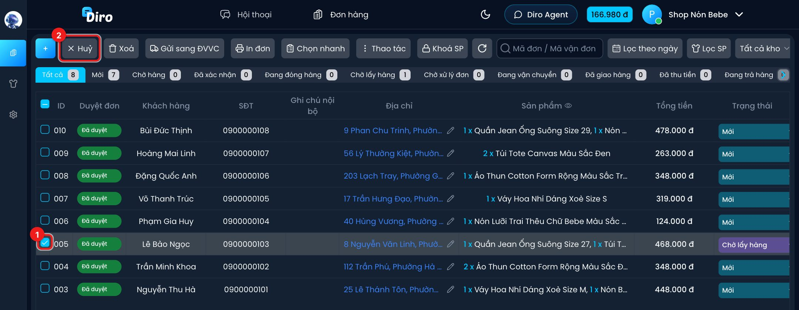
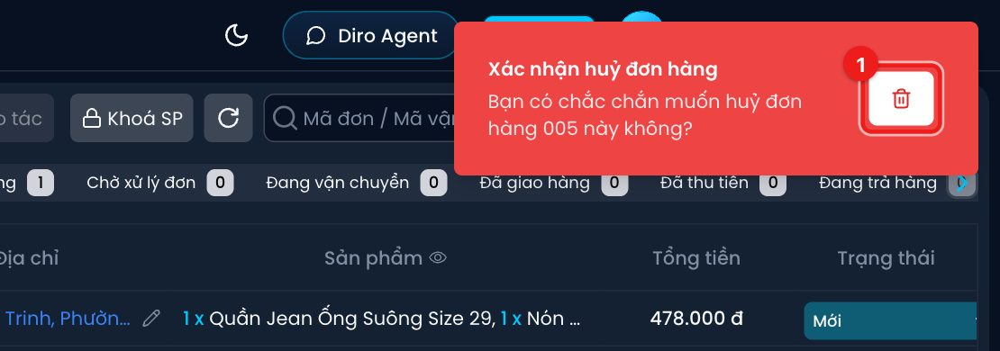
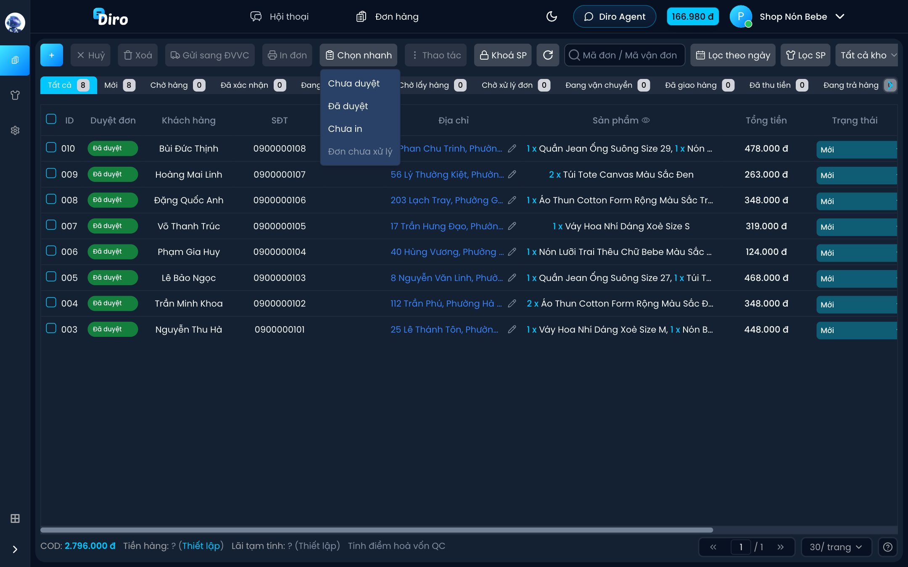
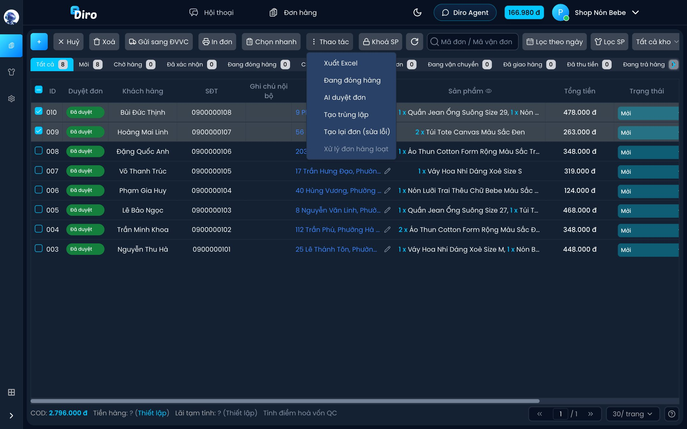
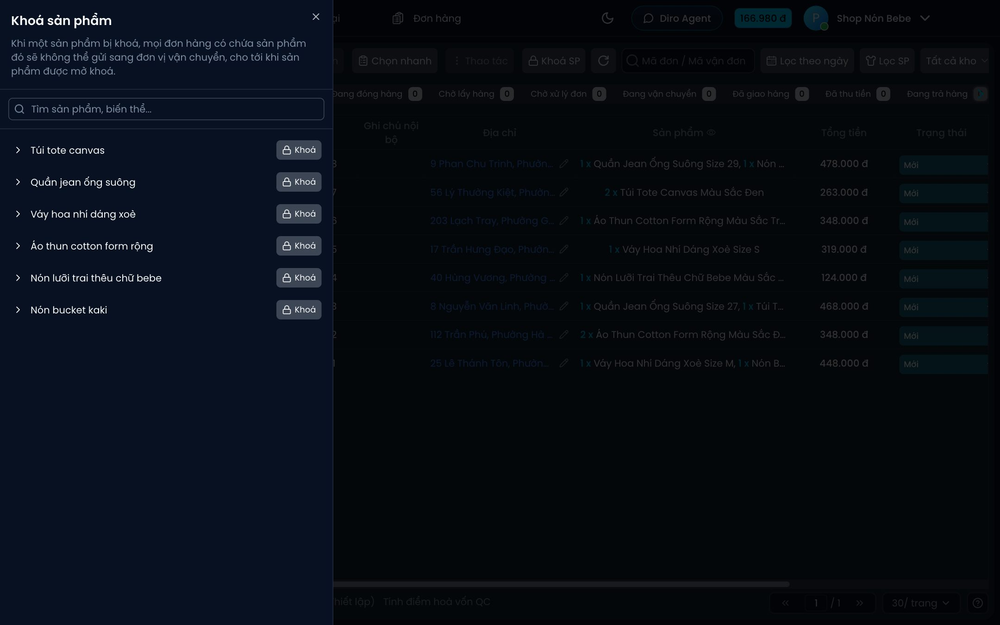

# Thao tác với nhiều đơn

Khi có nhiều đơn cần xử lý giống nhau (in tem, gửi hàng, huỷ…), bạn tick chọn các đơn rồi dùng các nút trên thanh công cụ thay vì làm từng đơn.

## Chọn đơn

1. Tick ô vuông đầu dòng của từng đơn. Tick ô ở tiêu đề cột để chọn cả trang.

Khi đã chọn ít nhất một đơn, các nút sau sáng lên:

2. **Huỷ** — huỷ các đơn đã chọn. Diro hỏi **Xác nhận huỷ đơn hàng** trước khi làm. Đơn huỷ chuyển sang tab **Đã hủy**.
3. **Xoá** — xoá các đơn đã chọn, có hỏi xác nhận. Đơn xoá chuyển sang tab **Đã xóa**.
4. **Gửi sang ĐVVC** — tạo vận đơn với hãng vận chuyển cho các đơn đã chọn. Đơn đang bị khoá sẽ tự bị bỏ ra khỏi lô. Chi tiết xem mục Vận chuyển.
5. **In đơn** — in tem vận đơn cho các đơn đã chọn. Chi tiết xem mục In đơn & nhãn.
6. **Thao tác** — menu các thao tác khác (xem [bên dưới](#menu-thao-tac)).
7. **Khoá SP** — khoá sản phẩm (không cần chọn đơn, xem [bên dưới](#khoa-sp)).

:::caution
Sau khi in hoặc gửi hàng xong, Diro tự bỏ tick các đơn vừa xử lý. Nếu bạn tự tick lại, hãy để ý nút **Huỷ** đứng ngay đầu thanh công cụ: nó áp dụng cho **mọi** đơn đang được tick.
:::

### Huỷ đơn

1. Tick đơn cần huỷ.
2. Bấm **Huỷ**.

Góc trên bên phải hiện thông báo **Xác nhận huỷ đơn hàng**. Bấm biểu tượng thùng rác (1) để huỷ;
bỏ qua thông báo thì không có gì thay đổi.

- Đơn **chưa gửi** sang hãng vận chuyển: chuyển ngay sang **Đã hủy**.
- Đơn đang **Chờ lấy hàng**: Diro **huỷ luôn vận đơn bên hãng** rồi mới chuyển đơn sang **Đã hủy**.
  Nếu hãng không cho huỷ, đơn giữ nguyên trạng thái và Diro báo lỗi.
- Đơn hãng **đã lấy hàng**: không huỷ được trên Diro, bạn cần liên hệ hãng để chặn giao hoặc hoàn hàng.

## Chọn nhanh

**Chọn nhanh** tick sẵn giúp bạn các đơn **đang hiển thị** thoả điều kiện (bỏ hết tick cũ trước):

- **Chưa duyệt** — đơn Chat Agent tạo chưa được duyệt.
- **Đã duyệt**.
- **Chưa in** — đơn đã có vận đơn nhưng chưa in tem.
- **Đơn chưa xử lý** — chỉ dùng được ở tab **Chờ xử lý đơn**: đơn bị hãng tạm giữ mà shop chưa xử lý.

Chọn nhanh không lọc bảng, chỉ tick. Ví dụ hay dùng: ở tab **Chờ lấy hàng**, bấm **Chọn nhanh → Chưa in** rồi bấm **In đơn**.

## Menu Thao tác {#menu-thao-tac}

- **Xuất Excel** — xuất các đơn đã chọn ra file Excel theo mẫu Viettel Post. Bạn chọn **Dịch vụ vận chuyển** (bắt buộc) và **Dịch vụ vận chuyển mở rộng** rồi bấm **Xuất Excel**.
- **Đang đóng hàng** — chuyển cả lô sang trạng thái **Đang đóng hàng** (có hỏi xác nhận).
- **AI duyệt đơn** — mở trang [AI duyệt đơn](./duyet-don-ai.md) ở tab mới với các đơn đã chọn.
- **Tạo trùng lặp** và **Tạo lại đơn (sửa lỗi)** — xem bên dưới.
- **Xử lý đơn hàng loạt** — chỉ dùng được ở tab **Chờ xử lý đơn**: xử lý cùng lúc nhiều đơn bị hãng vận chuyển tạm giữ.

### Tạo trùng lặp và Tạo lại đơn (sửa lỗi) {#tao-trung-lap-va-tao-lai-don}

Cả hai đều tạo một đơn mới giống hệt đơn cũ, nhưng dùng cho hai việc khác nhau:

| | **Tạo trùng lặp** | **Tạo lại đơn (sửa lỗi)** |
| --- | --- | --- |
| Khi nào dùng | Khách **mua thêm một lần nữa** | Đơn cũ **bị hỏng**: sai địa chỉ, vận đơn lỗi, phải gửi lại hãng |
| Ngày của đơn mới | Ngày giờ hiện tại, tính vào doanh số hôm nay | **Giữ nguyên ngày giờ của đơn gốc**, doanh số không bị cộng thêm |
| Báo lượt mua cho Facebook | **Có**, như một lượt mua mới | **Không** |

Khi tạo trùng lặp, Diro bắt bạn tick xác nhận "thông tin đơn hàng mới sẽ được gửi về cho Meta" trước khi làm, để tránh dùng nhầm làm số liệu quảng cáo bị thổi lên.

Với **Tạo lại đơn (sửa lỗi)**, đơn gốc **không tự bị xoá**: bạn tự huỷ vận đơn cũ ở hãng (nếu có) rồi xoá đơn cũ.

## Khoá SP {#khoa-sp}

Khi một sản phẩm bị khoá, **mọi đơn có chứa sản phẩm đó sẽ không gửi sang đơn vị vận chuyển được** cho tới khi bạn mở khoá. Dùng khi hàng chưa về, hàng lỗi cần kiểm tra lại…

1. Bấm **Khoá SP** trên thanh công cụ.
2. Tìm sản phẩm, bấm **Khoá** ở dòng sản phẩm để khoá cả sản phẩm, hoặc bấm mũi tên **>** rồi khoá riêng từng biến thể (ví dụ chỉ size M).
3. Bấm lại nút đó (lúc này là **Mở khoá**) để mở.

Các đơn bị ảnh hưởng hiện mờ trong danh sách; rê chuột vào dòng sẽ thấy "Đơn hàng bị khoá vì sản phẩm … đang bị khoá". Danh sách chỉ có sản phẩm còn hàng, riêng sản phẩm đang khoá thì luôn hiện để bạn mở được.
