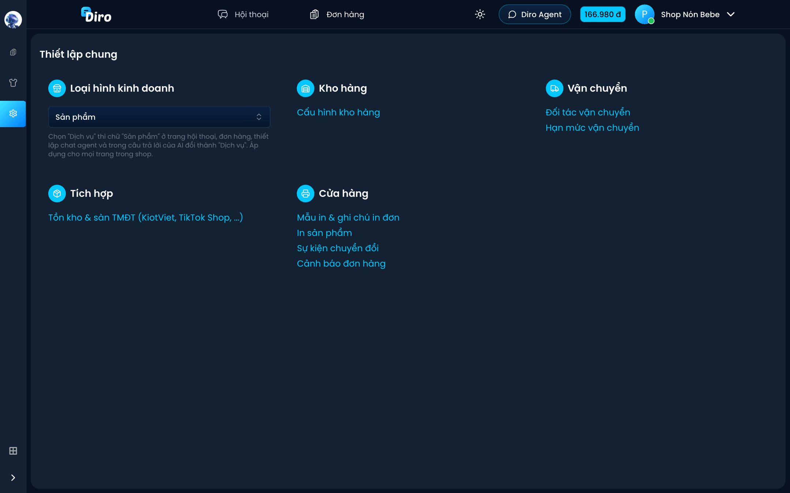

# Thiết lập chung

Bấm **Thiết lập** (biểu tượng bánh răng) ở thanh bên trái của mục Đơn hàng để mở trang **Thiết lập chung**. Đây là nơi tập trung các cài đặt liên quan tới đơn hàng của trang.

- **Loại hình kinh doanh** — chọn **Sản phẩm** hoặc **Dịch vụ**. Chọn **Dịch vụ** thì chữ "Sản phẩm" ở trang hội thoại, đơn hàng, thiết lập Chat Agent và trong câu trả lời của AI đổi thành "Dịch vụ". Áp dụng cho mọi trang trong shop. Thay đổi được lưu **ngay khi chọn**. Trang thuộc một shop thì theo loại hình của shop, không đổi riêng được.
- **Kho hàng → Cấu hình kho hàng** — tạo các kho, gán sản phẩm vào kho (xem mục Sản phẩm & kho).
- **Vận chuyển** — **Đối tác vận chuyển** (kết nối SPX, Viettel Post, J&T…) và **Hạn mức vận chuyển** (xem mục Vận chuyển).
- **Tích hợp → Tồn kho & sàn TMĐT (KiotViet, TikTok Shop, ...)** — xem mục Tích hợp.
- **Cửa hàng**:
  - **Mẫu in & ghi chú in đơn** và **In sản phẩm** — xem mục In đơn & nhãn.
  - **Sự kiện chuyển đổi** — chọn trạng thái đơn nào thì báo lượt mua cho Facebook.
  - **Cảnh báo đơn hàng** — xem [Cảnh báo đơn hàng](./canh-bao-don.md).

Mục **Sản phẩm** và **Thiết lập** chỉ chủ tài khoản thấy; nhân viên được phân quyền chỉ thấy các trang đơn hàng.
