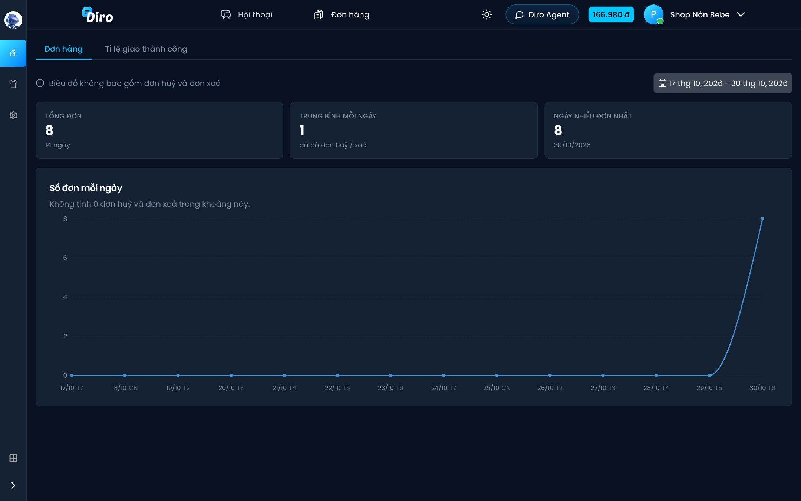
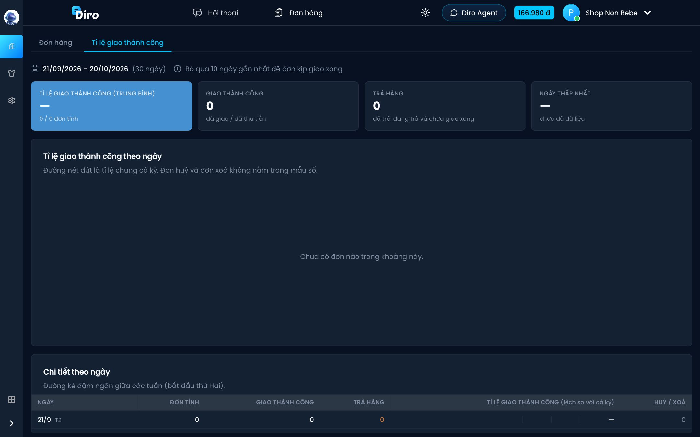

# Tổng quan

Trang **Tổng quan** (thanh bên trái: **Đơn hàng → Tổng quan**) cho bạn nhìn nhanh số đơn mỗi ngày và tỉ lệ khách nhận hàng thành công.

## Tab Đơn hàng

- Bấm ô ngày ở góc phải để chọn khoảng ngày cần xem (mặc định 14 ngày gần nhất).
- **Tổng đơn** — tổng số đơn trong khoảng đã chọn.
- **Trung bình mỗi ngày** — số đơn trung bình một ngày.
- **Ngày nhiều đơn nhất** — ngày bán chạy nhất và số đơn hôm đó.
- Biểu đồ **Số đơn mỗi ngày** — rê chuột vào từng điểm để xem số đơn của ngày đó.

Mọi con số và biểu đồ **không tính đơn huỷ và đơn xoá**.

## Tab Tỉ lệ giao thành công

Tab này cho biết trong số đơn đã gửi đi, bao nhiêu phần trăm khách nhận hàng.

- Khoảng thời gian **cố định 30 ngày**, kết thúc ở **10 ngày trước hôm nay**. Diro bỏ qua 10 ngày gần nhất để các đơn kịp giao xong, nếu không tỉ lệ sẽ bị thấp giả.
- **Tỉ lệ giao thành công (trung bình)** — số đơn giao thành công / số đơn được tính.
- **Giao thành công** — đơn **Đã giao hàng** hoặc **Đã thu tiền**.
- **Trả hàng** — đơn đã trả, đang trả và chưa giao xong.
- **Ngày thấp nhất** — ngày có tỉ lệ thấp nhất (kèm ngày cao nhất).
- Biểu đồ **Tỉ lệ giao thành công theo ngày** — đường nét đứt là tỉ lệ chung cả kỳ.
- Bảng **Chi tiết theo ngày** — mỗi ngày một dòng: số đơn tính, giao thành công, trả hàng, tỉ lệ (và lệch bao nhiêu so với cả kỳ), số đơn huỷ/xoá. Đường kẻ đậm ngăn giữa các tuần (bắt đầu thứ Hai).

Đơn huỷ và đơn xoá không nằm trong mẫu số.

:::tip
Tỉ lệ giao thành công ở đây là con số tốt để điền vào ô **Tỉ lệ giao thành công** khi thiết lập **Lãi tạm tính** ở danh sách đơn.
:::
