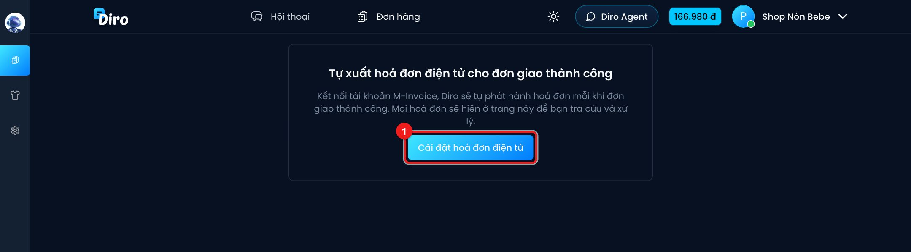
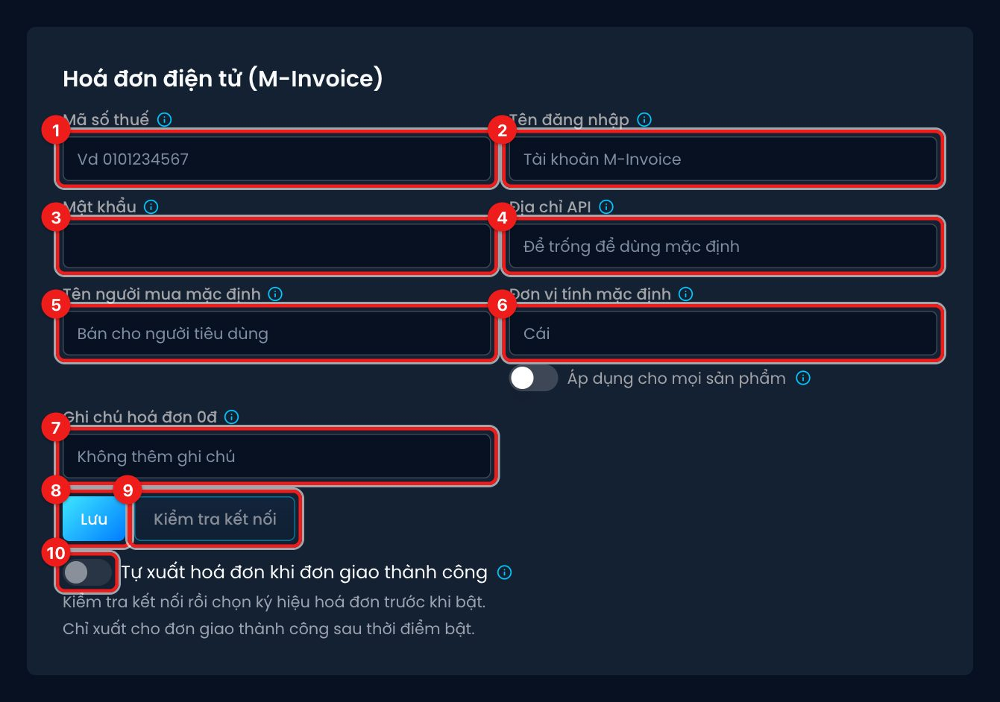

# Kết nối M-Invoice

Bạn khai báo tài khoản M-Invoice một lần trong trang **Tài khoản**. Thiết lập này áp dụng cho
**mọi trang** thuộc tài khoản của bạn.

## Mở phần thiết lập

Cách nhanh nhất: vào **Đơn hàng → Hoá đơn**. Khi chưa kết nối, trang hiện lời giới thiệu và nút:

1. Bấm **Cài đặt hoá đơn điện tử**. Diro mở trang **Tài khoản**, kéo xuống khung
   **Hoá đơn điện tử (M-Invoice)**.

Bạn cũng có thể bấm tên tài khoản ở góc trên bên phải, chọn trang tài khoản rồi kéo xuống.

## Điền thông tin

1. **Mã số thuế**: 10 số, hoặc 12 số (hộ kinh doanh dùng số CCCD). Chi nhánh thì thêm `-` và
   3 số, ví dụ `0101234567-001`.
2. **Tên đăng nhập**: tài khoản đăng nhập M-Invoice (không phải tài khoản Diro).
3. **Mật khẩu** M-Invoice. Diro mã hoá trước khi lưu. Đã lưu rồi thì để trống nếu không đổi.
4. **Địa chỉ API**: để trống để dùng địa chỉ mặc định `https://<mã số thuế>.minvoice.app/api/`.
   Chỉ điền khi M-Invoice cấp cho bạn địa chỉ khác.
5. **Tên người mua mặc định**: dùng khi đơn không có tên khách. Mặc định "Bán cho người tiêu dùng".
6. **Đơn vị tính mặc định**: ví dụ "Cái". Bật **Áp dụng cho mọi sản phẩm** nếu muốn mọi dòng
   hàng dùng đơn vị này. Không bật thì sản phẩm nào có **Đơn vị tính trên đơn** riêng sẽ dùng
   đơn vị của sản phẩm.
7. **Ghi chú hoá đơn 0đ**: dòng ghi chú in trên hoá đơn của đơn 0 đồng (hàng đền bù, quà tặng).
   Ví dụ "Hàng đền bù không thu tiền". Để trống thì không thêm ghi chú.
8. Bấm **Lưu**.
9. Bấm **Kiểm tra kết nối**. Diro đăng nhập thử vào M-Invoice và lấy danh sách ký hiệu hoá
   đơn. Thành công sẽ hiện thông báo **Kết nối M-Invoice thành công** và ô **Ký hiệu hoá đơn**.
   Chọn ký hiệu bạn muốn dùng, ví dụ `2C26MDR`.
10. Bật **Tự xuất hoá đơn khi đơn giao thành công**. Công tắc này chỉ bật được sau khi đã
    kiểm tra kết nối và chọn ký hiệu.

:::caution Chỉ xuất cho đơn giao thành công SAU thời điểm bật
Dưới công tắc có dòng **Đã bật lúc …**. Đơn đã giao thành công trước thời điểm đó sẽ **không**
được xuất hoá đơn. Diro không xuất bù hàng loạt cho đơn cũ.
:::

## Lưu ý

- Khi còn hoá đơn **Đang xuất** hoặc **Lỗi xuất**, bạn không đổi được Mã số thuế và Địa chỉ API.
  Hãy xử lý xong các hoá đơn đó trước.
- Đổi Mã số thuế, Địa chỉ API hoặc Tên đăng nhập thì phải nhập lại Mật khẩu.
- Nếu có hoá đơn lỗi trong 30 ngày gần nhất, khung này hiện dòng cảnh báo **Có … hoá đơn xuất
  lỗi trong 30 ngày qua**.
- Tắt công tắc thì Diro ngừng xuất hoá đơn cho đơn giao thành công từ lúc đó.
