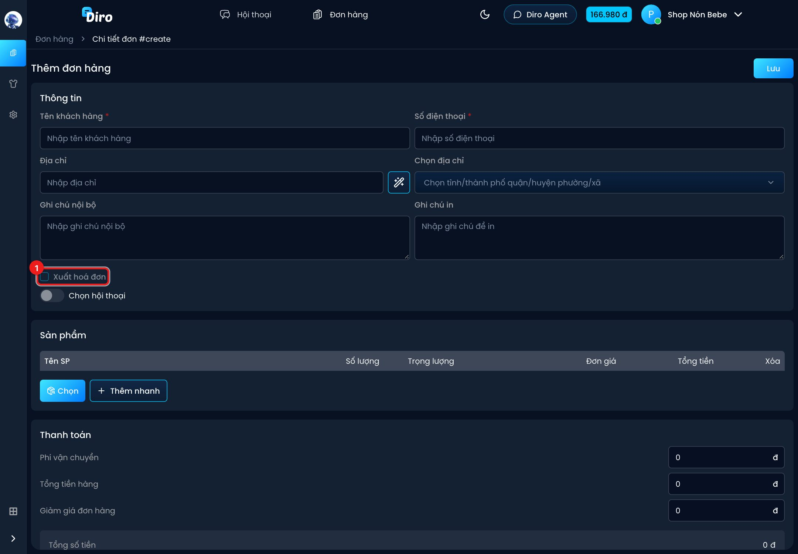

# Xuất hoá đơn cho đơn hàng

Sau khi đã [kết nối M-Invoice](./ket-noi-m-invoice.md) và bật tự xuất, bạn chọn đơn nào cần
hoá đơn bằng ô **Xuất hoá đơn**, và đặt tên hàng sẽ in trên hoá đơn.

## Ô "Xuất hoá đơn" trên đơn hàng

Ô này có ở form **Thêm đơn hàng**, form sửa đơn và form tạo đơn trong khung chat.

1. **Xuất hoá đơn**: tick thì đơn sẽ được xuất hoá đơn khi giao thành công. Bỏ tick thì không.

- Khi bạn đã bật tự xuất hoá đơn, ô này **được tick sẵn** cho đơn mới.
- Khi chưa bật tự xuất (như trong ảnh), ô bị mờ, rê chuột vào sẽ thấy **Bạn chưa được thiết
  lập xuất hoá đơn**.
- Khi hoá đơn đã được gửi đi (Đang xuất, Chờ CQT, Thành công, CQT từ chối), ô bị khoá:
  **Đơn đã xuất hoá đơn, không bỏ tick được**.
- Tick lại cho một đơn **đã giao thành công** thì Diro xuất hoá đơn ngay.

## Tên hàng trên hoá đơn

Tên sản phẩm trên Diro thường dài, có cả combo và quà tặng. Trên hoá đơn, bạn nên ghi tên
hàng ngắn gọn, đúng hàng thật. Ví dụ combo "Combo 5 áo thun 2 nón lá" nên ra hai dòng
**Áo thun × 5** và **Nón lá × 2**.

Cách đặt:

1. Vào **Đơn hàng**. Khi đã bật tự xuất hoá đơn, thanh công cụ có nút **Nhập tên SP trên HĐ**.
   Nếu có sản phẩm trong bảng chưa có tên trên hoá đơn, nút có biểu tượng cảnh báo màu vàng.
2. Bấm nút để mở khung **Nhập tên SP trên hoá đơn**. Bảng gồm **Mã SP**, **Tên SP**,
   **Đơn giá** và **Tên trên hoá đơn × Số lượng**. Sản phẩm chưa có tên được tô vàng và xếp lên đầu.
3. Với mỗi sản phẩm, gõ tên trên hoá đơn và số lượng. Một sản phẩm có thể ra nhiều dòng hoá
   đơn: bấm **Thêm tên** để thêm dòng. Biến thể được đặt tên riêng, có ghi **(biến thể)**.
4. Bấm **Lưu**.

Tên trên hoá đơn được lưu theo chủ tài khoản và **dùng chung cho mọi trang**.

:::caution Thiếu tên thì không gửi được đơn sang hãng
Đơn có tick **Xuất hoá đơn** mà còn sản phẩm chưa có tên trên hoá đơn sẽ bị chặn khi **Gửi sang
ĐVVC**, với lỗi **Thiếu thông tin xuất hoá đơn, vui lòng bấm vào nhập tên SP trên HĐ**. Hãy
đặt tên trước khi gửi đơn.
:::

## Nội dung hoá đơn được lấy từ đâu

- **Người mua**: tên khách trên đơn (không có thì dùng **Tên người mua mặc định**), kèm SĐT và
  địa chỉ nếu có. Hình thức thanh toán ghi **TM/CK**.
- **Dòng hàng**: theo tên trên hoá đơn. Các dòng cùng tên được gộp lại. Quà tặng thành dòng
  khuyến mại.
- **Tổng tiền hoá đơn bằng đúng tổng tiền đơn**. Phí ship và giảm giá được chia vào các dòng
  hàng, không có dòng phí ship riêng.
- Đây là **hoá đơn bán hàng**, không có thuế GTGT.
- Diro **chưa hỗ trợ** hoá đơn cho công ty (không có ô mã số thuế, tên công ty người mua).
- Đơn 0 đồng: mọi dòng thành hàng khuyến mại, kèm **Ghi chú hoá đơn 0đ**.
