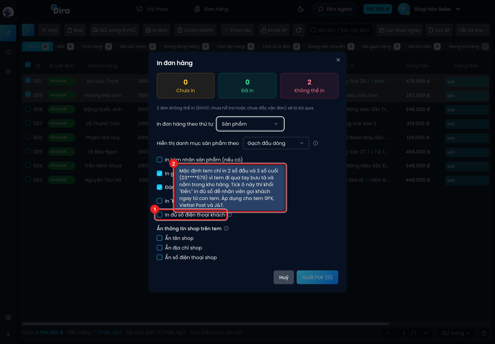

# In đủ số điện thoại khách trên tem

Mặc định, tem vận đơn Diro in ra **che bớt số điện thoại khách**: chỉ hiện 2 số đầu và 3 số cuối,
ví dụ `09****678`. Lý do: con tem đi qua tay bưu tá và nằm trong kho hãng, che số giúp bảo vệ
thông tin khách của bạn. Bưu tá vẫn gọi được khách qua app của hãng vận chuyển.

Nếu nhân viên đóng gói của bạn cần **gọi khách ngay từ con tem** (vd soạn xong mới phát hiện
thiếu hàng, sai màu), hãy bật in đủ số.

## Cách bật

1. Chọn đơn và bấm **In đơn** như trong [In tem vận đơn](./in-tem-van-don.md).
2. Trong hộp **In đơn hàng**, tick ô **In đủ số điện thoại khách** (1). Rê chuột vào biểu tượng
   ⓘ để xem giải thích (2).
3. Bấm **Xuất PDF**. Khối **Đến:** trên tem sẽ in đủ số điện thoại khách.

## Lưu ý

- Áp dụng cho tem **SPX Express**, **Viettel Post** và **J&T Express**.
- Lựa chọn được **nhớ trên trình duyệt** đang dùng: bật một lần, các lần in sau trên máy đó vẫn
  in đủ số cho tới khi bạn bỏ tick. Máy khác (hoặc trình duyệt khác) vẫn che số như mặc định.
- Tuỳ chọn này chỉ đổi cách in trên tem của Diro, **không** thay đổi số điện thoại đã gửi cho hãng
  vận chuyển.
- Muốn che bớt thông tin **của shop** (tên, địa chỉ, số điện thoại shop) thì dùng nhóm
  **Ẩn thông tin shop trên tem** ngay bên dưới trong cùng hộp in.
