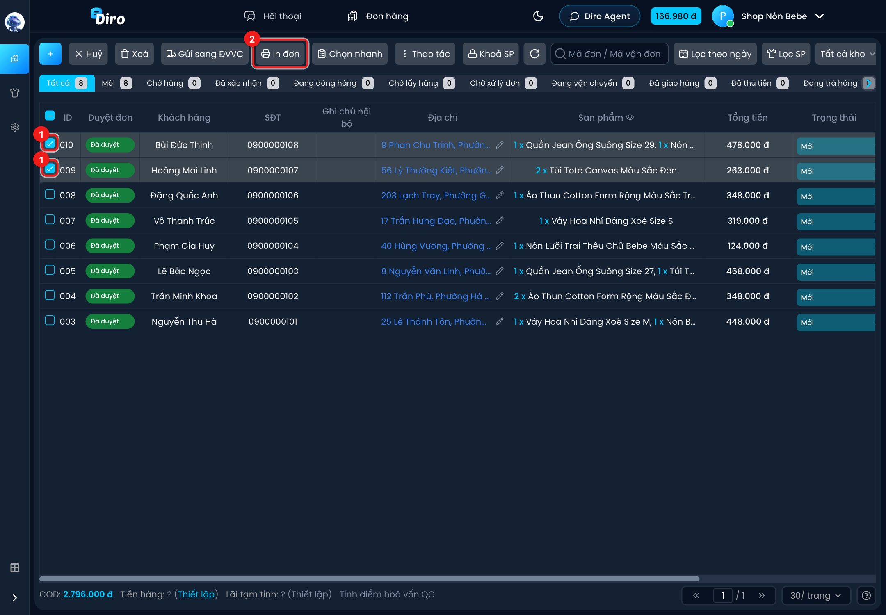
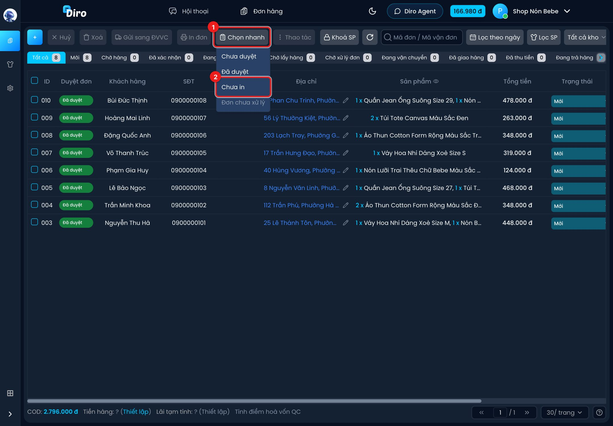
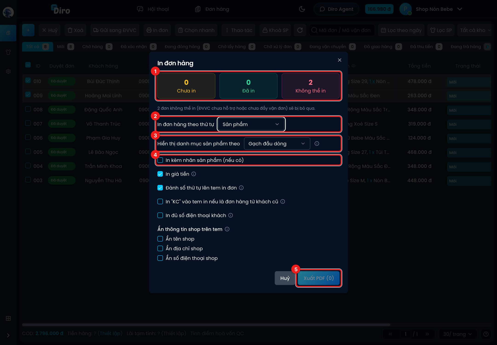
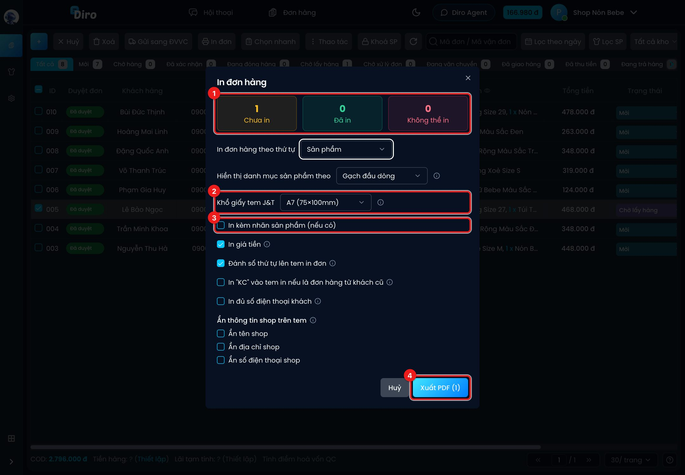
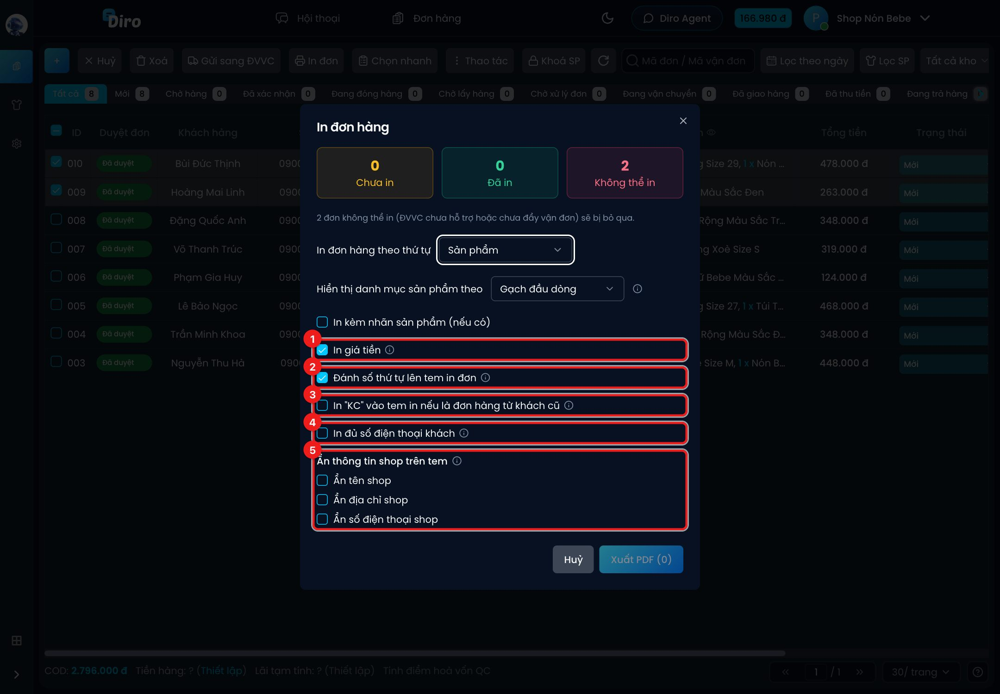

# In tem vận đơn

Sau khi gửi đơn sang đơn vị vận chuyển (Viettel Post, SPX Express, J&T Express), bạn in tem dán
lên gói hàng ngay trên Diro. Diro gom các tem thành **một file PDF khổ A7**, mỗi trang một tem,
để bạn in bằng máy in tem nhiệt.

## Bước 1: Chọn đơn cần in

Vào **Đơn hàng**, thường là tab **Chờ lấy hàng** (đơn đã có vận đơn, đang chờ bưu tá tới lấy).

1. Tick ô vuông đầu dòng của các đơn muốn in. Tick ô trên cùng để chọn cả trang.
2. Bấm **In đơn** trên thanh công cụ. Nút này chỉ bấm được khi đã chọn ít nhất 1 đơn.

:::tip Chọn nhanh các đơn chưa in
Bấm **Chọn nhanh** (1) → **Chưa in** (2): Diro tự tick mọi đơn trên trang đang có trạng thái
in là *Chưa in*, bạn không phải dò từng dòng.

:::

## Bước 2: Chọn cách in trong hộp "In đơn hàng"

1. **Ba ô đếm**: **Chưa in**, **Đã in** và **Không thể in**. Đơn *Không thể in* (chưa gửi sang
   ĐVVC, hoặc hãng chưa hỗ trợ in qua Diro) sẽ tự bị bỏ qua, không làm hỏng cả lô.
2. **In đơn hàng theo thứ tự**:
   - **Sản phẩm** (mặc định): Diro xếp đơn ít món lên trước, gom các đơn cùng sản phẩm, cùng
     biến thể (size/màu) đứng liền nhau — soạn hàng theo xấp tem sẽ nhanh và ít nhầm.
   - **Thời gian tạo đơn**: đơn tạo trước in trước.
3. **Hiển thị danh mục sản phẩm theo**: **Gạch đầu dòng** (`- Nón bucket kaki, SL: 1`) hoặc
   **Số thứ tự** (`1. Nón bucket kaki`). Gạch đầu dòng là mặc định vì số thứ tự dễ bị đọc nhầm
   thành số lượng.
4. **In kèm nhãn sản phẩm (nếu có)**: in thêm nhãn dán sản phẩm ngay sau tem của mỗi đơn. Xem
   [Nhãn sản phẩm](./nhan-san-pham.md).
5. **Xuất PDF (số đơn)**: tạo file PDF và tải về máy. Số trong ngoặc là số đơn sẽ được in.

Khi trong lô có đơn J&T, hộp này hiện thêm dòng **Khổ giấy tem J&T**: chọn **A7 (75×100mm)**
hoặc **Giấy J&T in sẵn logo (74×80)** — đúng loại cuộn giấy đang lắp trong máy in. Với cuộn J&T
in sẵn logo, tem trong file PDF bị xoay ngược là cố ý, để logo nằm đúng góc khi in ra.

Ví dụ trên là một đơn J&T vừa gửi: (1) đơn nằm ở ô **Chưa in**, (2) dòng **Khổ giấy tem J&T**
xuất hiện, (3) tick **In kèm nhãn sản phẩm** nếu muốn in cả nhãn, (4) bấm **Xuất PDF**.

### Các tuỳ chọn hiển thị trên tem

1. **In giá tiền** (mặc định bật): bỏ tick thì tem không in số tiền thu người nhận, thay bằng
   chữ nhỏ "Xem trên app".
2. **Đánh số thứ tự lên tem in đơn** (mặc định bật): mỗi tem có số 1, 2, 3… khoanh tròn ở góc
   trên bên phải, theo đúng thứ tự in. Nhãn sản phẩm in kèm không đánh số.
3. **In "KC" vào tem in nếu là đơn hàng từ khách cũ**: tem của khách đã từng mua có thêm chữ
   **KC** ở góc dưới bên phải (cạnh giá tiền) — tiện để bỏ thêm quà hay lời cảm ơn.
4. **In đủ số điện thoại khách**: mặc định tem che bớt số khách (`03****579`). Xem
   [In đủ số điện thoại khách trên tem](./in-so-dien-thoai-khach.md).
5. **Ẩn thông tin shop trên tem**: **Ẩn tên shop**, **Ẩn địa chỉ shop**, **Ẩn số điện thoại
   shop**. Tên và địa chỉ shop bị thay 2/3 phần đầu bằng `****`, chỉ còn phần đuôi; số điện
   thoại shop bị che giống số khách.

Mọi tuỳ chọn trên được **nhớ trên trình duyệt** bạn đang dùng — lần sau mở lại hộp in, Diro giữ
nguyên lựa chọn cũ. Đổi sang máy khác thì phải chọn lại.

## Bước 3: In file PDF

Bấm **Xuất PDF**. Diro tải về file tên dạng `diro_20261030_0915_12_don.pdf` (ngày, giờ, số đơn).
Mở file và in bằng máy in tem, khổ giấy **A7 75×100mm** (hoặc 74×80mm nếu dùng cuộn J&T in sẵn logo).

Khi tạo file xong, Diro:

- chuyển các đơn vừa in sang trạng thái in **Đã in**;
- tự bỏ tick các đơn vừa in và đóng hộp thoại.

:::warning Đóng hộp mà không in
Bấm **Huỷ** hoặc dấu ✕ để đóng hộp in thì **không có gì thay đổi** — đơn vẫn là *Chưa in* và
vẫn đang được tick. Lúc đó hãy cẩn thận: nút **Huỷ** đầu thanh công cụ (huỷ đơn) vẫn đang nhắm
vào các đơn đang tick.
:::

## In lại đơn đã in

Nếu lô bạn chọn có đơn đã in trước đó, hộp in hiện thêm ô vàng **Xác nhận in lại N đơn**. Nút
**Xuất PDF** bị khoá cho tới khi bạn tick ô này. In lại sẽ tạo thêm một tem trùng mã vận đơn, nên
chỉ tick khi thật sự cần (tem cũ bị rách, in lỗi…). Ô này **không** được nhớ — lần in nào có đơn
đã in cũng phải tick lại.

## Trạng thái in của đơn

- **Chưa in**: đơn vừa được gửi sang Viettel Post / SPX / J&T thành công.
- **Đã in**: đã xuất PDF qua Diro. Đơn chuyển sang *Đang vận chuyển* (hoặc xa hơn) cũng tự được
  coi là **Đã in**, vì nhiều shop in tem trên app của hãng.
- Để trống (không áp dụng): đơn chưa gửi sang ĐVVC, hoặc gửi qua hãng Diro chưa in được.
  Riêng J&T, vận đơn thiếu mã phân tuyến cũng không in được qua Diro.

Cột **Trạng thái in** tự hiện ở tab **Chờ lấy hàng**. Ở tab khác, bạn bật lại cột này trong
phần chọn cột hiển thị của bảng. Muốn sửa tay trạng thái in của một đơn, mở chi tiết đơn và đổi
ô **Trạng thái in**.
