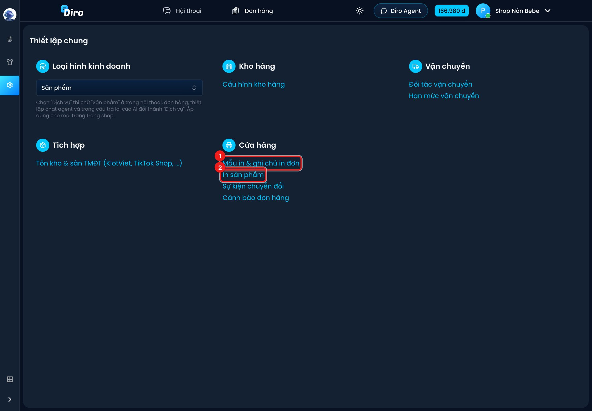
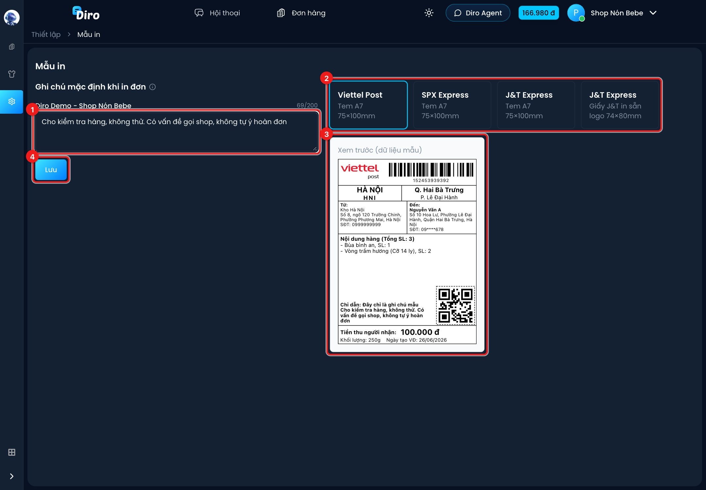
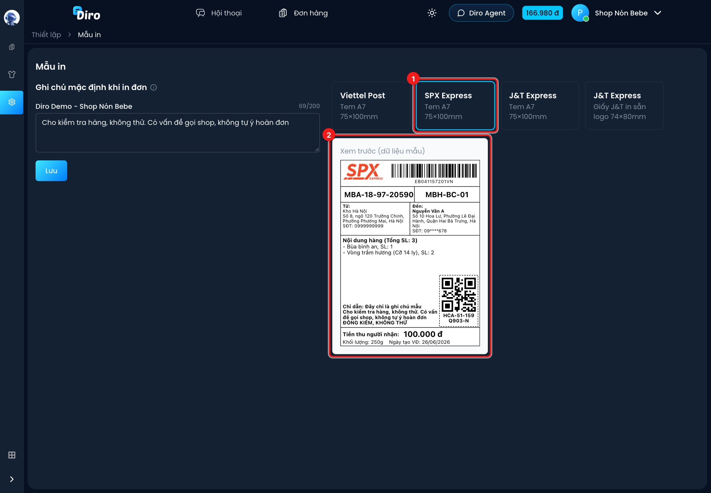
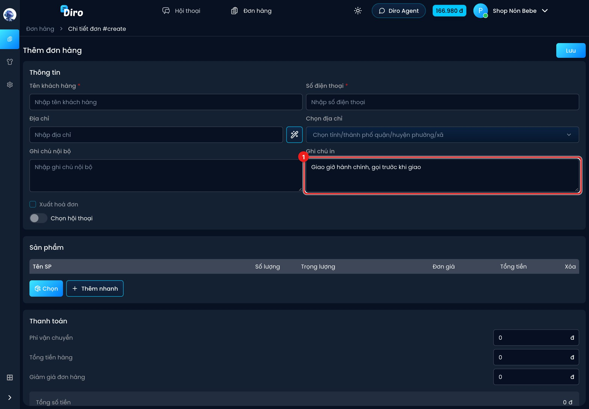
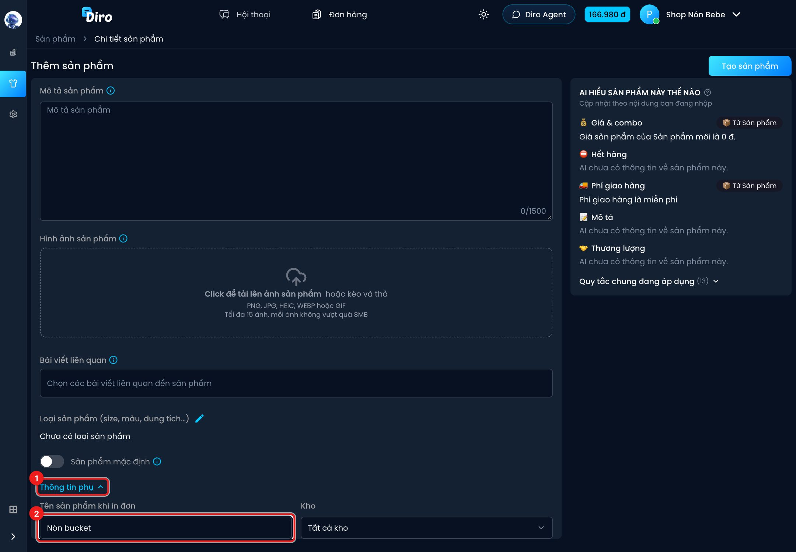

# Mẫu in & ghi chú in

Trang **Mẫu in** cho bạn xem trước con tem của từng hãng và đặt **ghi chú mặc định** — một câu
dặn bưu tá được in lên mọi tem của trang. Ngoài ra, mỗi đơn còn có ô **Ghi chú in** riêng, và mỗi
sản phẩm có thể có **tên ngắn khi in đơn**.

## Mở trang Mẫu in

Bấm biểu tượng **Thiết lập** (bánh răng) ở thanh bên trái. Trong khối **Cửa hàng**:

1. **Mẫu in & ghi chú in đơn** — trang Mẫu in (bên dưới).
2. **In sản phẩm** — trang nhãn sản phẩm, xem [Nhãn sản phẩm](./nhan-san-pham.md).

## Ghi chú mặc định khi in đơn

1. Gõ câu bạn muốn dặn bưu tá vào ô dưới tên trang, tối đa **200 ký tự**. Ví dụ: *Cho kiểm tra
   hàng, không thử. Có vấn đề gọi shop, không tự ý hoàn đơn.*
2. Chọn hãng để xem trước: **Viettel Post**, **SPX Express**, **J&T Express** (tem A7
   75×100mm) hoặc **J&T Express – Giấy J&T in sẵn logo 74×80mm**.
3. Khung **Xem trước (dữ liệu mẫu)** cập nhật ngay khi bạn gõ: câu của bạn nằm dưới dòng
   **Chỉ dẫn**. Nhờ vậy bạn thấy trước câu chiếm mấy dòng, có bị cắt không.
4. Bấm **Lưu**. Nút chỉ sáng lên khi bạn đã sửa nội dung.

Khung xem trước dùng **dữ liệu mẫu** (khách "Nguyễn Văn A", hàng mẫu) chứ không phải đơn thật.
Mỗi hãng có bố cục tem riêng; ví dụ tem SPX (ảnh trên) có thêm mã phân tuyến và dòng
"ĐỒNG KIỂM, KHÔNG THỬ".

:::info Ghi chú mặc định chỉ nằm trên tem
Câu này **chỉ được in lên tem**, không gửi sang hệ thống của đơn vị vận chuyển. Vùng ghi chú trên
tem có giới hạn số dòng (tem A7 khoảng 4 dòng), phần dư bị cắt và thêm dấu "…". Hãy viết ngắn gọn.
:::

**Shop có nhiều trang:** khi mở Mẫu in từ một shop, Diro hiện ô ghi chú của **shop** (áp dụng
cho mọi trang trong cửa hàng) và bên dưới là ô riêng cho **từng trang con**. Trang con để trống
thì dùng ghi chú của shop; điền vào thì đơn của trang đó dùng ghi chú riêng. Shop có hơn 5 trang
sẽ có thêm ô **Tìm trang theo tên...**.

## Ghi chú in của từng đơn

Mỗi đơn có ô **Ghi chú in** (ở form **Thêm đơn hàng**, form sửa đơn, và form tạo đơn trong khung
chat). Khác với ghi chú mặc định:

- Ghi chú in của đơn được **gửi sang đơn vị vận chuyển** cùng vận đơn, và khi in tem qua Diro
  nó hiện ở dòng **Chỉ dẫn: …**.
- Nó chỉ áp dụng cho **đúng đơn đó**.

1. Gõ nội dung vào ô **Ghi chú in**, ví dụ *Giao giờ hành chính, gọi trước khi giao*.

Đừng nhầm với **Ghi chú nội bộ** bên cạnh: ghi chú nội bộ chỉ để nhân viên shop đọc, **không**
in lên tem và không gửi cho hãng. Trên danh sách đơn, ghi chú in nằm ở cột **Ghi chú in**.

Vì ghi chú in đi theo vận đơn, hãy điền nó **trước khi bấm Gửi sang ĐVVC**.

## Tên sản phẩm khi in đơn

Tên sản phẩm dài (vd *Nón bucket kaki vành rộng chống nắng unisex*) làm khối **Nội dung hàng** trên
tem rối và dễ bị cắt. Bạn có thể đặt một tên ngắn chỉ dùng khi in:

1. Trong trang thêm/sửa sản phẩm, mở **Thông tin phụ**.
2. Điền **Tên sản phẩm khi in đơn**, ví dụ *Nón bucket*. Để trống thì dùng tên sản phẩm bình
   thường. Lưu sản phẩm như thường lệ.

Phần biến thể (màu, size…) **tự được nối vào sau** tên ngắn, nên đừng gõ màu/size vào ô này. Ví dụ
đơn mua màu Be sẽ in là *Nón bucket Màu sắc Be*. Tên ngắn này cũng được dùng làm tên hàng khi gửi
đơn sang đơn vị vận chuyển.
