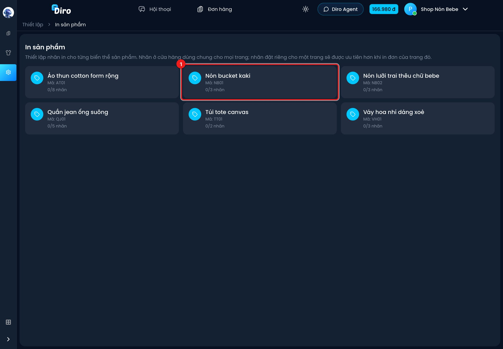
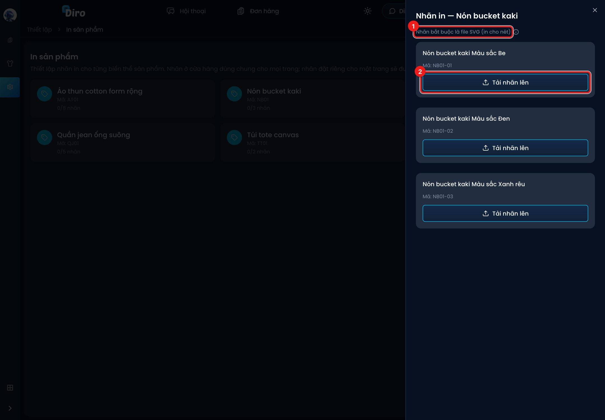
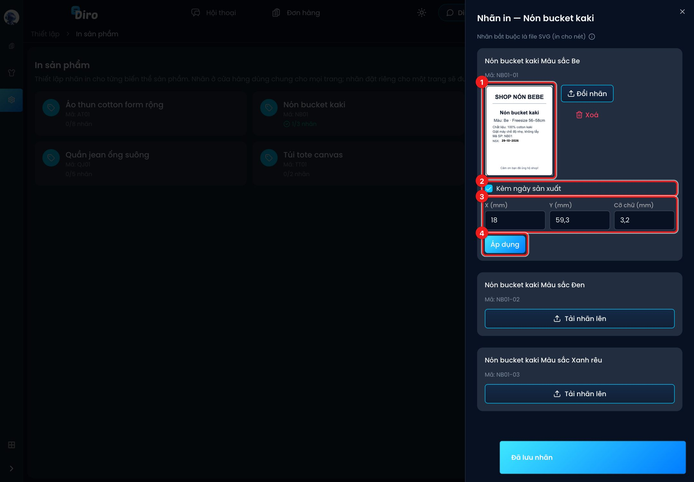

# Nhãn sản phẩm

Nhãn sản phẩm là con tem dán lên **chính món hàng** (thành phần, hướng dẫn dùng, ngày sản xuất…),
khác với tem vận đơn dán ngoài gói. Bạn tải sẵn nhãn cho từng biến thể một lần; mỗi khi in đơn,
Diro in luôn đúng nhãn, đúng số lượng, ngay sau tem vận đơn của đơn đó.

## Bước 1: Mở trang In sản phẩm

Vào **Thiết lập** → khối **Cửa hàng** → **In sản phẩm**. Trang liệt kê mọi sản phẩm, mỗi thẻ ghi
mã sản phẩm và số nhãn đã có trên tổng số biến thể (vd `0/3 nhãn`). Sản phẩm đã có nhãn hiện
dấu tích xanh.

1. Bấm vào thẻ sản phẩm cần đặt nhãn, ví dụ **Nón bucket kaki**.

## Bước 2: Tải nhãn cho từng biến thể

Một khung hiện ra bên phải, mỗi biến thể (màu, size…) một ô riêng.

1. Nhãn **bắt buộc là file SVG** để in nét. Rê chuột vào ⓘ để xem quy cách.
2. Bấm **Tải nhãn lên** ở biến thể cần đặt nhãn và chọn file `.svg` trên máy. Nhãn được lưu
   ngay khi tải xong (hiện thông báo **Đã lưu nhãn**).

Quy cách file:

- Khổ **A7**: nhãn dọc dùng khung 75×100mm; nhãn ngang dùng 100×75mm và được xoay lại khi in
  cho khớp giấy 75×100mm.
- Nhãn được canh vừa khung, **không bị cắt**; phần thừa để trắng.
- File PNG/JPG sẽ bị từ chối. Nếu thiết kế bằng Canva/Illustrator, hãy xuất ra **SVG**.

## Bước 3: Kèm ngày sản xuất (tuỳ chọn)

Sau khi tải nhãn, ô biến thể hiện ảnh xem trước cùng nút **Đổi nhãn** và **Xoá**.

1. Ảnh xem trước nhãn (thu nhỏ một nửa, vị trí vẫn đúng như bản in).
2. Tick **Kèm ngày sản xuất** để Diro in ngày lên nhãn.
3. Chỉnh vị trí và cỡ chữ của ngày, tính bằng milimét từ góc trên bên trái nhãn: **X (mm)**,
   **Y (mm)**, **Cỡ chữ (mm)**. Mặc định 18 / 59,3 / 3,2. Ảnh xem trước cập nhật ngay khi bạn sửa số.
4. Bấm **Áp dụng** để lưu.

Ngày sản xuất in ra luôn là **ngày hôm trước ngày in**, dạng `DD-MM-YYYY` — bạn không phải sửa
tay mỗi ngày. Mẹo: để sẵn chữ "NSX:" trong file SVG rồi chỉnh X, Y cho ngày nằm ngay sau chữ đó.

## Bước 4: In nhãn cùng tem vận đơn

Khi in đơn, trong hộp **In đơn hàng** tick **In kèm nhãn sản phẩm (nếu có)** (xem
[In tem vận đơn](./in-tem-van-don.md)). File PDF sẽ có: tem vận đơn của đơn 1, rồi nhãn các món
trong đơn 1, rồi tem đơn 2, nhãn đơn 2…

- Món mua **2 cái** thì in **2 nhãn**.
- Món chưa có nhãn thì bỏ qua, không làm lỗi lô in.
- Nhãn sản phẩm không được đánh số thứ tự như tem vận đơn.

## Shop có nhiều trang: nhãn riêng cho từng trang

Nếu bạn mở **In sản phẩm** từ một shop gộp nhiều trang, phía trên có ô **Áp dụng cho**:

- Chọn **tên shop (cửa hàng — mặc định)**: nhãn dùng chung cho mọi trang.
- Chọn một **trang con**: đặt nhãn riêng cho trang đó. Khi in đơn của trang này, Diro ưu tiên
  nhãn riêng; biến thể nào trang con không có nhãn riêng thì dùng nhãn của shop.

## Câu hỏi thường gặp

**Đổi nhãn có ảnh hưởng đơn đã in không?** Không. Nhãn mới chỉ dùng cho những lần in sau.

**Bấm Xoá nhãn rồi thì sao?** Biến thể đó trở về chưa có nhãn; khi in kèm nhãn, món đó được bỏ qua.
