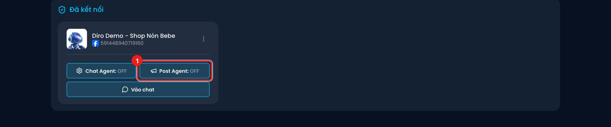
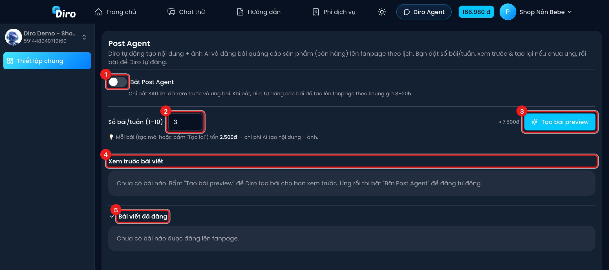

# Post Agent — AI tự đăng bài lên Fanpage

**Post Agent** giúp Fanpage của bạn luôn có bài mới mà không cần tự viết. Diro tự **viết nội dung và tạo ảnh bằng AI** để quảng cáo các sản phẩm **còn hàng** của trang, rồi **đăng lên Fanpage theo lịch**. Bạn chỉ cần đặt số bài mỗi tuần, xem trước và bật.

## Chi phí

Mỗi bài (tạo mới hoặc bấm **Tạo lại**) tốn **2.500 đ** — chi phí AI viết nội dung và tạo ảnh. Ví dụ 3 bài/tuần khoảng 7.500 đ mỗi tuần. Tiền trừ vào ví Diro của chủ tài khoản.

## Mở Post Agent

Trên **Bảng điều khiển**, bấm nút **Post Agent** trên thẻ trang. Chữ **ON**/**OFF** cho biết Post Agent của trang đang bật hay tắt.

:::note
Nút **Post Agent** chỉ hiện với tài khoản đã được mở tính năng này. Tài khoản nhân viên không dùng được Post Agent (trừ kỹ thuật viên).
:::

## Thiết lập

1. **Bật Post Agent** — công tắc bật/tắt việc tự đăng. **Chỉ bật sau khi đã xem trước và ưng bài.** Khi bật, Diro tự đăng các bài đã tạo lên Fanpage trong khung giờ **8h–20h**, và tự tạo thêm bài mới để luôn đủ số bài mỗi tuần.
2. **Số bài/tuần (1–10)** — số bài Diro đăng mỗi tuần. Các bài được rải đều trong tuần.
3. **Tạo bài preview** — tạo trước một lô bài (bằng số bài/tuần) để bạn xem. Bên cạnh nút có ước tính chi phí. Nút này hiện khi chưa có bài nào hoặc khi bạn vừa đổi số bài/tuần.
4. **Xem trước bài viết** — các bài đã tạo. Ảnh tạo bằng AI có thể mất **3–5 phút** mới hiện ra.
5. **Bài viết đã đăng** — các bài đã lên Fanpage, kèm thời gian đăng và link **Xem trên Facebook**.

## Các bước dùng Post Agent

1. Nhập **Số bài/tuần**, ví dụ `3`.
2. Bấm **Tạo bài preview**. Diro báo *"Đang tạo bài, ảnh sẽ hiện dần bên dưới…"*.
3. Đợi các bài hiện ra ở **Xem trước bài viết**. Mỗi bài có trạng thái (**Đang tạo…**, **Đã lên lịch**, **Đang đăng…**, **Đã đăng**, **Lỗi**, **Đã huỷ**) và các nút:
   - **Tạo lại (mất phí)** — chưa ưng thì cho AI viết lại bài khác (tốn thêm 2.500 đ).
   - **Đăng ngay** — đăng bài này lên Fanpage luôn, không chờ lịch. Đăng xong Diro báo *"Đã đăng bài lên fanpage thành công!"*.
4. Khi đã ưng, bật **Bật Post Agent**. Diro tự chọn khung giờ đăng hiệu quả nhất trong ngày cho từng bài.

Muốn dừng, tắt **Bật Post Agent**. Khi tắt, Diro không đăng và không tự tạo thêm bài mới.

:::tip
- Post Agent chỉ quảng cáo sản phẩm **còn hàng**, và xoay vòng giữa các sản phẩm để bài không lặp lại.
- Sản phẩm có ảnh đẹp, mô tả rõ thì bài AI tạo ra càng đúng. Cập nhật ảnh và mô tả sản phẩm ở mục **Sản phẩm & kho**.
:::

:::warning
Bài đã đăng là đăng thật lên Fanpage, khách của bạn sẽ thấy. Luôn xem trước trước khi bật.
:::
