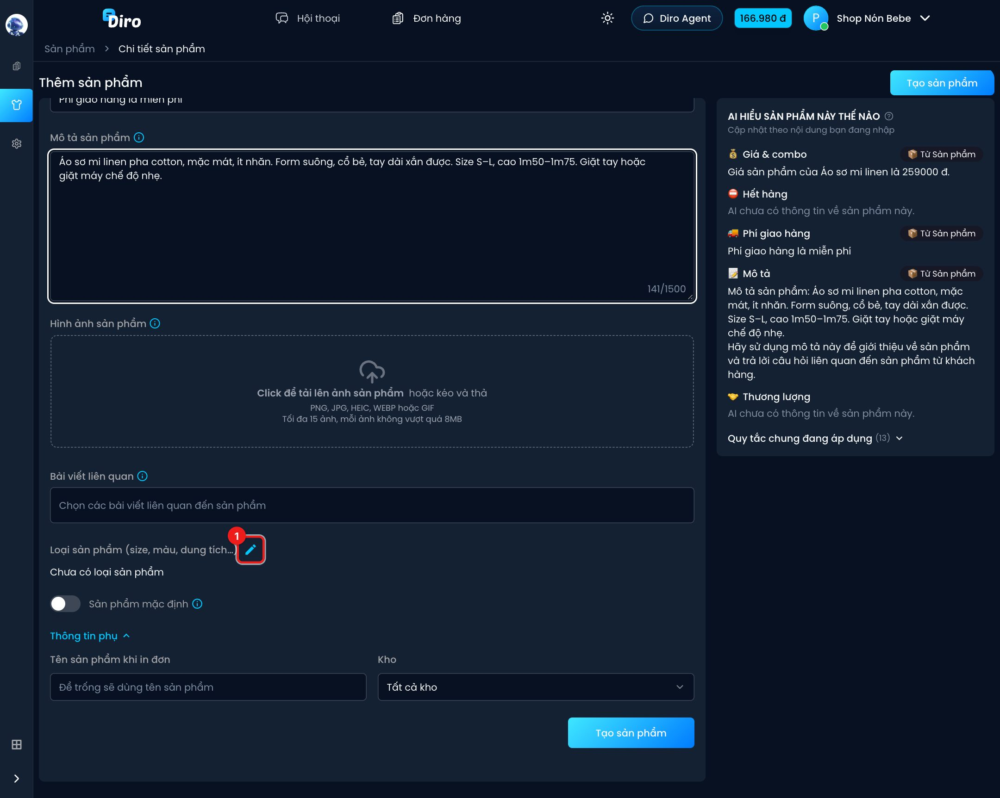
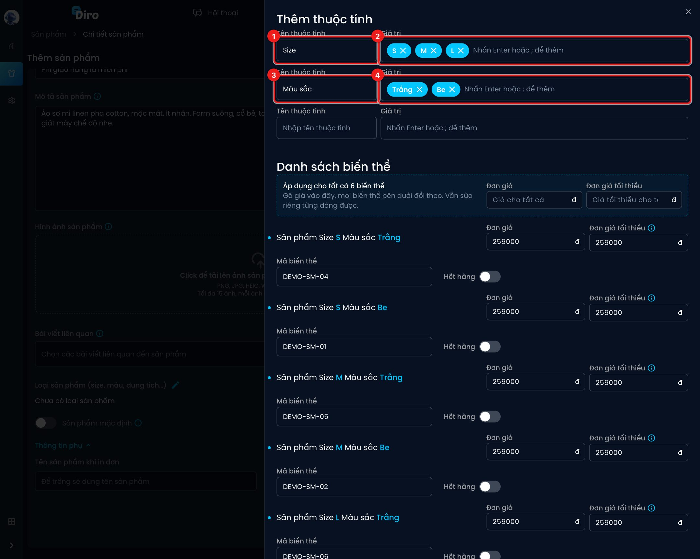
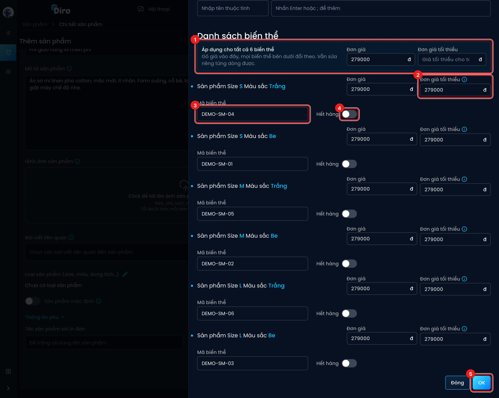
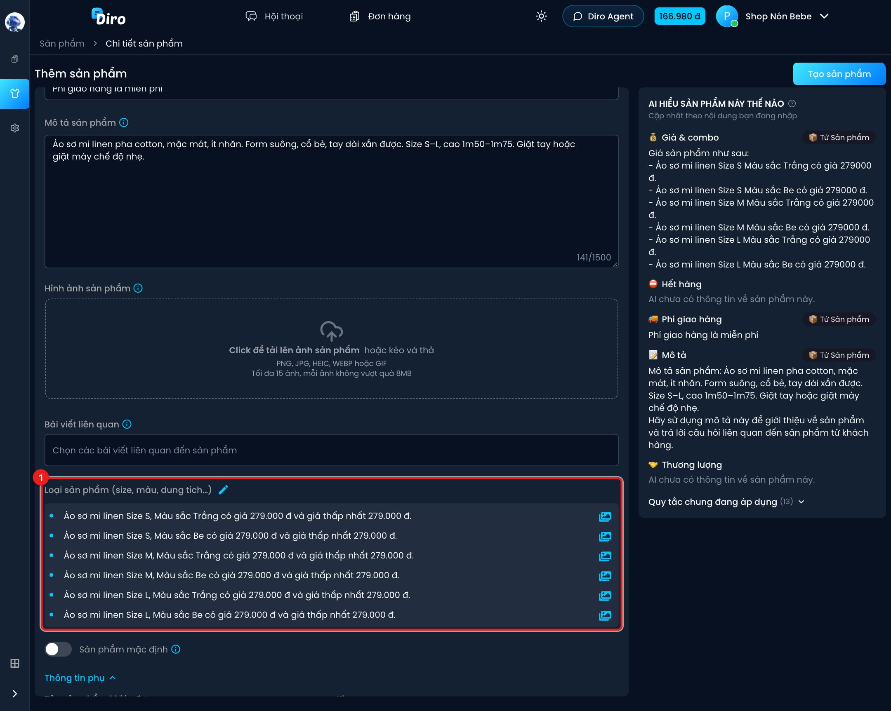

# Loại sản phẩm (size, màu…)

Khi một sản phẩm có nhiều size, màu, dung tích…, bạn tạo **loại sản phẩm** (còn gọi là biến thể).
Mỗi loại có giá, giá thấp nhất, mã riêng và có thể đánh dấu hết hàng riêng. AI sẽ hỏi khách
chọn loại nào và lên đơn đúng loại đó, vd "Áo sơ mi linen Size M, Màu sắc Be".

:::note
Nhập **Giá bán 1 sản phẩm** trước, rồi mới thêm loại sản phẩm. Giá đó được dùng làm giá
mặc định cho mọi loại.
:::

## Bước 1: Mở bảng thêm loại

1. Ở mục **Loại sản phẩm (size, màu, dung tích…)**, bấm **biểu tượng bút chì**.

## Bước 2: Nhập thuộc tính và giá trị

1. **Tên thuộc tính** thứ nhất, vd `Size`.
2. **Giá trị** của nó: gõ `S` rồi nhấn **Enter** (hoặc gõ dấu `;`), tiếp `M`, `L`… Mỗi giá trị
   thành một thẻ xanh; bấm × trên thẻ để bỏ.
3. **Tên thuộc tính** thứ hai (nếu cần), vd `Màu sắc`.
4. **Giá trị**: `Trắng`, `Be`.

Diro tự ghép mọi tổ hợp vào **Danh sách biến thể** bên dưới: 3 size × 2 màu = 6 loại.

:::tip
Giá trị có dấu phẩy như "1,5" vẫn giữ nguyên, vì chỉ **Enter** hoặc **;** mới tách giá trị.
:::

## Bước 3: Đặt giá, mã và hết hàng cho từng loại

1. **Áp dụng cho tất cả N biến thể** — gõ **Đơn giá** và/hoặc **Đơn giá tối thiểu** vào đây,
   mọi loại bên dưới đổi theo. Vẫn sửa riêng từng dòng được (vd size L đắt hơn).
2. **Đơn giá tối thiểu** của từng loại — giá thấp nhất AI được chốt khi khách trả giá.
   Không được lớn hơn đơn giá.
3. **Mã biến thể** — Diro gợi ý sẵn theo mã sản phẩm (vd `DEMO-SM-01`). Để trống thì tự sinh.
4. **Hết hàng** — bật cho loại đã hết. AI sẽ không chào bán loại này nữa.
5. Bấm **OK** để đưa danh sách vào form. **Đóng** (hoặc bấm ra ngoài) là bỏ phần vừa sửa.

## Bước 4: Kiểm tra

1. Các loại hiện dưới mục **Loại sản phẩm**, mỗi dòng ghi rõ giá và giá thấp nhất.

Khi đã có loại sản phẩm:

- Ô **Giá bán 1 sản phẩm** bị khoá và lấy theo giá các loại. Nếu các loại khác giá, nhãn hiện
  khoảng giá, vd "(259.000 đ - 299.000 đ)".
- Muốn sửa, bấm lại bút chì, đổi rồi bấm **OK**.

Nhớ bấm **Tạo sản phẩm** (hoặc **Lưu** khi đang sửa) để lưu.

## Ảnh riêng cho từng loại

Ở trang chi tiết của sản phẩm đã tạo, mỗi loại có thêm **biểu tượng ảnh** kèm số ảnh hiện có.
Bấm vào để tải ảnh riêng cho loại đó (vd ảnh áo màu Be), kéo để đổi thứ tự rồi bấm
**Lưu thứ tự ảnh**. Ảnh loại được lưu ngay khi tải lên. Xem
[Xem và sửa sản phẩm](./sua-san-pham.md).
