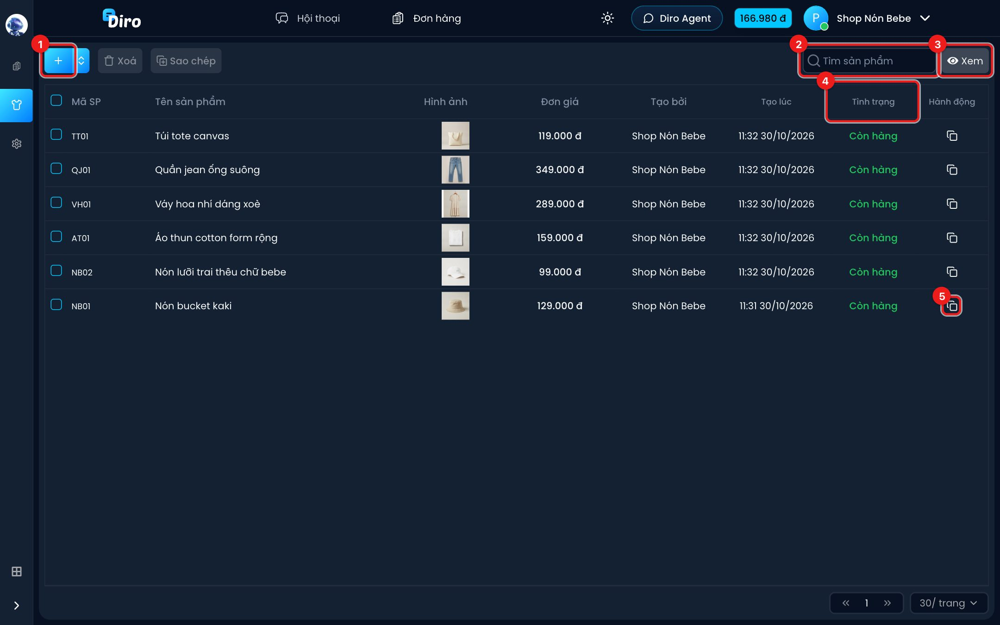
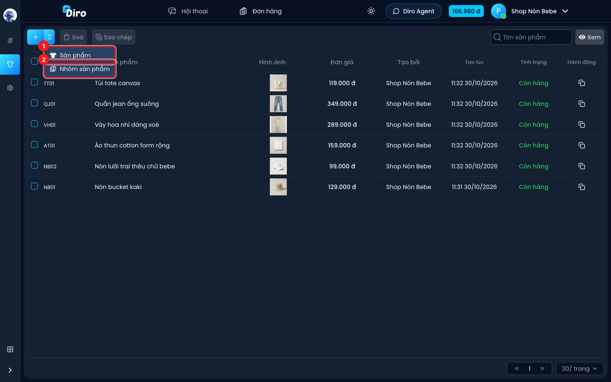
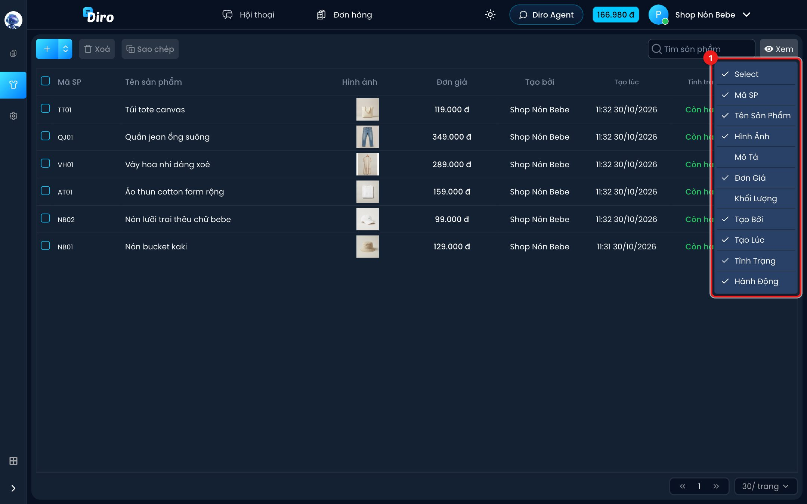

# Danh sách sản phẩm

Trang **Sản phẩm** liệt kê mọi sản phẩm của trang (fanpage) đang mở. Đây là nơi bạn thêm
sản phẩm mới, tìm nhanh một món, và chọn nhiều sản phẩm để xoá hoặc sao chép.

Mở trang: ở trang Đơn hàng, bấm biểu tượng **áo** ở thanh bên trái.

1. **Nút +** — thêm sản phẩm mới (xem [Tạo sản phẩm](./tao-san-pham.md)).
2. **Tìm sản phẩm** — gõ một phần **tên** hoặc **mã sản phẩm**, không cần đúng hoa thường.
3. **Xem** — chọn cột nào hiện trên bảng.
4. **Tình trạng** — **Còn hàng** (chữ xanh) hoặc **Hết hàng**. Sản phẩm hết hàng thì AI không
   chào bán nữa (xem [Xem và sửa sản phẩm](./sua-san-pham.md)).
5. **Biểu tượng sao chép** ở cột **Hành động** — chép sản phẩm này sang trang khác
   (xem [Sao chép sản phẩm](./sao-chep-san-pham.md)).

Bấm vào một dòng bất kỳ để mở trang chi tiết của sản phẩm đó.

## Các cột trong bảng

| Cột | Ý nghĩa |
|---|---|
| **Mã SP** | Mã ngắn bạn đặt cho sản phẩm, vd `NB01`. Khách không thấy mã này. |
| **Tên sản phẩm** | Tên đầy đủ. Rê chuột vào tên dài để xem hết. |
| **Hình ảnh** | Ảnh đầu tiên của sản phẩm. Chưa có ảnh thì hiện "No Image". |
| **Mô tả** | Ẩn sẵn. Bật bằng nút **Xem**. |
| **Đơn giá** | Giá bán 1 sản phẩm. |
| **Khối lượng** | Ẩn sẵn. Bật bằng nút **Xem**. |
| **Tạo bởi** | Người đã tạo sản phẩm. |
| **Tạo lúc** | Giờ và ngày tạo. |
| **Tình trạng** | Còn hàng / Hết hàng. |
| **Hành động** | Nút sao chép sang trang khác. |

## Thêm sản phẩm hoặc nhóm sản phẩm

Mũi tên nhỏ cạnh nút **+** mở thêm 2 lựa chọn:

1. **Sản phẩm** — giống bấm thẳng nút **+**.
2. **Nhóm sản phẩm** — xem [Nhóm sản phẩm](./nhom-san-pham.md).

## Chọn cột hiển thị

1. Bấm **Xem**, rồi bấm vào tên cột để bật hoặc tắt. Cột có dấu tích là đang hiện.

## Xoá sản phẩm

1. Tích ô vuông đầu dòng của những sản phẩm cần xoá (tích ô ở tiêu đề bảng để chọn cả trang).
2. Bấm **Xoá** ở thanh công cụ.
3. Một thông báo đỏ hiện ở góc phải hỏi lại mã các sản phẩm sẽ xoá. Bấm **biểu tượng thùng
   rác** trên thông báo để xác nhận.

:::warning
Xoá là mất hẳn sản phẩm khỏi danh sách AI đọc. Nếu chỉ tạm ngừng bán, hãy đánh dấu **Hết hàng**
thay vì xoá.
:::

## Phân trang

Góc dưới bên phải có nút chuyển trang (« ») và ô chọn số dòng mỗi trang (mặc định **30/ trang**).

## Lưu ý với trang gộp (Shop)

Nếu bạn đang mở một **Shop** (nhiều trang gộp lại), danh sách hiện sản phẩm của tất cả trang
con, kèm ảnh đại diện trang ở cột **Mã SP**. Bạn **không tạo được sản phẩm bên trong Shop**:
nút **+** bị khoá, hãy mở từng trang riêng lẻ để tạo.
