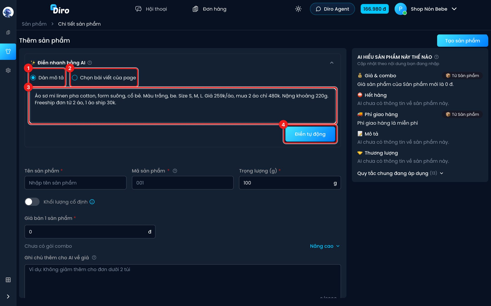
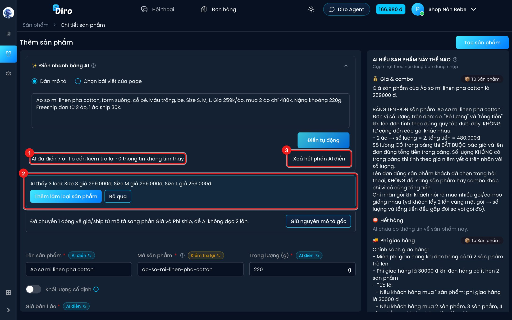
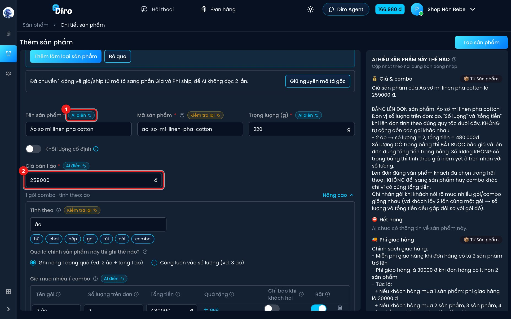

# Điền nhanh bằng AI

Bạn đã có sẵn bài quảng cáo hay đoạn mô tả sản phẩm? Thay vì gõ từng ô, hãy dán vào thẻ
**Điền nhanh bằng AI** ở đầu trang **Thêm sản phẩm**. AI đọc và điền sẵn tên, trọng lượng, giá,
gói mua nhiều/combo, phí ship, mô tả… để bạn kiểm tra lại.

:::info
AI chỉ **điền vào form**, chưa lưu gì. Sản phẩm chỉ được tạo khi bạn bấm **Tạo sản phẩm**.
Điền nhanh bằng AI không trừ tiền ví.
:::

## Bước 1: Dán mô tả rồi bấm Điền tự động

1. **Dán mô tả** — chọn khi bạn muốn dán chữ (bài quảng cáo, tin nhắn báo giá…).
2. **Chọn bài viết của page** — chọn khi bạn muốn AI đọc thẳng một bài đã đăng trên fanpage.
   Bài viết được chọn cũng tự gắn vào ô **Bài viết liên quan** của sản phẩm.
3. Dán nội dung vào khung. Nên có giá, giá mua nhiều, phí ship, size/màu nếu có. Ví dụ:
   *"Áo sơ mi linen pha cotton, form suông, cổ bẻ. Màu trắng, be. Size S, M, L. Giá 259k/áo,
   mua 2 áo chỉ 480k. Nặng khoảng 220g. Freeship đơn từ 2 áo, 1 áo ship 30k."*
4. Bấm **Điền tự động**. AI đọc trong khoảng 10 giây.

Nếu form đã có chữ, Diro hỏi lại trước khi điền: AI chỉ ghi đè các ô **bạn chưa sửa tay**,
ô bạn đã sửa được giữ nguyên.

## Bước 2: Xem kết quả

1. Dòng tóm tắt: **AI đã điền N ô · N ô cần kiểm tra lại · N thông tin không tìm thấy**.
2. Nếu mô tả có nhiều loại (size, màu, dung tích…), AI gợi ý: *"AI thấy 3 loại: Size S giá
   259.000đ…"*. Bấm **Thêm làm loại sản phẩm** để tạo sẵn các loại này
   (xem [Loại sản phẩm (size, màu…)](./bien-the.md)), hoặc **Bỏ qua**.
3. **Xoá hết phần AI điền** — trả các ô AI đã điền về như cũ.

Có thể bạn còn thấy thêm:

- *"Đã chuyển N dòng về giá/ship từ mô tả sang phần Giá và Phí ship, để AI không đọc 2 lần."* —
  AI đã cắt các câu về giá khỏi ô Mô tả. Muốn giữ nguyên văn thì bấm **Giữ nguyên mô tả gốc**.
- Nhắc về **ưu đãi có thời hạn** (vd "giảm 20% tới chủ nhật"): AI không đưa loại ưu đãi này vào
  bảng giá cố định. Nên tạo bằng tin nhắn kéo tương tác.

## Bước 3: Kiểm tra từng ô có nhãn

1. Ô nào AI điền sẽ có nhãn bên cạnh tên ô:
   - **AI điền** (xanh) — AI lấy từ một câu trong mô tả. Rê chuột vào nhãn để xem câu đó.
   - **Kiểm tra lại** (vàng) — AI tự suy ra chứ mô tả không ghi thẳng. Bạn xem kỹ ô này.
   - Bấm mũi tên ↶ trên nhãn để bỏ giá trị AI điền ở ô đó.
2. Bạn sửa tay một ô thì nhãn biến mất — từ đó ô ấy là của bạn, lần **Điền tự động** sau sẽ
   không ghi đè.

Kiểm tra xong, xem tiếp [Giá, combo và phí ship](./gia-combo-phi-ship.md) rồi bấm **Tạo sản phẩm**.

## Câu hỏi thường gặp

**AI báo "Mô tả này chưa có giá hay phí ship rõ ràng".**
Đoạn bạn dán không có con số giá/phí ship. Bạn nhập tay các ô bên dưới.

**AI báo "AI đang bận" hoặc "Đợi vài giây rồi thử lại nhé".**
Mỗi phút chỉ bấm được vài lần. Đợi một lát rồi bấm lại, hoặc nhập tay.

**Mô tả dán vào phải dài bao nhiêu?**
Từ 10 tới 5.000 ký tự.
