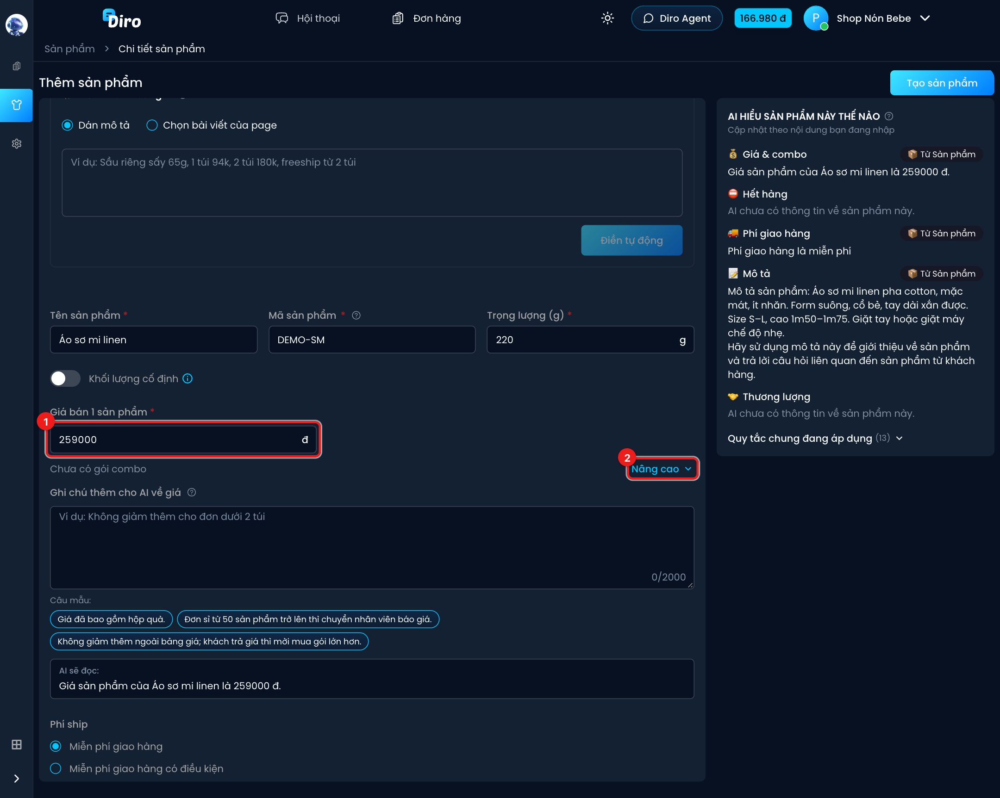
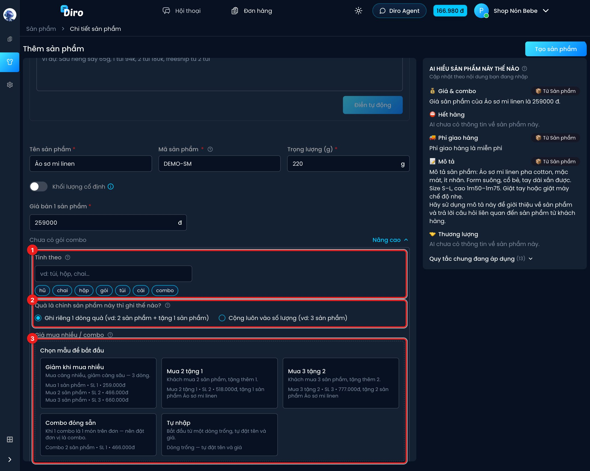
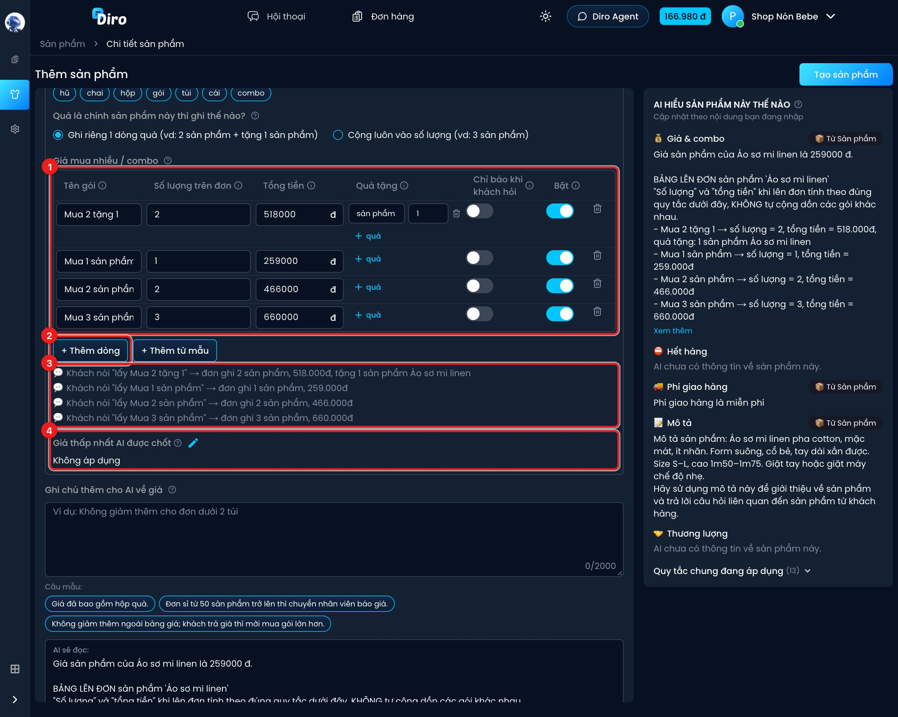
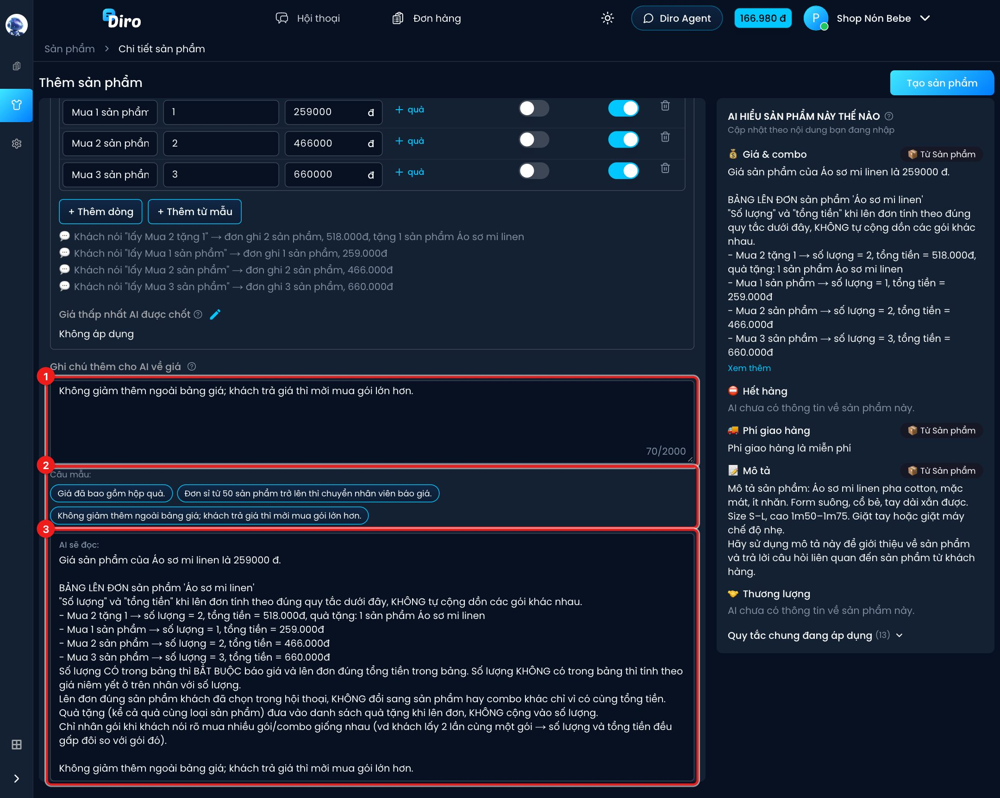
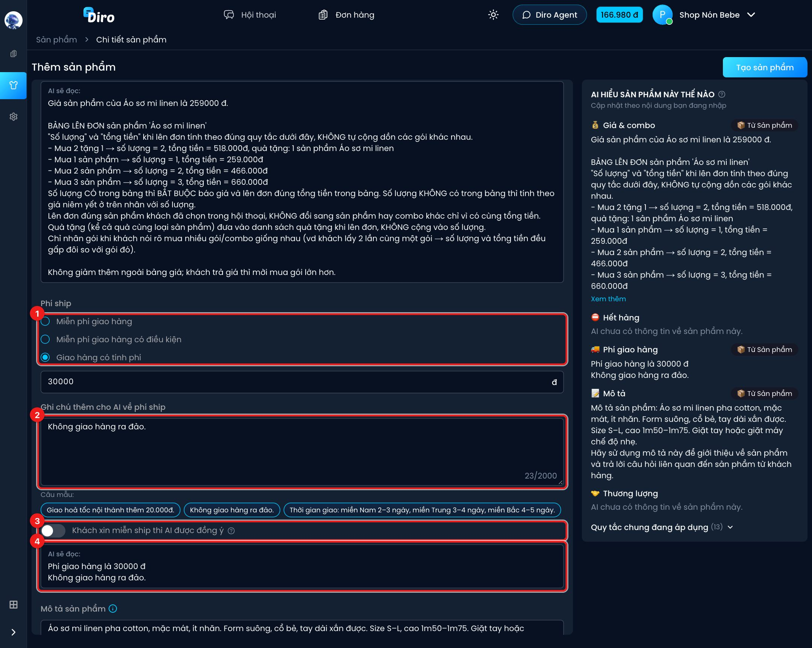
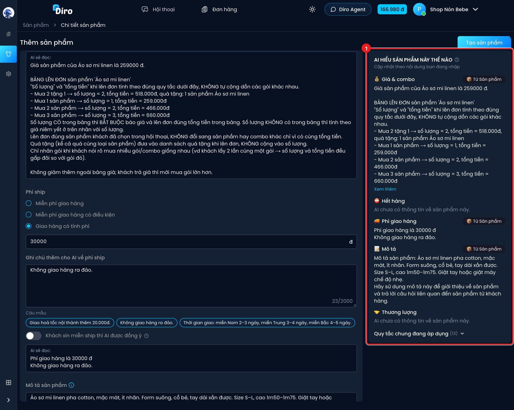

# Giá, combo và phí ship

Phần này quyết định AI **báo giá** và **lên đơn** ra sao: giá lẻ, giá khi mua nhiều, quà tặng,
phí ship, và những điều bạn muốn dặn thêm AI. Bên dưới mỗi khối luôn có ô **AI sẽ đọc:** cho
bạn thấy đúng câu chữ AI nhận được.

## Giá bán và nút Nâng cao

1. **Giá bán 1 sản phẩm** — giá lẻ. Khi bạn đặt đơn vị (vd "áo"), nhãn đổi thành
   "Giá bán 1 áo". Nếu sản phẩm có size/màu, ô này bị khoá và lấy theo giá từng loại
   (xem [Loại sản phẩm (size, màu…)](./bien-the.md)).
2. **Nâng cao** — mở phần đơn vị tính, quà tặng, bảng giá mua nhiều/combo, giá thấp nhất.
   Khi đóng, dòng bên trái tóm tắt, vd *"3 gói combo · tính theo: sản phẩm"*.

## Đơn vị, quà tặng và mẫu combo

1. **Tính theo** — đơn vị đếm khi lên đơn: gõ hoặc bấm nhanh **hũ, chai, hộp, gói, túi, cái,
   combo**. Ví dụ chọn "túi" thì đơn "Mua 2 tặng 1" ghi 2 túi + 1 túi tặng.
2. **Quà là chính sản phẩm này thì ghi thế nào?**
   - **Ghi riêng 1 dòng quà** (đa số shop dùng): đơn ghi 2 sản phẩm + tặng 1 sản phẩm.
   - **Cộng luôn vào số lượng**: đơn ghi 3 sản phẩm.
   Chọn đúng cách nhân viên của bạn đang lên đơn.
3. **Giá mua nhiều / combo** — lần đầu có ô **Chọn mẫu để bắt đầu**, giá mẫu tính theo giá bán
   bạn vừa nhập:
   - **Giảm khi mua nhiều** — 3 dòng: mua 1, mua 2, mua 3, càng nhiều càng rẻ.
   - **Mua 2 tặng 1**, **Mua 3 tặng 2** — có quà tặng kèm.
   - **Combo đóng sẵn** — khi 1 combo là 1 món trên đơn (nên đặt đơn vị là "combo").
   - **Tự nhập** — một dòng trống.

## Bảng giá mua nhiều / combo

1. Mỗi dòng là một gói:
   - **Tên gói** — tên khách dễ gọi, vd "Mua 2 tặng 1".
   - **Số lượng trên đơn** — số món khách **trả tiền** trong gói, chưa tính quà.
   - **Tổng tiền** — khách trả cho cả gói, chưa gồm phí ship.
   - **Quà tặng** — bấm **+ quà** để thêm quà (kể cả quà là chính sản phẩm này).
   - **Chỉ báo khi khách hỏi** — bật thì AI không tự giới thiệu gói này, chỉ báo khi khách hỏi
     đúng tới nó. Hợp với giá sỉ.
   - **Bật** — tắt để tạm ẩn gói mà không xoá. Thùng rác cuối dòng để xoá gói.
2. **+ Thêm dòng** (dòng trống) và **+ Thêm từ mẫu** (thêm gói theo mẫu ở trên).
3. Các dòng 💬 cho bạn thấy trước: khách nói "lấy Mua 2 tặng 1" thì đơn sẽ ghi gì, bao nhiêu tiền.
4. **Giá thấp nhất AI được chốt** — bấm bút chì để đặt. Khi khách trả giá, AI được giảm tối đa
   xuống mức này. Để trống ("Không áp dụng") thì AI luôn từ chối mặc cả.

Số lượng **có** trong bảng thì AI báo đúng tổng tiền của gói; số lượng **không có** trong bảng
thì AI tính theo giá bán lẻ nhân số lượng.

## Ghi chú thêm cho AI về giá

1. **Ghi chú thêm cho AI về giá** — điều bảng không ghi được, vd "Không giảm thêm ngoài bảng
   giá; khách trả giá thì mời mua gói lớn hơn". Tối đa 2.000 ký tự.
2. **Câu mẫu** — bấm để chèn nhanh một câu mẫu vào ô ghi chú.
3. **AI sẽ đọc:** — nội dung giá AI thực sự nhận được, cập nhật ngay khi bạn gõ. Nếu ô này báo
   *"Sửa các ô báo đỏ để xem AI sẽ đọc gì"* nghĩa là còn ô nhập sai.

## Phí ship

1. Chọn một trong ba cách tính:
   - **Miễn phí giao hàng** — AI báo freeship.
   - **Miễn phí giao hàng có điều kiện** — chọn **Theo số lượng sản phẩm** hoặc **Theo giá trị
     đơn hàng**, nhập mức tối thiểu để được freeship và phí ship khi chưa đủ mức.
   - **Giao hàng có tính phí** — nhập số tiền ship cố định.
2. **Ghi chú thêm cho AI về phí ship** — vd "Không giao hàng ra đảo", "Giao hoả tốc nội thành
   thêm 20.000đ". Có **Câu mẫu** để bấm chèn nhanh.
3. **Khách xin miễn ship thì AI được đồng ý** — chỉ hiện khi có tính phí ship. Bật thì khách
   đòi miễn ship là AI đồng ý luôn; tắt (mặc định) thì AI giữ phí ship như cài đặt.
4. **AI sẽ đọc:** — câu phí ship AI nhận được.

:::tip
Đừng ghi giá hay phí ship vào **Mô tả sản phẩm** nữa. Đã có ô riêng, ghi hai nơi dễ làm AI
nhận hai con số khác nhau.
:::

## Khung "AI hiểu sản phẩm này thế nào"

1. Khung bên phải tổng hợp **đúng nội dung AI sẽ đọc** khi tư vấn khách, chia theo mục:
   **Giá & combo**, **Hết hàng**, **Phí giao hàng**, **Mô tả**, **Thương lượng**. Thấy sai thì sửa
   ở form bên trái, khung tự cập nhật.

Nhãn bên phải mỗi mục cho biết thông tin lấy từ đâu:

- **Từ Sản phẩm** — từ chính các ô bạn đang nhập.
- **Ưu đãi tạm thời** — từ tin nhắn tự động đang chạy.
- **Hệ thống** — câu cố định của Diro.

Phía dưới có thể có:

- **Quy tắc riêng sản phẩm này** và **Quy tắc chung đang áp dụng** — các mệnh lệnh bạn đã viết
  cho Chat Agent mà AI cũng đọc kèm sản phẩm này.
- **Có thể bị đè / cần chú ý** — cảnh báo khi một mệnh lệnh cũng ghi giá hoặc phí ship. Nên chuyển
  thông tin đó về trang sản phẩm để AI không nhận hai con số khác nhau.

Trên màn hình nhỏ (điện thoại), khung này mở bằng nút **AI hiểu sản phẩm thế nào?**.
