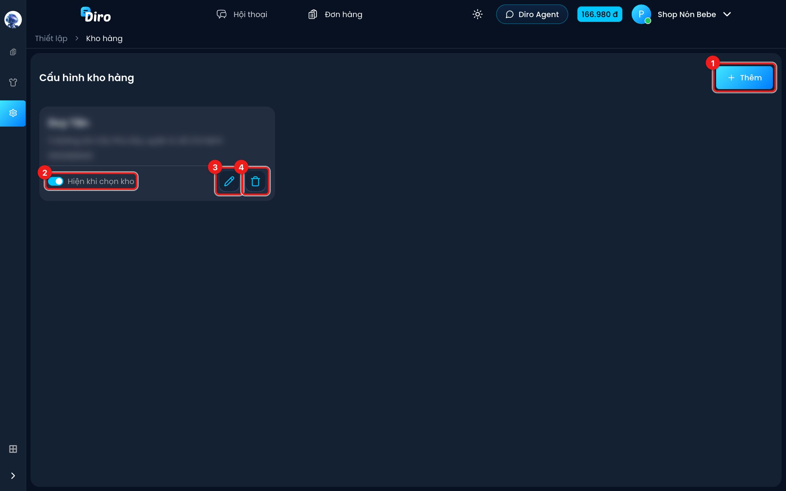
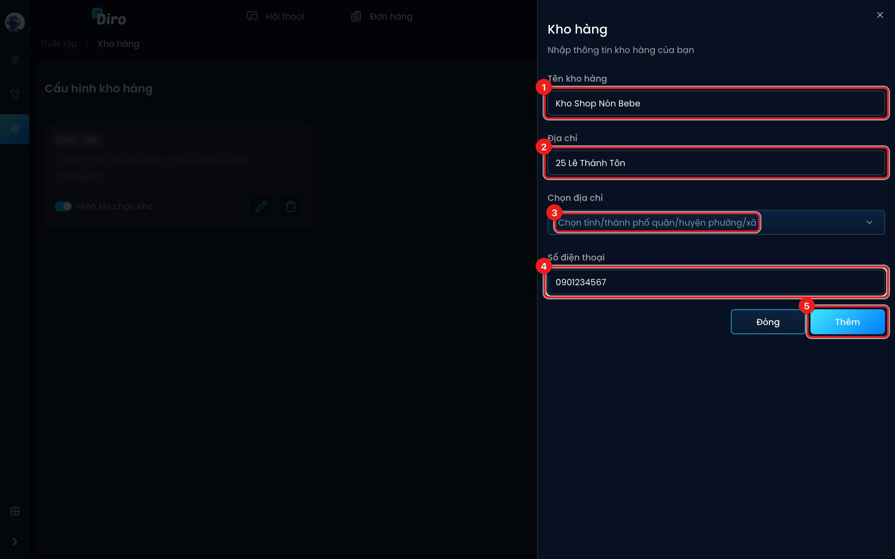

# Kho hàng

Nếu bạn gửi hàng từ nhiều nơi (vd kho Hà Nội và kho Sài Gòn), hãy khai báo từng **kho hàng**.
Kho được dùng ở:

- Ô **Kho** của từng sản phẩm (trong **Thông tin phụ**) — sản phẩm này nằm ở kho nào.
- Bộ lọc **Tất cả kho** ở trang Đơn hàng — xem đơn theo kho.
- Ô chọn kho lấy hàng khi gửi đơn sang đơn vị vận chuyển. Diro nhắc khi bạn gửi đơn từ kho khác
  với kho của sản phẩm trong đơn.

Danh sách kho dùng chung cho mọi trang trong tài khoản của bạn.

Mở trang: **Thiết lập** (biểu tượng bánh răng ở thanh bên trái) → **Kho hàng**.

## Danh sách kho

1. **Thêm** — tạo kho mới.
2. **Hiện khi chọn kho** — tắt để **ẩn** kho khỏi bộ lọc Kho ở trang Đơn hàng và ô chọn kho khi
   gửi đơn. Kho ẩn có nhãn **Đã ẩn**. Công tắc này lưu ngay khi bấm.
3. **Bút chì** — sửa tên, địa chỉ, số điện thoại của kho.
4. **Thùng rác** — xoá kho (có thông báo hỏi lại).

:::warning Nên ẩn thay vì xoá
Xoá kho làm các sản phẩm và vận đơn cũ đang gắn kho đó mất thông tin kho. Kho không dùng nữa thì
tắt **Hiện khi chọn kho** là đủ.
:::

## Thêm kho

1. **Tên kho hàng** — vd "Kho Shop Nón Bebe".
2. **Địa chỉ** — số nhà, tên đường.
3. **Chọn địa chỉ** — chọn tỉnh/thành phố, quận/huyện, phường/xã.
4. **Số điện thoại** — số liên hệ tại kho.
5. Bấm **Thêm** (khi sửa kho thì nút là **Cập nhật**). **Đóng** để bỏ.

## Gắn sản phẩm vào kho

Mở sản phẩm (hoặc khi tạo mới), ở **Thông tin phụ** chọn kho trong ô **Kho**, rồi bấm **Lưu**
(hoặc **Tạo sản phẩm**). Để **Tất cả kho** nếu sản phẩm có ở mọi kho. Xem
[Tạo sản phẩm](./tao-san-pham.md).
