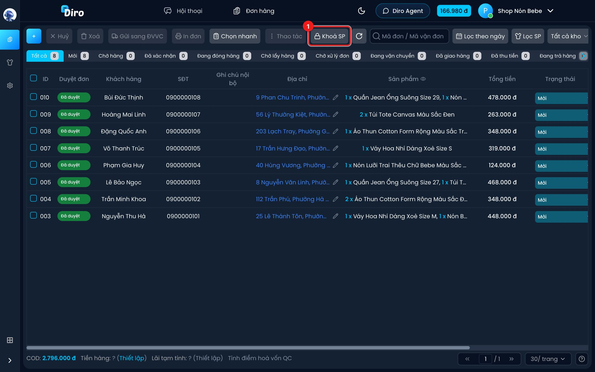
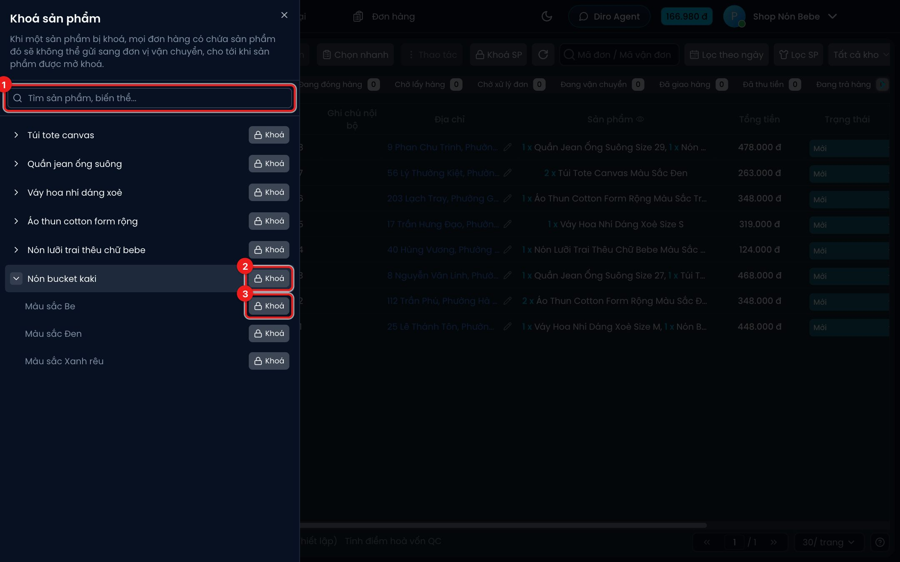

# Khoá sản phẩm

**Khoá sản phẩm** dùng khi bạn tạm không muốn gửi hàng một món (hết hàng trong kho, đang chờ
hàng về, lô lỗi…). Khi một sản phẩm bị khoá, **mọi đơn hàng có chứa sản phẩm đó sẽ không gửi được
sang đơn vị vận chuyển** cho tới khi bạn mở khoá. Bạn có thể khoá cả sản phẩm hoặc chỉ một loại
(vd chỉ size M).

:::info Khoá khác Hết hàng
- **Hết hàng** (ở trang sản phẩm): AI ngừng chào bán, không nhận đơn mới.
- **Khoá**: đơn đã có vẫn nằm đó nhưng bị chặn gửi đi. Dùng khi đã lỡ chốt đơn mà chưa có hàng giao.
:::

## Mở bảng Khoá sản phẩm

Nút này nằm ở trang **Đơn hàng**, không phải trang Sản phẩm.

1. Ở thanh công cụ trang **Đơn hàng**, bấm **Khoá SP**.

## Khoá hoặc mở khoá

1. **Tìm sản phẩm, biến thể...** — gõ để lọc nhanh. Đang tìm thì các sản phẩm có loại tự mở ra.
2. Nút **Khoá** cạnh tên sản phẩm — khoá cả sản phẩm. Bấm mũi tên ở đầu dòng để xem các loại.
3. Nút **Khoá** cạnh từng loại (vd **Màu sắc Be**) — chỉ khoá loại đó.

Bấm là có hiệu lực ngay, không cần lưu. Dòng đã khoá có biểu tượng ổ khoá, nền đậm hơn và nút
đổi thành **Mở khoá**. Bảng đơn hàng tự tải lại để cập nhật nhãn khoá trên các đơn.

Lưu ý:

- Khoá cả sản phẩm và khoá từng loại là hai việc riêng: mở khoá cả sản phẩm **không** tự mở khoá
  loại bạn đã khoá lẻ trước đó.
- Danh sách chỉ hiện sản phẩm còn hàng, nhưng sản phẩm đang bị khoá thì luôn hiện (để bạn còn
  mở khoá được).
