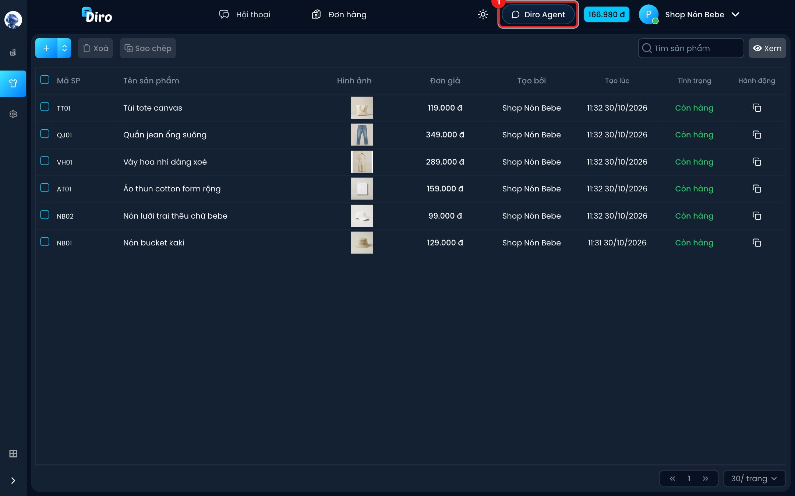
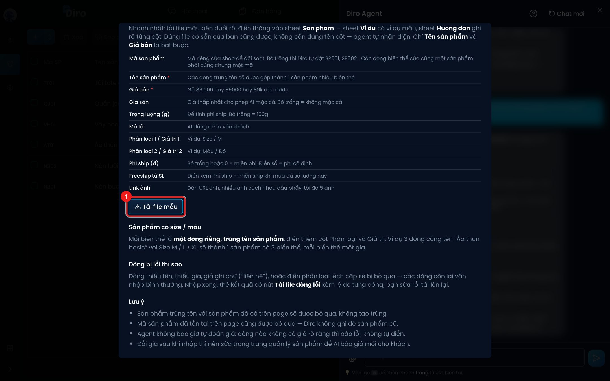

# Nhập sản phẩm từ Excel

Có nhiều sản phẩm (trên 20) và đã có bảng giá trong Excel? Hãy để **Diro Agent** nhập giúp:
mỗi lần tối đa **500 sản phẩm**, file .xlsx hoặc .csv, tối đa 10MB.

## Bước 1: Mở Diro Agent

1. Bấm nút **Diro Agent** trên thanh trên cùng. (Tài khoản nhân viên không có nút này.)

## Bước 2: Xem hướng dẫn và tải file mẫu

1. **Biểu tượng kẹp giấy** — để tải file Excel lên (bước 3).
2. **Biểu tượng dấu hỏi** — mở **Hướng dẫn dùng Diro Agent**. Chọn tab **Nhập SP từ Excel**.

1. Bấm **Tải file mẫu** để lấy file `mau-danh-sach-san-pham.xlsx`. Điền thẳng vào sheet
   **San pham**; sheet **Vi du** có ví dụ, sheet **Huong dan** giải thích từng cột.

Dùng file có sẵn của bạn cũng được, không cần đúng tên cột — Agent tự nhận diện. Chỉ **Tên sản
phẩm** và **Giá bán** là bắt buộc.

| Cột | Ghi chú |
|---|---|
| **Mã sản phẩm** | Bỏ trống thì Diro tự đặt SP001, SP002… Các dòng loại của cùng một sản phẩm phải dùng chung một mã. |
| **Tên sản phẩm** \* | Các dòng trùng tên được gộp thành 1 sản phẩm nhiều loại. |
| **Giá bán** \* | Gõ 89.000 hay 89000 hay 89k đều được. |
| **Giá sàn** | Giá thấp nhất cho phép AI mặc cả. Bỏ trống = không mặc cả. |
| **Trọng lượng (g)** | Bỏ trống = 100g. |
| **Mô tả** | AI dùng để tư vấn khách. |
| **Phân loại 1 / Giá trị 1** | Vd Size / M. |
| **Phân loại 2 / Giá trị 2** | Vd Màu / Đỏ. |
| **Phí ship (đ)** | Bỏ trống hoặc 0 = miễn phí. Điền số = phí cố định. |
| **Freeship từ SL** | Điền kèm Phí ship = miễn ship khi mua đủ số lượng này. |
| **Link ảnh** | Dán link ảnh, nhiều ảnh cách nhau dấu phẩy, tối đa 5 ảnh. |

**Sản phẩm có size/màu:** mỗi loại là **một dòng riêng, trùng tên sản phẩm**, điền thêm cột Phân
loại và Giá trị. Vd 3 dòng cùng tên "Áo thun basic" với Size M / L / XL thành 1 sản phẩm có 3 loại.

## Bước 3: Gửi file cho Agent

1. Bấm **kẹp giấy** (hoặc kéo thả file vào khung chat) để tải file lên.
2. Agent hỏi bạn muốn nhập cho fanpage nào — chọn trang.
3. Agent đọc file và đề xuất cột nào ứng với dữ liệu gì. Sai thì nhắn để nó sửa, vd *"cột Đơn
   giá mới là giá bán nhé"*.
4. Bấm **Áp dụng** trên thẻ đề xuất. Việc nhập chạy nền, có thanh tiến độ; bạn vẫn dùng Diro bình
   thường trong lúc chờ. Bấm **Bỏ qua** nếu không muốn nhập.

Agent không tự ghi gì khi bạn chưa bấm **Áp dụng**.

## Dòng bị lỗi và lưu ý

- Dòng thiếu tên, thiếu giá, giá ghi chữ ("liên hệ"), hoặc điền phân loại lệch cặp sẽ bị bỏ qua;
  các dòng khác vẫn nhập. Thẻ kết quả có nút **Tải file dòng lỗi** kèm lý do từng dòng, sửa rồi
  tải lên lại.
- Sản phẩm **trùng tên** hoặc **trùng mã** với sản phẩm đã có trên trang sẽ được bỏ qua — Diro
  không tạo trùng, không ghi đè sản phẩm cũ.
- Agent không bao giờ tự đoán giá.
- Nhập xong, muốn đổi giá thì sửa ở trang sản phẩm (xem [Xem và sửa sản phẩm](./sua-san-pham.md)).
