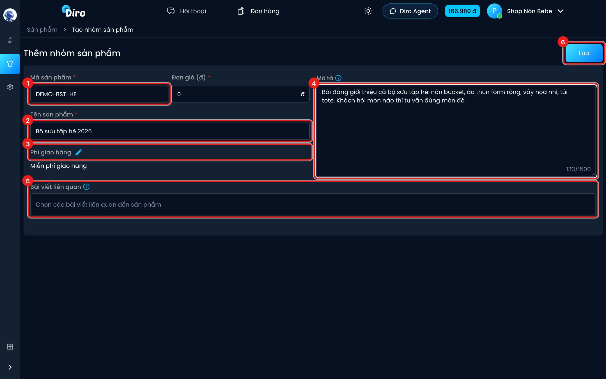

# Nhóm sản phẩm

**Nhóm sản phẩm** dành cho bài viết/quảng cáo giới thiệu **nhiều món cùng lúc** (vd "Bộ sưu tập
hè"). Bạn gắn bài viết đó vào nhóm và viết mô tả chung, để khi khách nhắn tin từ bài này, AI
hiểu khách đang xem cả bộ và hỏi lại khách muốn món nào.

Nhóm sản phẩm không phải món để bán: AI **không** chào bán hay lên đơn cho chính nhóm. Nhóm
không có trọng lượng, loại sản phẩm hay ảnh.

## Tạo nhóm sản phẩm

Ở trang **Sản phẩm**, bấm mũi tên cạnh nút **+** rồi chọn **Nhóm sản phẩm**
(xem [Danh sách sản phẩm](./danh-sach-san-pham.md)).

1. **Mã sản phẩm** (bắt buộc) — vd `DEMO-BST-HE`.
2. **Tên sản phẩm** (bắt buộc) — tên nhóm, vd "Bộ sưu tập hè 2026". Ô **Đơn giá (đ)** bên cạnh
   cũng bắt buộc (lớn hơn 0) — nhập một mức giá tham khảo, vd giá món rẻ nhất trong bộ.
3. **Phí giao hàng** — bấm bút chì để chọn miễn phí / miễn phí có điều kiện / có tính phí.
4. **Mô tả** — giới thiệu chung về bộ, những món có trong bộ.
5. **Bài viết liên quan** — chọn bài đăng giới thiệu cả bộ.
6. Bấm **Lưu**.

Lưu xong, bạn được đưa tới trang chi tiết của nhóm để sửa tiếp.
