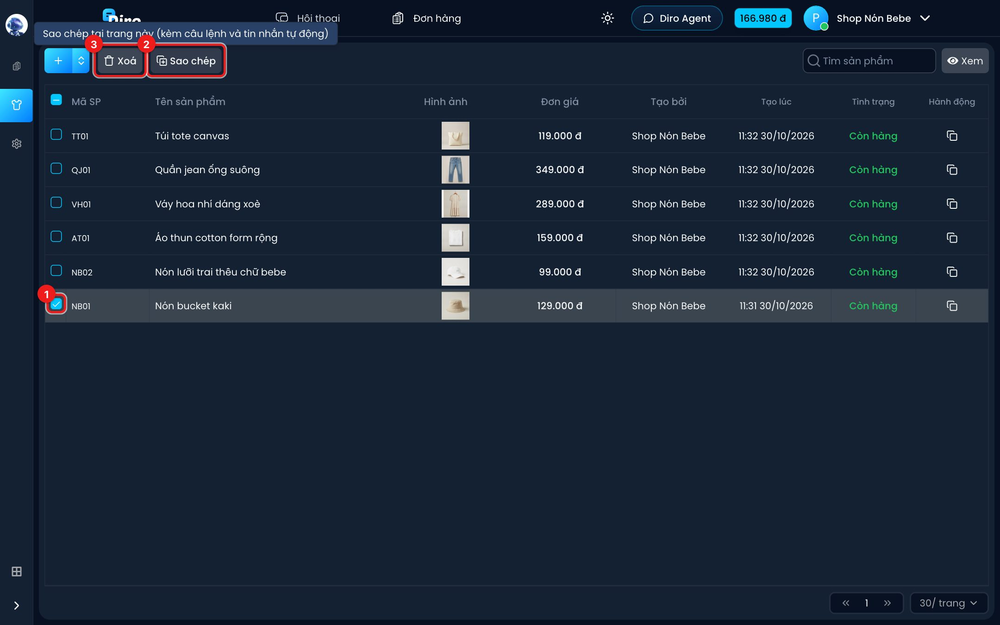
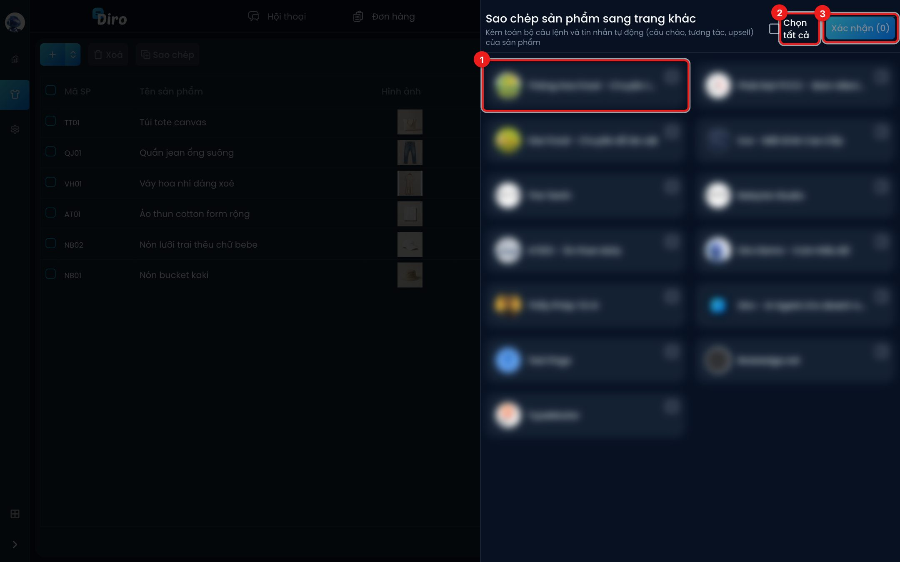

# Sao chép sản phẩm

Có 2 cách sao chép, đều chép **kèm câu lệnh và tin nhắn tự động** (câu chào, tương tác, upsell)
của sản phẩm:

- **Sao chép tại trang này** — nhân bản ngay trong trang, để làm sản phẩm na ná (vd thêm mẫu áo
  mới cùng giá, cùng cách bán).
- **Sao chép sang trang khác** — chép sang fanpage khác bạn đang quản lý.

## Nhân bản ngay trong trang

1. Tích ô vuông đầu dòng của sản phẩm cần nhân bản (chọn được nhiều sản phẩm, tối đa 20 mỗi lần).
2. Bấm **Sao chép** ở thanh công cụ (rê chuột vào nút sẽ thấy "Sao chép tại trang này (kèm câu
   lệnh và tin nhắn tự động)").
3. Nút **Xoá** bên cạnh là để xoá các sản phẩm đang chọn — đừng bấm nhầm.

Bản sao có mã thêm đuôi `_COPY` (trùng thì `_COPY2`, `_COPY3`…) và tên thêm "(bản sao)", vd
`NB01_COPY` – "Nón bucket kaki (bản sao)". Bản sao **không** là sản phẩm mặc định.

:::warning Đổi ngay mã, tên hoặc ảnh của bản sao
Hai sản phẩm giống hệt nhau làm AI dễ nhận nhầm. Mở bản sao, đổi tên, ảnh, giá cho đúng mẫu
mới rồi **Lưu**.
:::

## Chép sang trang khác

Ở trang **Sản phẩm**, bấm biểu tượng sao chép ở cột **Hành động** của sản phẩm cần chép. Bảng
**Sao chép sản phẩm sang trang khác** mở ra:

1. Bấm vào các trang muốn chép tới (mỗi ô là một trang, có ảnh đại diện và tên trang).
2. Hoặc **Chọn tất cả**.
3. Bấm **Xác nhận (N)**, N là số trang đã chọn.

Chép xong có thông báo **Sao chép sản phẩm thành công**. Nếu không có trang nào để chép, bảng
báo "Không có trang nào có thể sao chép".
