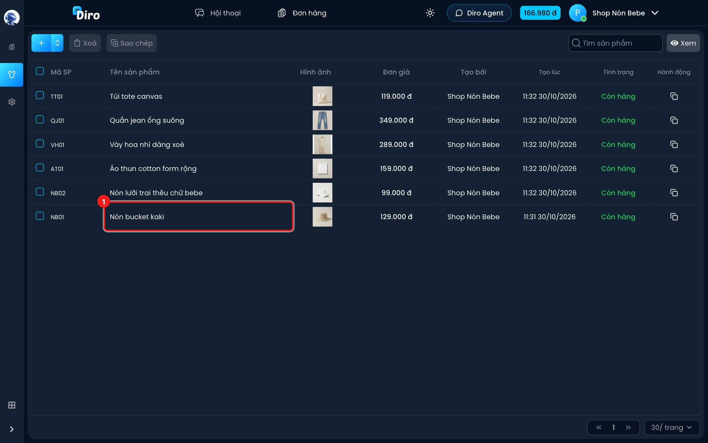
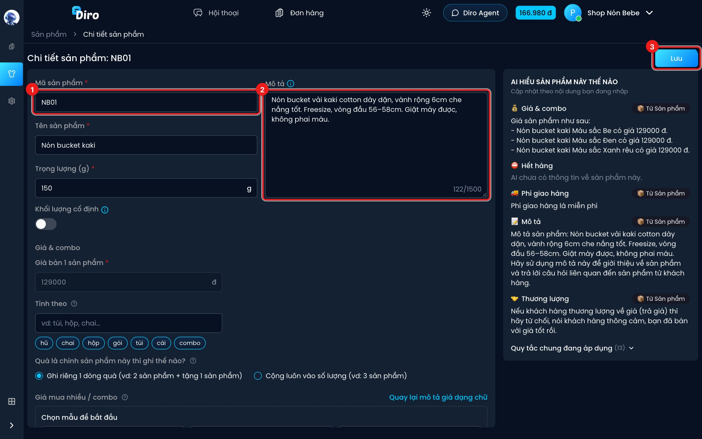
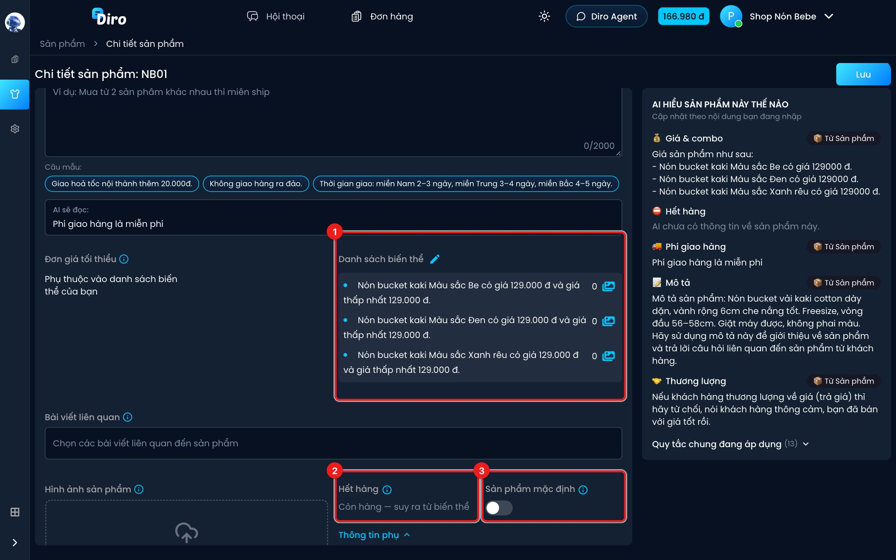

# Xem và sửa sản phẩm

Mỗi sản phẩm có một trang chi tiết để bạn sửa thông tin, đánh dấu hết hàng, đặt sản phẩm mặc
định. Khung **AI HIỂU SẢN PHẨM NÀY THẾ NÀO** bên phải cập nhật ngay khi bạn sửa, nên bạn thấy
trước AI sẽ nói gì trước khi lưu.

## Mở trang chi tiết

1. Ở trang **Sản phẩm**, bấm vào dòng của sản phẩm cần xem, vd **Nón bucket kaki**.

## Sửa thông tin và lưu

1. **Mã sản phẩm**, **Tên sản phẩm**, **Trọng lượng (g)**, **Khối lượng cố định** — giống lúc tạo
   (xem [Tạo sản phẩm](./tao-san-pham.md)).
2. **Mô tả** — AI dùng để trả lời câu hỏi của khách, tối đa 1.500 ký tự.
3. **Lưu** — bấm sau khi sửa. Rời trang mà chưa bấm thì thay đổi bị bỏ.

Phần **Giá & combo** và **Phí giao hàng** dùng y như lúc tạo, xem
[Giá, combo và phí ship](./gia-combo-phi-ship.md).

## Loại sản phẩm, hết hàng, sản phẩm mặc định

1. **Danh sách biến thể** — bấm bút chì để thêm/sửa size, màu (xem
   [Loại sản phẩm (size, màu…)](./bien-the.md)). Biểu tượng ảnh ở cuối mỗi dòng để thêm ảnh
   riêng cho loại đó.
2. **Hết hàng**:
   - Sản phẩm **không có** loại: là một công tắc. Bật thì sản phẩm chuyển sang **Hết hàng**,
     AI ngừng chào bán sản phẩm này. Nhớ bấm **Lưu**.
   - Sản phẩm **có** loại: không bấm được, chỉ hiện "Còn hàng — suy ra từ biến thể" hoặc
     "Hết hàng — tất cả biến thể đã hết". Muốn báo hết thì bật **Hết hàng** cho từng loại trong
     danh sách biến thể; hết sạch mọi loại thì sản phẩm mới hết hàng.
3. **Sản phẩm mặc định** — bật thì sản phẩm được chọn sẵn khi khách hỏi mua mà không đi từ bài
   quảng cáo nào.

Bên dưới còn có **Bài viết liên quan**, **Hình ảnh sản phẩm** và **Thông tin phụ** (**Tên sản
phẩm khi in đơn**, **Kho**), giống lúc tạo.

:::tip Hết hàng tạm thời
Hàng về lại thì tắt **Hết hàng** rồi **Lưu**, AI bán tiếp ngay. Đừng xoá sản phẩm chỉ vì tạm hết.
:::

## Sản phẩm tạo từ trước: mô tả giá dạng chữ

Sản phẩm cũ có thể vẫn đang dùng **mô tả giá dạng chữ** thay vì **Bảng giá & combo**. Khi đó,
cuối khung bên phải có dòng *"Sản phẩm đang dùng mô tả giá dạng chữ. AI chưa đọc Bảng giá &
combo."* và nút **Chuyển sang bảng giá mới**. Lưu mọi thay đổi trước rồi mới bấm chuyển.

Ngược lại, sản phẩm đang dùng bảng giá mới có link **Quay lại mô tả giá dạng chữ** ở góc phải
mục **Giá mua nhiều / combo**.

## Áp dụng bảng giá cho trang khác

Nếu trang của bạn nằm trong một Shop và các trang khác trong Shop có cùng sản phẩm, dưới khối
giá sẽ có mục **Áp dụng cho trang khác**. Tích các trang rồi bấm **Áp dụng bảng giá cho N trang**
để chép Bảng giá & combo, đơn vị, ghi chú cho AI và tuỳ chọn freeship sang. Hãy **Lưu** trước,
vì Diro chép theo bản đã lưu.
