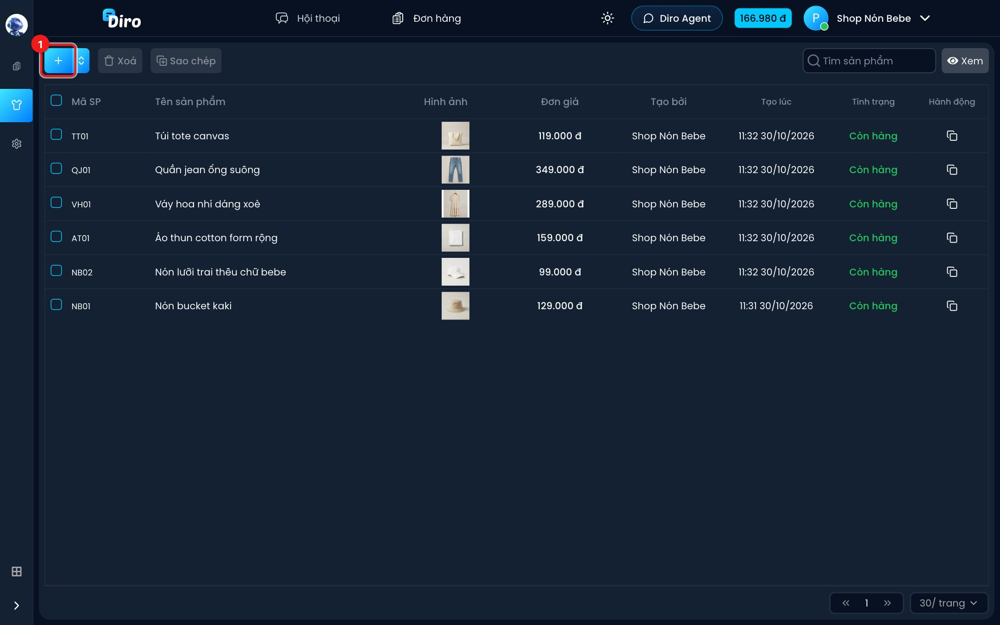
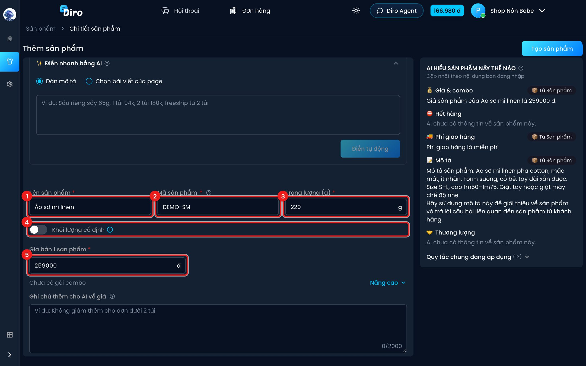
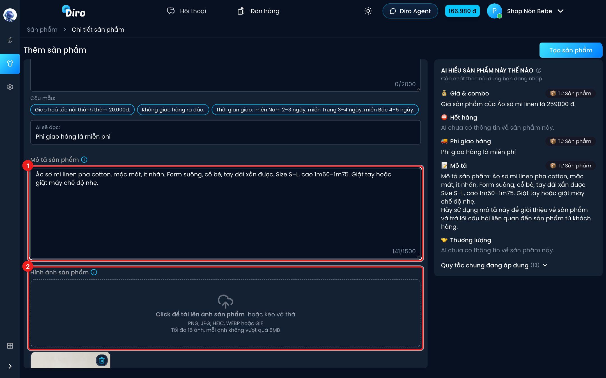
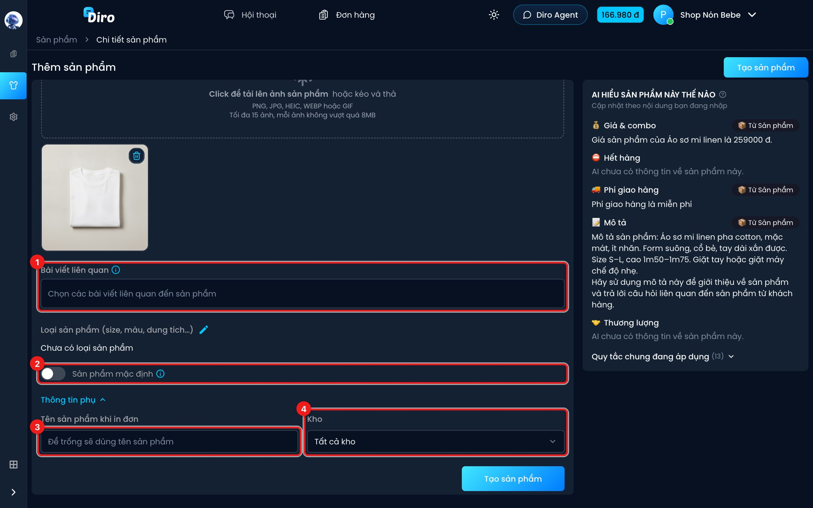
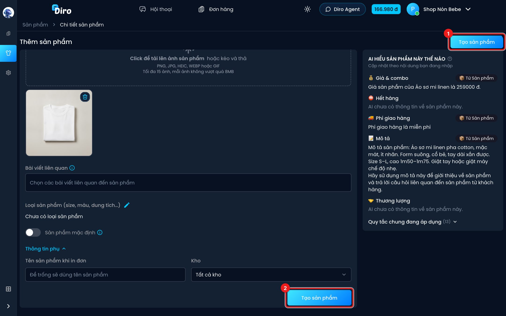
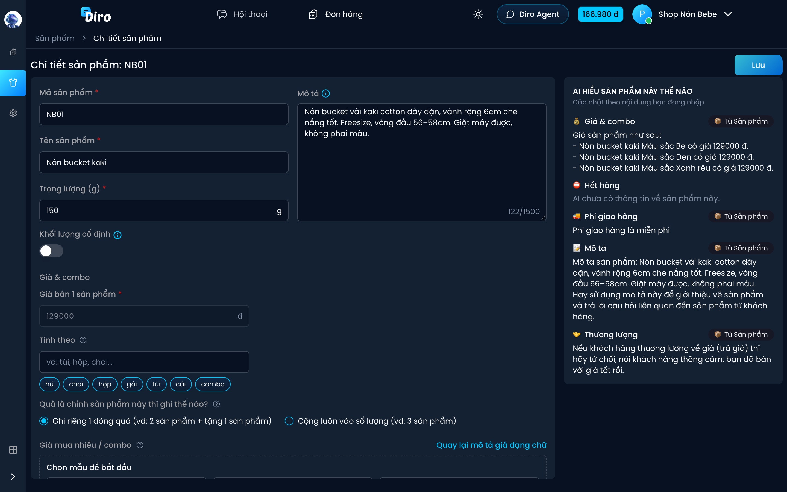

# Tạo sản phẩm

Mỗi món bạn bán cần có một sản phẩm trên Diro để AI biết giá, phí ship và cách lên đơn.
Trang **Thêm sản phẩm** chia làm 2 khung: bên trái là ô nhập, bên phải là khung
**AI HIỂU SẢN PHẨM NÀY THẾ NÀO** cho bạn xem trước AI sẽ đọc gì.

:::info Không có gì được lưu cho tới khi bạn bấm "Tạo sản phẩm"
Bạn cứ thử gõ, thử "Điền tự động", thử chọn mẫu combo. Rời trang khi chưa bấm **Tạo sản phẩm**
thì mọi thứ bị bỏ.
:::

Ví dụ dưới đây tạo sản phẩm **Áo sơ mi linen**, mã **DEMO-SM**, giá 259.000đ.

## Bước 1: Mở trang Thêm sản phẩm

1. Ở trang **Sản phẩm**, bấm nút **+**.

:::tip Có sẵn bài quảng cáo?
Ở đầu trang có thẻ **Điền nhanh bằng AI**: dán bài quảng cáo vào, AI tự điền giá, combo,
phí ship. Xem [Điền nhanh bằng AI](./dien-nhanh-bang-ai.md). Bạn vẫn kiểm tra lại các ô bên dưới.
:::

## Bước 2: Thông tin cơ bản

1. **Tên sản phẩm** (bắt buộc) — tên khách hay gọi, vd "Áo sơ mi linen".
2. **Mã sản phẩm** (bắt buộc) — mã ngắn để phân biệt, vd `DEMO-SM`. Khách không thấy mã này.
   Mỗi mã chỉ dùng cho một sản phẩm trong trang.
3. **Trọng lượng (g)** (bắt buộc) — dùng để khai cân nặng khi gửi hàng cho đơn vị vận chuyển.
   Mặc định 100g.
4. **Khối lượng cố định** — bật khi bạn bán theo set/combo đóng sẵn: khách mua bao nhiêu thì
   đơn vẫn khai đúng số gam ở trên. Tắt (mặc định) thì khối lượng nhân theo số lượng.
5. **Giá bán 1 sản phẩm** (bắt buộc) — giá lẻ của 1 món. Giá mua nhiều, combo, phí ship làm
   ở bước sau, xem [Giá, combo và phí ship](./gia-combo-phi-ship.md).

## Bước 3: Mô tả và hình ảnh

1. **Mô tả sản phẩm** — chất liệu, kích thước, cách dùng, bảo quản… AI dùng phần này để trả
   lời câu hỏi của khách, nên viết càng rõ càng tốt (tối đa 1.500 ký tự). Giá và phí ship
   **không** cần ghi ở đây vì đã có ô riêng.
2. **Hình ảnh sản phẩm** — bấm vào khung hoặc kéo thả ảnh vào. Nhận PNG, JPG, HEIC, WEBP, GIF;
   tối đa 15 ảnh, mỗi ảnh không quá 8MB. AI gửi các ảnh này khi khách xin xem hình. Bấm
   thùng rác trên ảnh để bỏ ảnh.

## Bước 4: Bài viết liên quan, loại sản phẩm và thông tin phụ

1. **Bài viết liên quan** — chọn các bài đăng/quảng cáo trên fanpage nói về sản phẩm này.
   Khách nhắn tin từ bài nào thì AI biết tập trung bán đúng sản phẩm đó.
2. **Sản phẩm mặc định** — bật thì sản phẩm này được chọn sẵn khi khách hỏi mua mà **không**
   đi từ bài quảng cáo nào.
3. **Tên sản phẩm khi in đơn** (trong **Thông tin phụ**) — tên in lên tem/vận đơn. Để trống thì
   dùng tên sản phẩm.
4. **Kho** — sản phẩm này nằm ở kho nào. Mặc định **Tất cả kho**. Xem [Kho hàng](./kho-hang.md).

Ô **Loại sản phẩm (size, màu, dung tích…)** ngay trên dùng để tạo size, màu. Xem
[Loại sản phẩm (size, màu…)](./bien-the.md).

## Bước 5: Bấm Tạo sản phẩm

1. Bấm **Tạo sản phẩm** ở góc trên bên phải, hoặc
2. nút **Tạo sản phẩm** ở cuối form. Hai nút giống nhau.

Nếu còn ô sai (báo chữ đỏ), Diro không tạo và tự mở phần có lỗi để bạn sửa. Tạo xong sẽ có
thông báo **Đã tạo sản phẩm thành công** và bạn được đưa sang trang chi tiết của sản phẩm vừa tạo:

Từ đây bạn sửa tiếp bất cứ lúc nào, nhớ bấm **Lưu**. Xem [Xem và sửa sản phẩm](./sua-san-pham.md).

## Câu hỏi thường gặp

**Mã sản phẩm có bắt buộc phải theo quy tắc nào không?**
Không. Chỉ cần ngắn, dễ nhớ và không trùng với sản phẩm khác trong cùng trang.

**Tôi đang mở một Shop (nhiều trang gộp), sao không thấy nút +?**
Sản phẩm luôn thuộc về một trang cụ thể. Hãy mở trang riêng lẻ rồi tạo ở đó.
