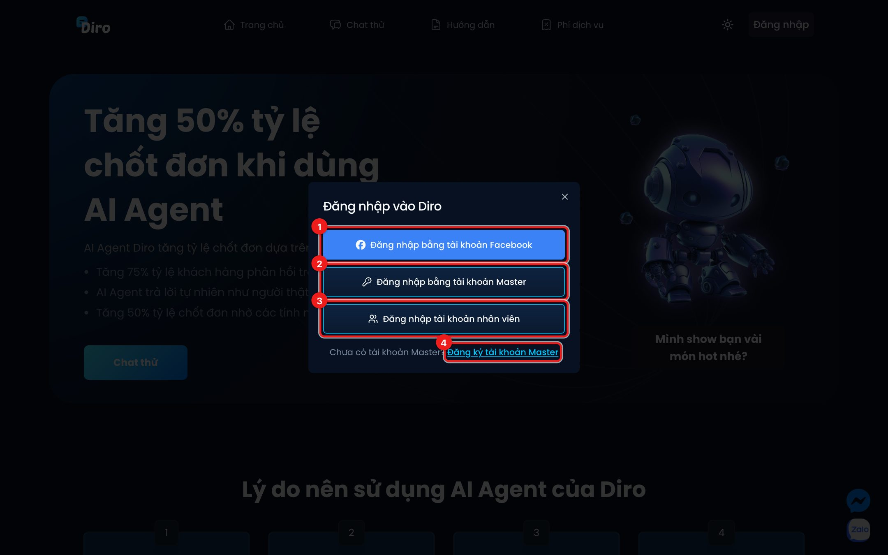

# Shop, nhân viên & tài khoản liên kết

Mục này dành cho chủ shop có **nhiều Fanpage**, **nhiều nick Facebook** hoặc **thuê nhân viên** làm
việc trên Diro.

- [Tài khoản Master và tài khoản liên kết](./tai-khoan-master.md) — một tài khoản đăng nhập bằng
  email gom được nhiều nick Facebook và Zalo OA.
- [Shop: gộp nhiều trang thành một cửa hàng](./shop.md) — các trang dùng chung sản phẩm, kho, đơn hàng.
- [Phân quyền nhân viên](./phan-quyen-nhan-vien.md) — tạo tài khoản Nhân viên / Kỹ thuật viên và cấp trang.
- [Kết nối thiết bị di động](./thiet-bi-di-dong.md) — đăng nhập app Diro trên điện thoại bằng mã QR.

## Các loại tài khoản trên Diro

| Loại | Đăng nhập bằng | Dùng để |
|---|---|---|
| **Tài khoản Facebook** | Nút "Đăng nhập bằng tài khoản Facebook" | Cách đăng nhập đơn giản nhất cho shop một nick Facebook |
| **Tài khoản Master** (chủ) | Email/SĐT + mật khẩu | Gom nhiều nick Facebook và Zalo OA về một chỗ, dùng chung một ví; là tài khoản **duy nhất** dùng được Phân quyền |
| **Nhân viên** | Email + mật khẩu do chủ tạo | Vào chat, lên đơn, xử lý đơn trên những trang được cấp |
| **Kỹ thuật viên** | Email + mật khẩu do chủ tạo | Chỉ làm việc với Chat Agent và Post Agent trên những trang được cấp; không xem chat, đơn hàng |

1. **Đăng nhập bằng tài khoản Facebook**.
2. **Đăng nhập bằng tài khoản Master**.
3. **Đăng nhập tài khoản nhân viên** — dành cho Nhân viên và Kỹ thuật viên.
4. **Đăng ký tài khoản Master** — tạo tài khoản Master mới.
