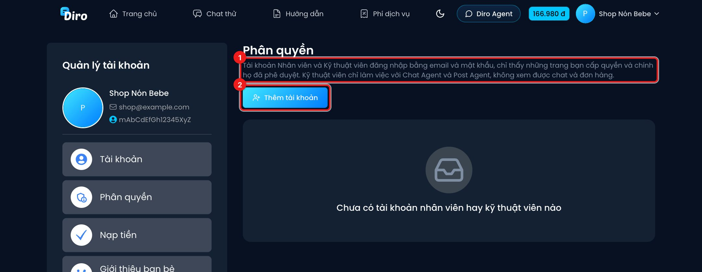
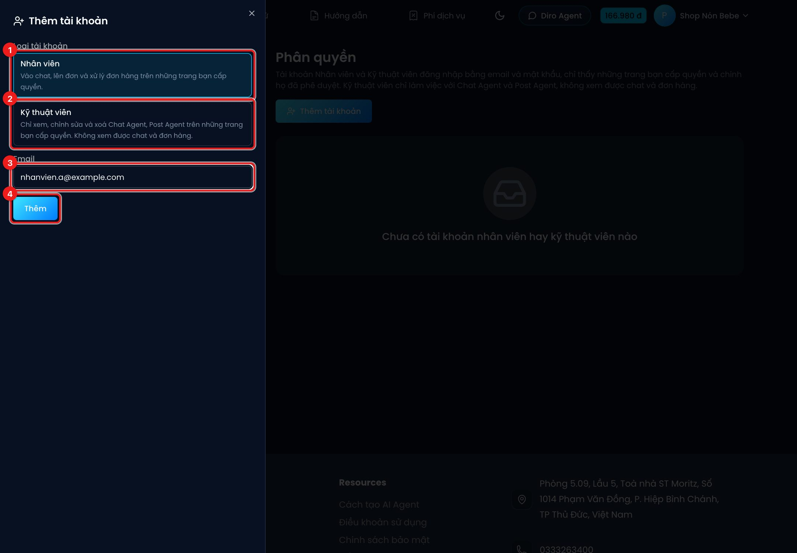

# Phân quyền nhân viên

**Phân quyền** cho phép chủ shop tạo tài khoản riêng cho từng nhân viên, mỗi người đăng nhập bằng
**email + mật khẩu** của mình và chỉ thấy **những trang được cấp**. Không cần đưa nick Facebook hay
mật khẩu của chủ cho ai.

:::info Chỉ tài khoản Master dùng được
Phân quyền chỉ hoạt động với **tài khoản Master**. Nếu bạn đang đăng nhập bằng Facebook, hãy tạo
tài khoản Master rồi liên kết tài khoản Facebook vào đó trước (xem
[Tài khoản Master và tài khoản liên kết](./tai-khoan-master.md)).
:::

## Hai loại tài khoản

| | **Nhân viên** | **Kỹ thuật viên** |
|---|---|---|
| Vào chat, nhắn khách | ✓ | ✗ |
| Lên đơn, xử lý đơn, in vận đơn | ✓ | ✗ |
| Gộp chat | ✓ | ✗ |
| Xem, sửa, xoá **Chat Agent**, dùng **Post Agent** | ✗ | ✓ |
| Xem tỉ lệ chốt đơn | ✓ | ✗ |
| Thêm trang, tạo shop | ✗ | ✗ |
| Cấu hình đơn vị vận chuyển, kho, hoá đơn điện tử, kết nối TikTok Shop | ✗ | ✗ |
| Nạp tiền, giới thiệu bạn bè, phân quyền | ✗ | ✗ |

Tiền AI và các dịch vụ khác luôn trừ vào **ví của chủ** (tài khoản Master). Nhân viên không có ví
riêng: số dư hiện ở góc trên màn hình của nhân viên là số dư ví của chủ, để họ biết mà báo chủ nạp
khi sắp hết.

## Thêm tài khoản

1. Vào **Tài khoản** → **Phân quyền** (hoặc bấm tên ở góc trên bên phải → **Tài khoản** → **Phân quyền**).
2. Bấm **Thêm tài khoản**.

1. Chọn **Nhân viên**…
2. …hoặc **Kỹ thuật viên**.
3. Nhập **email** của người đó.
4. Bấm **Thêm**.

Tiếp theo:

- Nếu email **chưa có tài khoản**: Diro hỏi thêm **Mật khẩu** và **Nhập lại mật khẩu**. Bấm **Tạo
  tài khoản nhân viên** (hoặc kỹ thuật viên), rồi gửi email + mật khẩu này cho người đó.
- Nếu email **đã là tài khoản nhân viên** (ví dụ người đó đang làm cho shop khác): Diro thêm ngay,
  không hỏi mật khẩu. Một nhân viên làm được cho nhiều chủ.
- Nếu email đã là **tài khoản Master hoặc tài khoản Facebook** trên Diro: không dùng làm tài khoản
  nhân viên được, hãy dùng email khác.

## Cấp trang cho nhân viên

Mỗi tài khoản trong danh sách Phân quyền có 3 nút:

- **Cấp quyền** — chọn các **Shop** và **Trang** cấp cho người đó, hoặc tick **Tất cả các trang hiện
  tại và trong tương lai** (cấp luôn những trang bạn thêm sau này). Bấm **Lưu**.
- **Đặt lại mật khẩu** — đặt mật khẩu mới khi nhân viên quên (tài khoản nhân viên không tự đặt lại
  mật khẩu được).
- **Gỡ** — xoá người đó khỏi danh sách và thu hồi mọi quyền.

Dưới tên mỗi người có danh sách trang đã cấp. Trang ghi **chờ duyệt** là trang nhân viên chưa nhận.

## Phía nhân viên: đăng nhập và nhận trang

1. Ở trang chủ Diro bấm **Đăng nhập** → **Đăng nhập tài khoản nhân viên**, nhập email và mật khẩu.
2. Lần đầu được cấp trang, trên **Bảng điều khiển** có nút **Phê duyệt trang** (kèm số trang đang chờ).
3. Bấm vào, xem các trang được cấp và bấm **Nhận trang** (hoặc **Để sau**). Trang nào được nhận mới
   hiện trên Bảng điều khiển của nhân viên.

:::note
Nhân viên vào trang **Tài khoản** chỉ thấy **Tài khoản** và **Kết nối thiết bị di động** — họ không
có ví, không nhận hoa hồng và không quản lý ai.
:::
