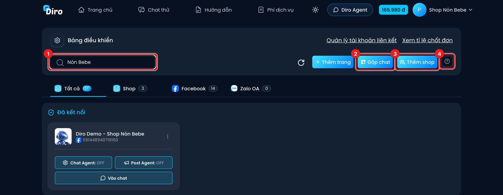
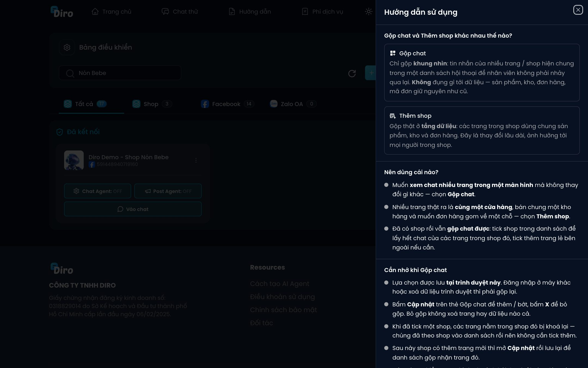
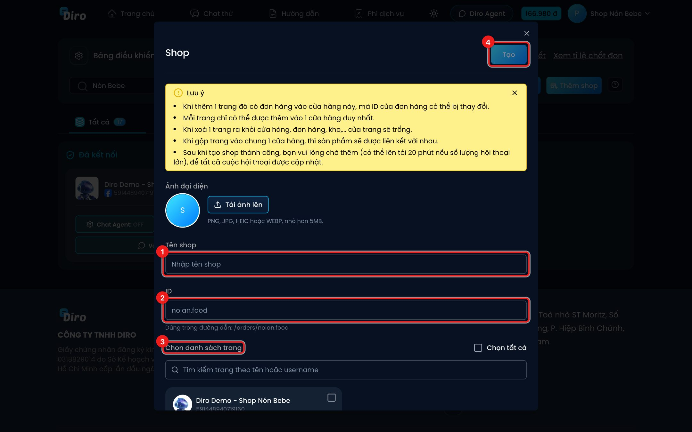

# Shop: gộp nhiều trang thành một cửa hàng

Nếu nhiều Fanpage thực ra là **cùng một cửa hàng** — bán chung một kho, muốn đơn hàng gom về một chỗ
— hãy tạo **Shop**. Các trang trong shop **dùng chung sản phẩm, kho và đơn hàng**.

:::info Shop khác Gộp chat
- **Thêm shop**: gộp thật ở tầng dữ liệu (sản phẩm, kho, đơn). Đây là thay đổi lâu dài, ảnh hưởng
  mọi người trong shop.
- **Gộp chat**: chỉ gộp **khung nhìn** tin nhắn của nhiều trang/shop vào một danh sách, không đụng
  dữ liệu. Xem [Gộp chat nhiều trang](../tin-nhan/gop-chat.md).

Đã có shop rồi vẫn gộp chat được: tick shop trong Gộp chat để lấy hết chat các trang của shop đó.
:::

## Nút Thêm shop và Gộp chat

1. Ô **Tìm kiếm** trang theo tên.
2. **Gộp chat** — xem [Gộp chat nhiều trang](../tin-nhan/gop-chat.md).
3. **Thêm shop** — tạo shop mới.
4. Nút **?** — mở **Hướng dẫn sử dụng**, giải thích khác nhau giữa Gộp chat và Thêm shop.

Shop đã tạo hiện ở thẻ **Shop** trên Bảng điều khiển (cạnh thẻ Tất cả, Facebook, Zalo OA).

## Tạo shop

1. Bấm **Thêm shop**.
2. Điền thông tin rồi bấm **Tạo**.

1. **Tên shop**.
2. **ID** — mã của shop dùng trong đường dẫn, ví dụ `/orders/nonbebe`. Diro gợi ý sẵn từ tên shop;
   nếu ID đã có người dùng, Diro báo và gợi ý ID khác. Đổi ID sau này sẽ làm hỏng các link đã chia sẻ trước đó.
3. **Chọn danh sách trang** đưa vào shop (có ô tìm kiếm và **Chọn tất cả**).
4. Bấm **Tạo**.

Bạn cũng có thể tải **ảnh đại diện** cho shop (PNG, JPG, HEIC, WEBP, dưới 5MB).

:::warning Đọc kỹ trước khi tạo
- Mỗi trang chỉ thuộc **một shop duy nhất**.
- Thêm một trang **đã có đơn hàng** vào shop thì **mã ID đơn hàng có thể bị đổi**.
- Gộp trang vào chung một shop thì **sản phẩm được liên kết với nhau**.
- Gỡ một trang ra khỏi shop thì đơn hàng, kho… của trang đó sẽ **trống**.
- Sau khi tạo, chờ thêm một lúc (có thể tới **20 phút** nếu nhiều hội thoại) để toàn bộ hội thoại được cập nhật.
:::

## Sửa hoặc xoá shop

Rê chuột lên thẻ shop ở Bảng điều khiển để hiện nút **Cập nhật** (đổi tên, ảnh, ID, thêm/bớt trang)
và **Xóa**.

Chỉ chủ tài khoản tạo, sửa, xoá được shop. Nhân viên không thấy nút **Thêm shop**.
