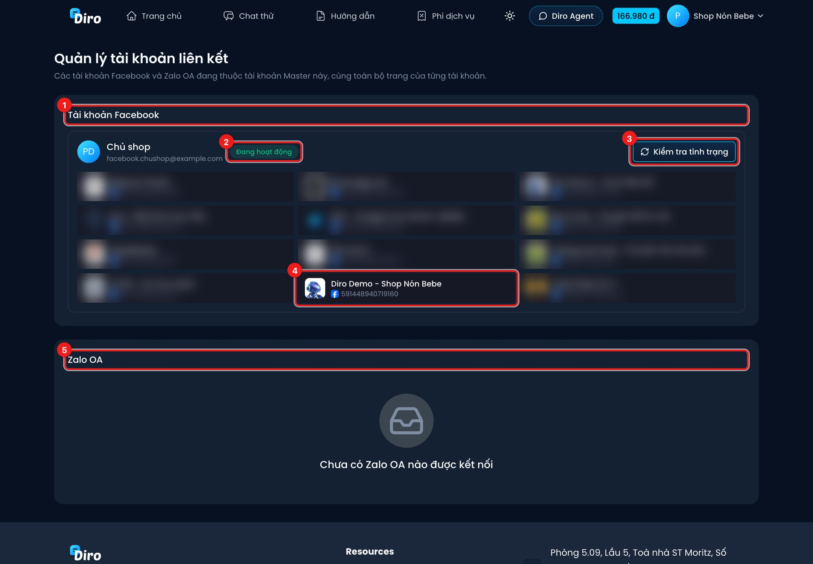

# Tài khoản Master và tài khoản liên kết

**Tài khoản Master** là tài khoản đăng nhập bằng **email (hoặc số điện thoại) và mật khẩu**. Một tài
khoản Master liên kết được **nhiều tài khoản Facebook** và **Zalo OA**: mọi trang của các tài khoản
đó hiện chung ở một Bảng điều khiển, dùng chung **một ví**, và chỉ tài khoản Master mới tạo được
tài khoản nhân viên.

Nên dùng tài khoản Master khi:

- Bạn quản lý trang bằng nhiều nick Facebook khác nhau.
- Bạn muốn nhân viên đăng nhập bằng tài khoản riêng, không dùng chung nick Facebook của chủ.
- Bạn không muốn mất quyền vào Diro khi nick Facebook bị khoá.

## Tạo tài khoản Master

1. Ở trang chủ Diro, bấm **Đăng nhập** → **Đăng ký tài khoản Master**.
2. Nhập email, số điện thoại, mật khẩu, bấm **Đăng ký**.
3. Nhập **mã 6 số** Diro gửi tới email để xác nhận.

Quên mật khẩu thì bấm **Quên mật khẩu?** ở màn hình đăng nhập tài khoản Master, Diro gửi mã đặt lại
qua email. Đổi mật khẩu khi đang đăng nhập: vào **Tài khoản** → mục **Bảo mật** → **Đổi mật khẩu**.

## Liên kết tài khoản Facebook vào Master

Việc liên kết bắt đầu **từ phía tài khoản Facebook**, rồi tài khoản Master duyệt:

1. Đăng nhập Diro **bằng tài khoản Facebook** cần liên kết.
2. Vào **Tài khoản** (bấm tên ở góc trên bên phải → **Tài khoản**), tìm mục **Tài khoản Master**,
   bấm **Liên kết với tài khoản Master**.
3. Nhập **email hoặc số điện thoại của tài khoản Master**, bấm **Liên kết**. Mục này chuyển sang
   "Đang chờ chấp nhận từ tài khoản Master…" (bấm **Huỷ yêu cầu** nếu đổi ý).
4. Đăng nhập **tài khoản Master**, vào **Bảng điều khiển** → **Quản lý tài khoản liên kết**. Ở mục
   **Yêu cầu chờ phê duyệt**, bấm **Duyệt liên kết** (hoặc **Từ chối**).

:::warning Liên kết là một chiều, không hoàn tác được
Khi tài khoản Master duyệt:

- **Số dư đã nạp** của tài khoản Facebook chuyển hết sang tài khoản Master. Số dư voucher chỉ chuyển
  ở tài khoản Facebook **đầu tiên** được liên kết.
- Toàn bộ **Chat Agent** chuyển sang tài khoản Master; tài khoản Facebook không tạo Chat Agent được nữa.
- **Bạn bè đã giới thiệu** chuyển sang tài khoản Master — Master nhận hoa hồng thay.
- Tài khoản Facebook đó **không đăng nhập vào Diro được nữa** và **không gỡ liên kết được**.

Hộp duyệt hiện rõ số tiền và số người được giới thiệu sẽ chuyển sang trước khi bạn bấm.
:::

## Quản lý tài khoản liên kết

Trang **Quản lý tài khoản liên kết** (chỉ tài khoản Master thấy) liệt kê các tài khoản Facebook và
Zalo OA đang thuộc tài khoản Master, cùng toàn bộ trang của từng tài khoản. Mở bằng đường link
**Quản lý tài khoản liên kết** ở góc trên Bảng điều khiển.

1. **Tài khoản Facebook** — mỗi khung là một nick Facebook đã liên kết (tên, email).
2. **Tình trạng**: **Đang hoạt động**, hoặc **Không còn hoạt động** khi Facebook đã khoá nick hay
   phiên đăng nhập Facebook đã hỏng.
3. **Kiểm tra tình trạng** — hỏi lại Facebook xem nick còn dùng được không.
4. Các **trang** của nick đó. Trang đã gộp vào shop có ghi chú số trang được gộp.
5. **Zalo OA** — các Zalo OA đã kết nối, cũng có nút kiểm tra tình trạng.

:::tip
Khi một nick Facebook "Không còn hoạt động", các trang của nick đó có thể ngừng nhận tin. Đăng nhập
lại nick đó (hoặc kết nối trang bằng nick khác còn quyền quản trị trang) để khôi phục.
:::
