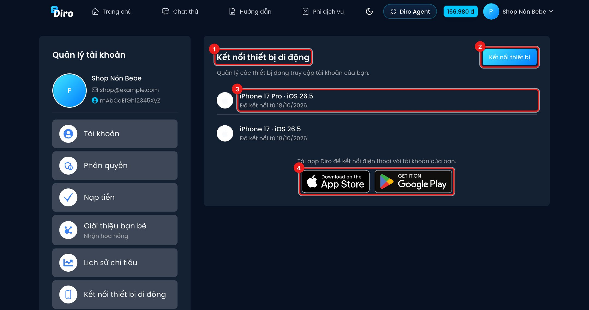
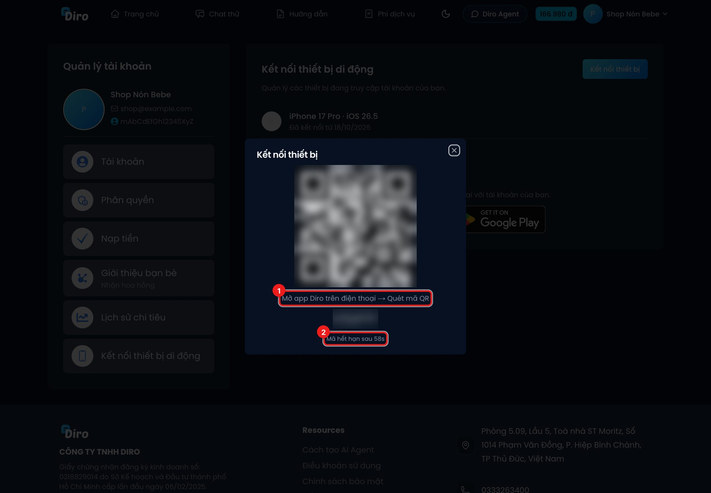

# Kết nối thiết bị di động

Bạn có thể dùng **app Diro** trên điện thoại (iOS và Android), ví dụ để nhận thông báo khi ví sắp
hết tiền. Thay vì gõ tài khoản trên điện thoại, bạn đăng nhập bằng cách **quét mã QR** từ máy tính.

## Xem các thiết bị đã kết nối

Vào **Tài khoản** → **Kết nối thiết bị di động**.

1. Trang **Kết nối thiết bị di động** — quản lý các thiết bị đang truy cập tài khoản của bạn.
2. Nút **Kết nối thiết bị** — tạo mã QR để kết nối điện thoại mới.
3. Mỗi dòng là một thiết bị: tên máy, hệ điều hành và ngày bắt đầu kết nối.
4. Chưa có app thì tải ở **App Store** hoặc **Google Play**.

## Kết nối điện thoại mới

1. Cài app Diro trên điện thoại.
2. Trên máy tính, bấm **Kết nối thiết bị**. Một mã QR hiện ra.
3. Trên điện thoại, mở app Diro → **Quét mã QR**, đưa camera vào mã.

1. Hướng dẫn: **Mở app Diro trên điện thoại → Quét mã QR**. Dưới mã QR có thêm một mã chữ ngắn.
2. Mã chỉ sống khoảng **1 phút** ("Mã hết hạn sau …s"); hết hạn thì Diro tự tạo mã mới.

Khi điện thoại quét xong, màn hình báo **✓ Thiết bị đã kết nối** kèm tên máy, và máy đó xuất hiện
trong danh sách.

:::tip
Bạn cũng mở được màn hình quét mã bằng đường dẫn `diro.ai/settings/devices/pair`.
:::

:::caution
Không chụp hay gửi mã QR cho người khác: ai quét được mã trong lúc còn hạn sẽ đăng nhập được vào
tài khoản của bạn.
:::

Nhân viên và kỹ thuật viên cũng kết nối điện thoại được, ở đúng mục này trong trang Tài khoản của họ.
