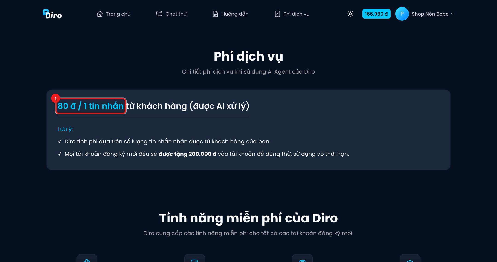

# Bảng giá

Diro **không thu phí thuê bao**: bạn chỉ trả theo mức dùng, trừ dần vào ví. Trang **Phí dịch vụ**
(mục **Phí dịch vụ** trên thanh trên cùng, hoặc `diro.ai/pricing`) tóm tắt bảng giá.

1. Giá chính: **80đ cho 1 tin nhắn của khách được AI xử lý**.

## Các khoản phí

| Khoản | Giá |
|---|---|
| AI trả lời tin nhắn khách — chế độ **Tiêu chuẩn** | **80đ** / tin |
| AI trả lời tin nhắn khách — chế độ **Tư duy sâu** | **120đ** / tin |
| **AI duyệt đơn** | **40đ** / đơn |
| **Post Agent** tạo ảnh bài đăng | **2.500đ** / ảnh |
| Nạp tiền dưới 100.000đ | 3.000đ phí nạp (từ 100.000đ trở lên miễn phí) |

Chế độ Tiêu chuẩn / Tư duy sâu chọn trong thiết lập Chat Agent của từng trang.

Không tính phí: tin khách nhắn mà AI không xử lý (hội thoại đang do nhân viên, AI tắt), tin nhân viên
tự gửi, số trang, số hội thoại, số nhân viên.

## Miễn phí

- Tài khoản đăng ký mới được **tặng 200.000đ** để dùng thử. Khoản tặng này có **hạn dùng 30 ngày**
  kể từ khi tạo tài khoản; phần chưa dùng hết sẽ hết hạn. (Trang Phí dịch vụ đang ghi "vô thời hạn"
  — thực tế hệ thống áp hạn 30 ngày.)
- Bạn được giới thiệu nhập mã voucher thì nhận thêm **200.000đ** không thời hạn (xem
  [Giới thiệu bạn bè](./gioi-thieu-ban-be.md)).
- Không giới hạn số trang, số cuộc hội thoại, số nhân viên.
- Tự động lên đơn, vận chuyển, hỗ trợ Facebook Messenger.

Theo dõi số tiền đã tiêu ở [Lịch sử chi tiêu](./lich-su-chi-tieu.md), nạp thêm ở [Nạp tiền](./nap-tien.md).
