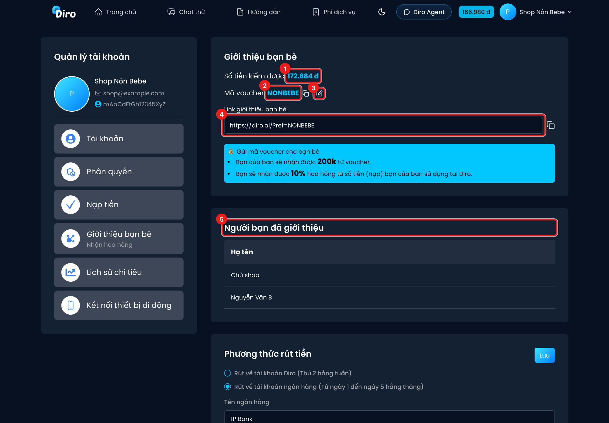
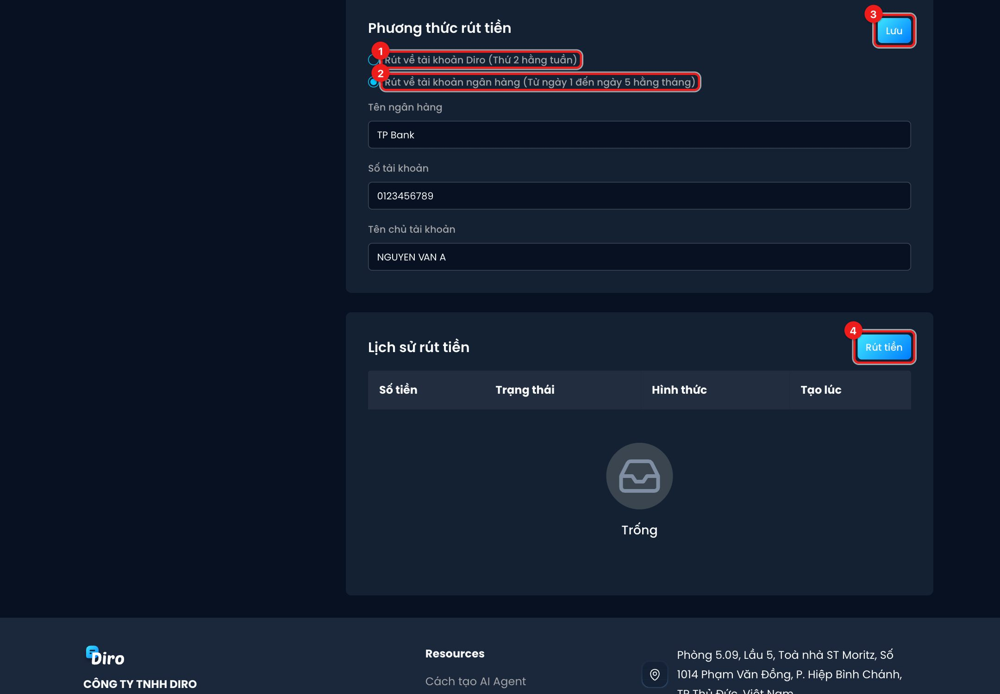

# Giới thiệu bạn bè và hoa hồng

Giới thiệu bạn bè dùng Diro để **nhận hoa hồng** trên số tiền họ sử dụng. Bạn của bạn cũng được tặng
**200.000đ** khi dùng mã của bạn.

Mở bằng **Tài khoản** → **Giới thiệu bạn bè**.

## Mã giới thiệu và người bạn đã giới thiệu

1. **Số tiền kiếm được** — hoa hồng hiện có.
2. **Mã voucher** — mã giới thiệu của bạn. Bấm biểu tượng copy để sao chép.
3. Biểu tượng **bút** — đổi mã theo ý bạn (ví dụ tên shop). Mã đã có người dùng thì Diro báo
   "Mã đã tồn tại".
4. **Link giới thiệu** — gửi link này cho bạn bè; bấm biểu tượng copy bên phải để sao chép. Bạn bè
   mở link rồi đăng ký Diro là mã của bạn được áp **tự động**, không cần nhập tay.
5. **Người bạn đã giới thiệu** — danh sách những người đã đăng ký bằng mã của bạn.

Cách tính:

- Bạn của bạn nhập mã voucher ở trang Nạp tiền → **Nhập Voucher** **trong 24 giờ đầu** sau khi tạo
  tài khoản, và nhận **200.000đ** (không thời hạn).
- Bạn nhận **10% hoa hồng** trên số tiền bạn của bạn **đã nạp và đã sử dụng** tại Diro (tỉ lệ đúng của
  tài khoản bạn hiện trong khung xanh).

:::note
Hoa hồng tính trên tiền **đã dùng**, không phải tiền vừa nạp. Vì vậy con số "Số tiền kiếm được" tăng
dần theo mức dùng của bạn bè, và có thể **giảm nhẹ** khi bạn bè vừa nạp thêm mà chưa dùng.
:::

## Rút hoa hồng

Chọn **Phương thức rút tiền** rồi bấm **Lưu** (3):

1. **Rút về tài khoản Diro (Thứ 2 hằng tuần)** — hoa hồng **tự động** chuyển vào ví Diro của bạn mỗi
   thứ Hai, dùng để trả phí AI. Không cần làm gì thêm.
2. **Rút về tài khoản ngân hàng (Từ ngày 1 đến ngày 5 hằng tháng)** — điền **Tên ngân hàng**, **Số tài
   khoản**, **Tên chủ tài khoản**. Với cách này, hoa hồng **không tự chuyển**: bạn phải bấm **Rút tiền**
   để tạo yêu cầu, Diro chuyển khoản trong khoảng ngày 1–5 hằng tháng.

4. **Rút tiền** — mở form tạo yêu cầu rút: thông tin ngân hàng và **Số tiền rút**, bấm **Tạo**. Nút
   bị mờ khi chưa có hoa hồng ("Số dư không đủ").

Bảng **Lịch sử rút tiền** ghi số tiền, trạng thái (**Đang chờ**, **Thành công**, **Thất bại**), hình
thức và thời gian của từng lần rút.

:::caution
Đã chọn **rút về ngân hàng** mà quên bấm **Rút tiền** thì hoa hồng cứ nằm đó, không tự vào ví. Nếu
muốn hoa hồng tự bù vào phí AI, hãy chọn **Rút về tài khoản Diro**.
:::
