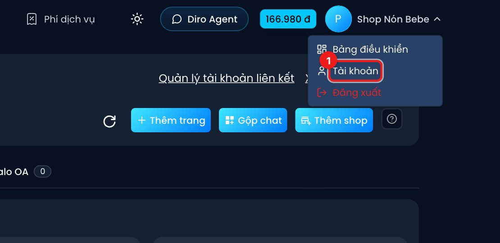

# Tài khoản & ví

Diro tính phí theo mức dùng thực tế, trừ dần vào **ví** của bạn. Số dư ví luôn hiện ở góc trên bên
phải mọi màn hình (ô màu xanh) — bấm vào là tới trang **Nạp tiền**.

Các trang trong mục này đều nằm trong **Quản lý tài khoản**: bấm tên của bạn ở góc trên bên phải →
**Tài khoản**, rồi chọn mục ở cột trái.

- [Thông tin tài khoản](./thong-tin-tai-khoan.md) — ảnh đại diện, thông tin xuất hoá đơn, Vận đơn bằng Diro, đổi mật khẩu, thông báo Telegram.
- [Nạp tiền](./nap-tien.md) — chuyển khoản nạp ví, nhập voucher, cảnh báo sắp hết tiền, lịch sử nạp.
- [Lịch sử chi tiêu](./lich-su-chi-tieu.md) — chi phí và số tin AI xử lý theo từng ngày.
- [Giới thiệu bạn bè](./gioi-thieu-ban-be.md) — mã giới thiệu, hoa hồng và rút tiền.
- [Bảng giá](./bang-gia.md) — Diro tính phí những gì.

:::note
Tài khoản **nhân viên** không có ví riêng — mọi chi phí trừ vào ví của chủ. Nhân viên chỉ thấy mục
**Tài khoản** và **Kết nối thiết bị di động**.
:::
