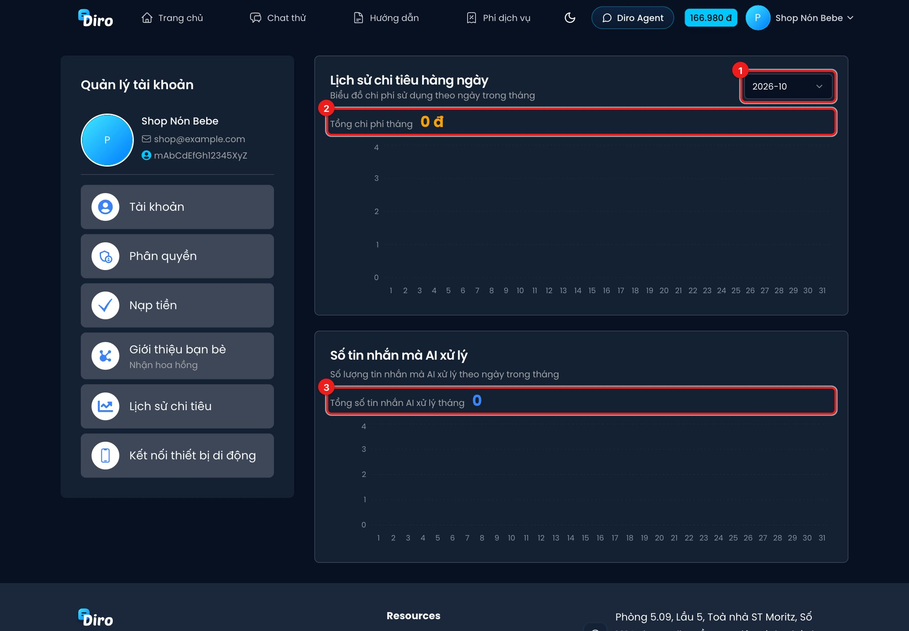

# Lịch sử chi tiêu

Trang **Lịch sử chi tiêu** cho biết mỗi ngày bạn đã tiêu bao nhiêu tiền và AI đã xử lý bao nhiêu
tin nhắn. Mở bằng **Tài khoản** → **Lịch sử chi tiêu**.

1. **Chọn tháng** cần xem.
2. **Lịch sử chi tiêu hàng ngày** — **Tổng chi phí tháng** và biểu đồ cột chi phí từng ngày. Rê chuột
   lên một cột để xem số tiền của ngày đó.
3. **Số tin nhắn mà AI xử lý** — **Tổng số tin nhắn AI xử lý tháng** và số tin theo từng ngày.

Chi phí gồm mọi khoản trừ ví: tin AI trả lời khách, AI duyệt đơn, ảnh Post Agent tạo… Xem
[Bảng giá](./bang-gia.md).

:::tip
Ngày nào chi phí tăng vọt mà số khách không tăng, hãy kiểm tra xem có đang bật **Tư duy sâu** cho
Chat Agent (giá cao hơn) hoặc có chạy **Cho AI nhắn hội thoại chưa phản hồi** hàng loạt không.
:::
