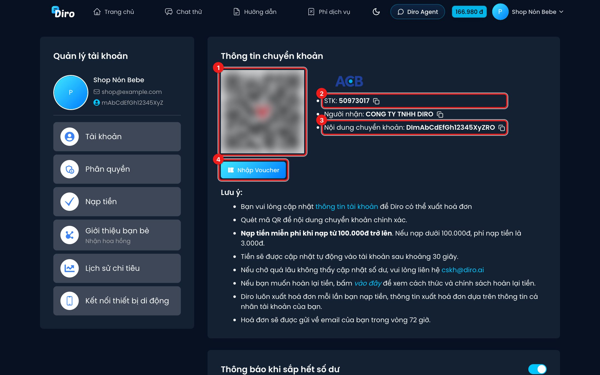
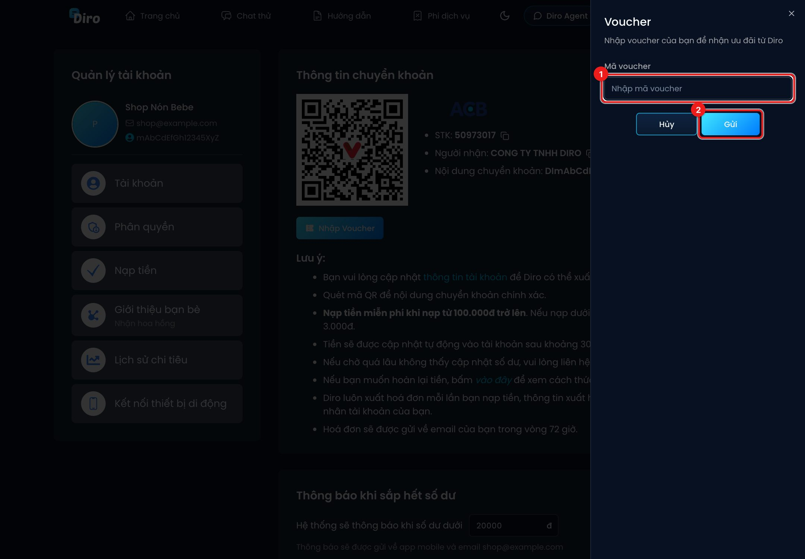
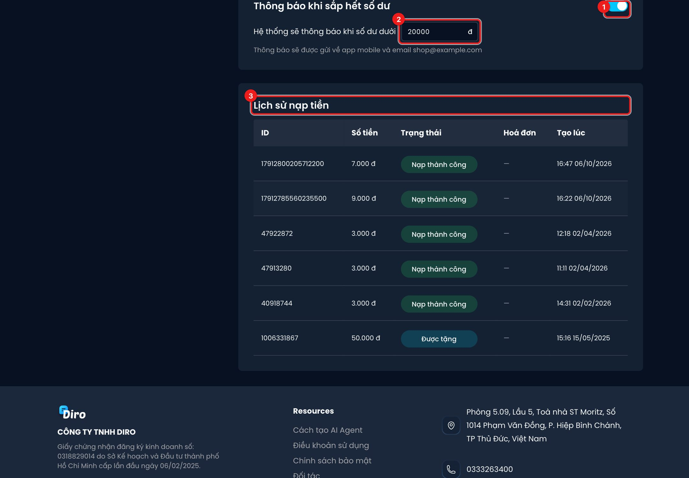

# Nạp tiền

Bạn nạp tiền vào ví Diro bằng **chuyển khoản ngân hàng**. Tiền tự vào ví sau khoảng 30 giây, không
cần báo ai.

Mở trang: bấm vào **số dư** ở góc trên bên phải, hoặc **Tài khoản** → **Nạp tiền**.

## Chuyển khoản

1. **Mã QR** — mở app ngân hàng, quét mã này là đủ: số tài khoản, người nhận và nội dung chuyển
   khoản được điền sẵn, bạn chỉ cần nhập số tiền.
2. Nếu chuyển tay: **STK** (ngân hàng ACB) và **Người nhận** — bấm biểu tượng copy cạnh mỗi dòng.
3. **Nội dung chuyển khoản** — mã riêng của tài khoản bạn (dạng `DI…RO`). **Phải ghi đúng** nội dung
   này thì Diro mới biết tiền của ai.
4. **Nhập Voucher** — xem bên dưới.

Cần nhớ:

- **Nạp từ 100.000đ trở lên: miễn phí.** Dưới 100.000đ mất phí nạp 3.000đ.
- Tiền vào ví sau khoảng **30 giây**. Chờ lâu không thấy, liên hệ **cskh@diro.ai**.
- Diro **xuất hoá đơn mỗi lần nạp**, theo [thông tin tài khoản](./thong-tin-tai-khoan.md) của bạn,
  gửi về email trong vòng **72 giờ**. Muốn hoàn tiền, bấm link **vào đây** trong phần Lưu ý để xem
  chính sách hoàn tiền.

## Nhập voucher

1. Nhập **Mã voucher** — mã giới thiệu của người đã giới thiệu bạn dùng Diro.
2. Bấm **Gửi**. Mã hợp lệ thì **200.000đ** được cộng vào ví; không hợp lệ thì Diro báo "Mã không hợp lệ".

Điều kiện: chỉ nhập được **trong 24 giờ đầu** sau khi tạo tài khoản, mỗi tài khoản **một lần**, và
không dùng mã của chính mình.

Tiền tặng (voucher, tiền tặng khi đăng ký) chỉ dùng để trả phí trên Diro, không rút ra được.

## Cảnh báo sắp hết tiền và lịch sử nạp

1. **Thông báo khi sắp hết số dư** — bật/tắt cảnh báo. Công tắc **lưu ngay** khi bấm.
2. **Ngưỡng cảnh báo** — số dư xuống dưới mức này thì Diro báo về **app mobile** và **email** của
   bạn. Thấp nhất 10.000đ. Nhập xong bấm ra ngoài ô (hoặc Enter) là lưu.
3. **Lịch sử nạp tiền** — mỗi dòng có mã giao dịch, số tiền, trạng thái, hoá đơn và thời gian.
   Trạng thái gồm: **Nạp thành công**, **Được tặng** (tiền tặng, voucher), **Hoa hồng** (hoa hồng
   giới thiệu chuyển vào ví), **Đã hoàn trả**. Cột **Hoá đơn** có link **Xem hoá đơn** và mã tra cứu
   khi hoá đơn đã được xuất.

:::warning Khi ví hết tiền
Khi số dư không đủ cho một tin AI, **Chat Agent tạm ngừng trả lời khách** và cạnh số dư hiện tam
giác vàng nhấp nháy. Nạp thêm là AI chạy lại. Sau khi nạp, có thể dùng **Cho AI nhắn hội thoại chưa
phản hồi** trong màn hình Hội thoại để AI trả lời những khách đã nhắn trong lúc hết tiền (xem
[Tìm kiếm và lọc hội thoại](../tin-nhan/tim-kiem-va-loc.md)).
:::
