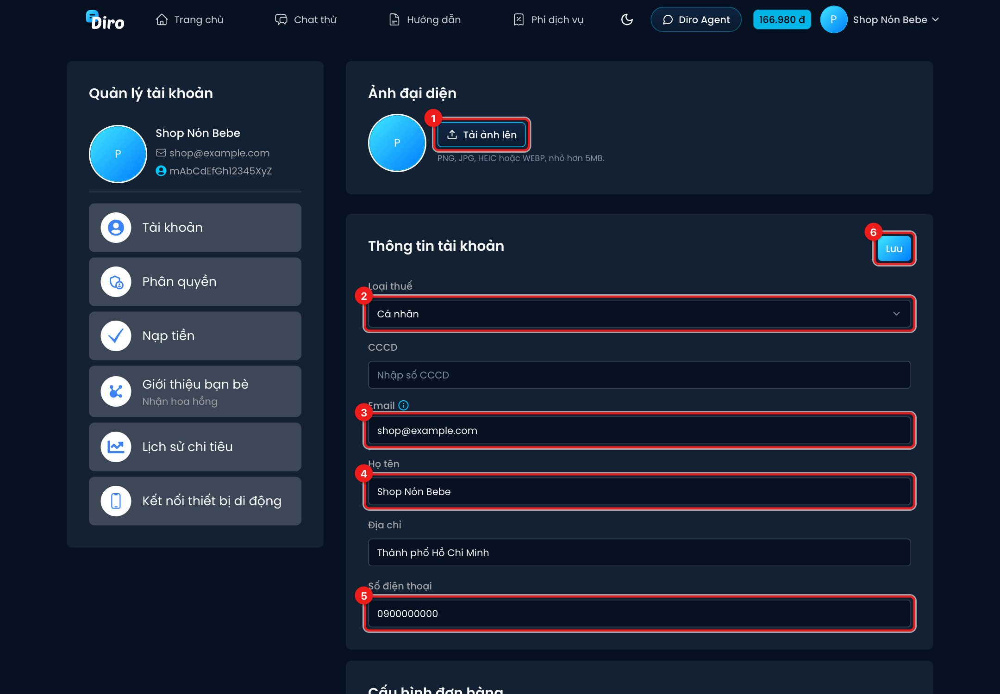
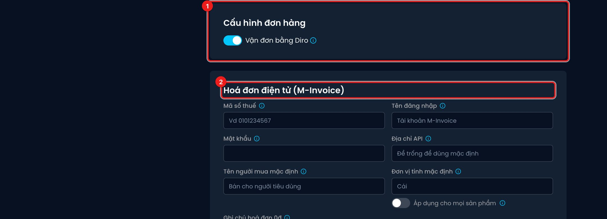
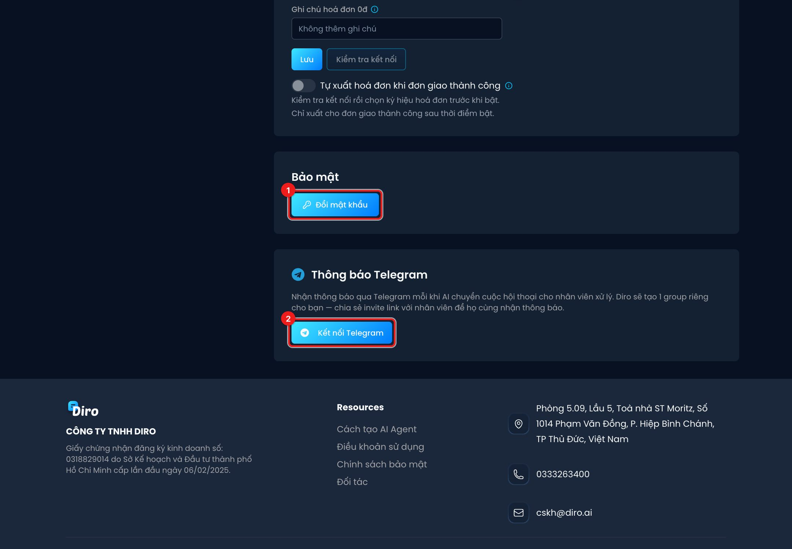

# Thông tin tài khoản

Trang **Tài khoản** chứa thông tin cá nhân (dùng để Diro xuất hoá đơn mỗi lần bạn nạp tiền) và vài
cài đặt chung cho cả tài khoản.

## Ảnh đại diện và thông tin xuất hoá đơn

1. **Tải ảnh lên** — đổi ảnh đại diện (PNG, JPG, HEIC hoặc WEBP, nhỏ hơn 5MB).
2. **Loại thuế** — **Cá nhân** hoặc **Hộ kinh doanh / Doanh nghiệp**.
   - Cá nhân: điền **CCCD**.
   - Hộ kinh doanh / Doanh nghiệp: điền **Mã số thuế** rồi bấm **Tra cứu** để Diro tự điền tên
     doanh nghiệp; ô Họ tên đổi thành **Tên doanh nghiệp**.
3. **Email** — nơi nhận thông báo từ Diro và **hoá đơn nạp tiền**.
4. **Họ tên** (hoặc Tên doanh nghiệp).
5. **Số điện thoại**. Ngoài ra còn ô **Địa chỉ**.
6. Bấm **Lưu**.

:::tip
Điền đúng các thông tin này **trước khi nạp tiền** — hoá đơn của mỗi lần nạp được xuất theo thông
tin tài khoản tại thời điểm đó.
:::

## Cấu hình đơn hàng

1. **Vận đơn bằng Diro** — khi bật, AI tự **cập nhật lại đơn** nếu khách đổi thông tin đơn trong lúc
   chat, và sự kiện mua hàng (Purchase) được gửi cho Facebook ngay khi có đơn mới. Cần thiết lập ít
   nhất **1 đơn vị vận chuyển** thì mới bật được. Công tắc này **lưu ngay** khi bấm.
2. **Hoá đơn điện tử (M-Invoice)** — kết nối M-Invoice để xuất hoá đơn cho khách mua hàng. Xem mục
   Hoá đơn điện tử.

## Bảo mật và thông báo Telegram

1. **Đổi mật khẩu** — nhập mật khẩu hiện tại, mật khẩu mới hai lần. Chỉ có ở **tài khoản Master**
   (tài khoản đăng nhập bằng Facebook không có mật khẩu Diro).
2. **Kết nối Telegram** — nhận thông báo qua Telegram **mỗi khi AI chuyển một hội thoại cho nhân
   viên**. Diro tạo một group Telegram riêng cho bạn:
   - Bấm **Mở** để vào group; copy **invite link** gửi cho nhân viên để họ cùng nhận thông báo.
   - **Tắt thông báo** / **Bật lại thông báo** khi cần.
   - **Tạo lại group** nếu group cũ bị xoá hoặc bot bị đuổi khỏi group (group cũ sẽ không nhận
     thông báo nữa).

## Tài khoản Master (chỉ ở tài khoản Facebook)

Nếu bạn đăng nhập **bằng Facebook**, trang này có thêm mục **Tài khoản Master** để liên kết tài
khoản Facebook vào một tài khoản Master. Đọc kỹ
[Tài khoản Master và tài khoản liên kết](../shop-nhan-vien/tai-khoan-master.md) trước khi bấm, vì
liên kết **không hoàn tác được**.
